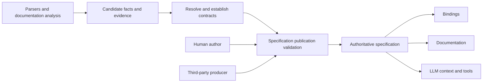

# Authoritative interface language — design proposal

Status: architecture approved by the author, 2026-09-22. This establishes the
contract and research-to-specification boundary. It is not yet a normative
grammar or a claim that a conforming parser exists. Syntax below illustrates
the proposed authoring experience. The language's name and file extension are
deliberately not selected here.

Evidence and current implementation links are in the
[initial research](../research/2026-09-22-interface-language-a.md).

## 1. Purpose and settled requirements

Describe an existing API sufficiently precisely that independent consumers can
produce bindings, documentation and useful LLM context from the same contract.
People and third-party systems must be able to write the specification without
running APIAnyware or possessing its analysis database.

The author has settled two design questions:

1. The language contains **complete, authoritative specifications only**.
   Analysis uncertainty and candidate facts are not part of its semantic model.
2. The language has a **dedicated interface-language syntax**. KDL/.apiw is
   evidence about the existing implementation, not a syntax constraint.

The initial semantic baseline is the current Swift-facing Apple API analysis,
including the changes in `APIAnyware.add-ocaml-target`. That baseline already
contains Objective-C and C constructs. Future source profiles must accommodate
Rust, Zig, Windows APIs and C APIs on Linux without forcing them into an ObjC
type model. ABI definitions belong to tooling; specifications select them.

This phase designs the language. APIAnyware integration and language libraries,
parsers, formatters and editor tooling are later phases.

## 2. Recommended shape and alternatives

| Approach | Benefit | Cost |
|---|---|---|
| **Common semantic core, explicit source/access profiles, ABI references** — recommended | Independent producers and consumers share precise contracts; native distinctions remain explicit. | Requires a versioned vocabulary and a conformance corpus, not just a grammar. |
| Extend an existing IDL such as WIT | Reuses a familiar interface syntax and some ownership concepts. | Must demonstrate that native lifetimes, dispatch and representation fit without conflicting meanings or opaque annotation bags. |
| Extend Swift interface syntax and add contracts | Close to the first extractor's input and familiar to Swift authors. | Makes later source languages and independent consumers depend on Swift-shaped semantics. |

The recommendation creates one language with defined extension points, not a
general-purpose schema language or an executable DSL. Authoring an ABI,
register-allocation algorithm, arbitrary program, validator plugin, or target
binding implementation is outside a document's power.

## 3. Publication boundary



The same validation boundary applies to all producers. No source is made
authoritative merely because an LLM, parser, human or particular tool wrote it.
The publisher accepts responsibility for the asserted contract. Validation
establishes conformance and internal consistency, not that an arbitrary binary
actually honours every assertion.

Unknown nullability, unrecorded pointer pointees, conflicting ownership claims,
and unresolved availability prevent publication where those facts are required.
They remain in the analysis workspace with actionable diagnostics. No confidence
threshold turns a guess into a language fact.

Supporting references may be attached to a declaration or contract clause as
non-normative citations. Removing those references cannot change its meaning.
Inference history, superseded candidates and merge precedence remain external.

### What “complete” means

Completeness is relative to an explicitly declared API surface, API version and
environment domain. All dependencies needed to interpret or use that surface
must resolve through the package and its pinned imports. A package covering a
named module must not quietly omit a difficult member and still claim full
coverage of that module. A deliberately smaller surface needs its own explicit
scope and must not present itself as the whole library.

Every applicable requirement of the selected language/profile versions must
have one unambiguous answer, either written directly or implied by a normative
rule. A normative default is part of the language; an extractor's convenient
fallback is not. Requirements that do not apply are determined from the model,
not filled with `unknown` or dummy values.

An opaque resource is complete when its representation is intentionally hidden
and its usable operations, ownership and lifetime are specified. It is not a
repair for missing layout of a by-value aggregate. Likewise, a stated range of
permitted behaviours can be authoritative: “zero or more callbacks” is a
contract when the API grants that freedom, not a substitute for investigating
the callback count.

The model must distinguish an established absence of a guarantee from an
analysis gap. For example, a source profile may deliberately promise no stable
native layout. That is a complete source-level contract, but cannot authorize
direct by-value FFI access. Parameter-dependent facts name their parameters;
runtime-resolved facts name the specified resolution mechanism. None of these
states may be used as a generic escape from missing analysis.

Surface coverage is an explicit publisher assertion, distinct from reference
closure. Source-public, ABI-public and chosen consumer-facing surfaces may
differ. A validator checks the declared inventory and its closure; comparison
with the actual library needs separate extraction or conformance evidence.

## 4. Four separate identities

| Identity | Examples of the question it answers |
|---|---|
| Semantic API | Which operation is this? What must callers provide and what does it guarantee? |
| Source declaration | Was it declared in Swift, Rust, Zig, C, or described by a metadata source? What original name/signature identifies it? |
| Access path | Is it reached by a native symbol, Objective-C dispatch, COM interface, managed member, or a source-compiled call? |
| ABI/profile selection | Which registered convention, representation and runtime assumptions govern this access path in this environment? |

One operation can have multiple access paths. They are not automatically
interchangeable. Each path has explicit preconditions, representations and
observable behaviour; equivalence or a specified adaptation must be established
before consumers may substitute one for another. Callback entry paths have ABI
selections of their own.

Each adaptation describes arguments, results, errors and additional failure
possibilities. If a managed projection discards distinctions available on a
native path, the two paths cannot claim the same observable contract. Give them
distinct contracts with a relation between them; do not silently call the
transformation equivalent.

Bindings choose an implementation strategy based on supported access paths.
Trampoline generation, target GC rooting and target-language naming policy
remain consumer decisions. Required ownership, release timing and threading
guarantees remain in the API contract.

## 5. Semantic model

The following is the proposed specification checklist. Final syntax must give
each row a typed meaning; the initial specification must not hide an unfinished
row behind arbitrary strings.

| Area | Required distinctions |
|---|---|
| Packages and identities | Language version, package identity/version, declared surface and environment domain, pinned imports, stable declaration identifiers, original names distinct from identity. |
| Types | Primitives with explicit meaning; named aliases; records; enums and flags; object/interface/resource identities; collections; callbacks; pointers; optional values; source-profile types. |
| Representation | Semantic type distinct from ABI representation; fixed vs runtime/resilient layout; pointer depth and mutability; opaque handles vs buffers; type identity preserved across aliases/imports. |
| Operations | Functions, methods, constructors, properties/accessors, parameters/results, direction, overload identity, static/instance membership, inherited requirements and conformance. |
| Memory | Transfer of an ownership obligation; borrowed access and its region; retain/copy behaviour; weak/unsafe references; allocator and matching disposal; container vs element ownership; consumed receiver vs consumed argument. |
| Lifetimes | Owner-dependent validity; invalidation events; escape/capture; mutation invalidation; resource state and destruction obligations on normal and exceptional paths. |
| Callbacks | Invocation lifetime and cardinality; user-data association; destroy notification; escaping; callback threads/executors; reentrancy/concurrency; cancellation and in-flight completion. |
| Concurrency | Required executor/thread; transferability and sharing constraints; synchronization obligations; permitted concurrent calls and reentrancy; release-thread constraints. |
| Failure | Error values, sentinel returns, out errors, exceptions/panics/unwinding, process termination where contractual, cancellation; output validity and ownership on every outcome. |
| Availability | Platform/version/build-feature predicates, introduced/deprecated/withdrawn distinctions, compile-time versus runtime availability, optional runtime capabilities. |
| Patterns | Reusable typed role definitions, concrete bindings, ordering and state transitions, ownership/invalidation laws, composition with other patterns. |
| Documentation | Summaries, parameter/result explanations, examples, semantic cross-references, preconditions, effects and lifecycle descriptions; source citations remain optional. |

### Memory is a relationship

An ownership obligation describes what must eventually be discharged, not only
whether a pointer is present. A returned owned reference and a returned owned
allocation can require different release operations. A parameter can be borrowed
for the call, retained independently by the callee, copied into owned storage,
or consumed from the caller. A setter's storage qualifier does not by itself
determine its getter's return ownership.

Borrow validity needs a named region or owner and its invalidators. A buffer
also needs the relationship between capacity, initialized length, units,
alignment, mutability and any terminator. A pointer-to-output needs separate
contracts for the destination pointer and the produced value. Nullable is not
synonymous with optional output storage.

### Patterns describe obligations

Retain the existing kind/instance distinction. A subscription pattern, for
example, binds registration, callback, cancellation and release roles to actual
declarations and values. Its laws specify whether cancellation prevents future
entry, waits for in-flight callbacks, or only requests termination. “Until
cancellation” alone is insufficient to decide when captured memory can be freed.

Pattern definitions may compose a versioned set of language-defined law forms.
They do not introduce executable predicates or change the meanings of existing
laws. Unknown mandatory law forms reject semantic validation. Explanatory prose
can describe intent but cannot supply binding-critical semantics absent from the
typed contract.

## 6. ABI selection

A document selects an ABI from a versioned catalogue shipped with or explicitly
installed into the tooling. Catalogue identity and release are dependencies of
interpretation. A specification never supplies its own ABI implementation.

For each callable access path, interpretation must determine:

1. The applicable environment: architecture, OS and relevant version domain,
   runtime, compiler/build constraints and feature conditions.
2. A registered ABI identity/revision and its required parameters.
3. The entry mechanism and identity, such as library/symbol, class/selector,
   interface identifier/member, or module/source declaration.
4. The physical signature/representation mapping required by that mechanism,
   including callback entry and return paths, variadics where supported, and
   unwind/exception behaviour.

The catalogue owns register/stack rules, data-layout algorithms and target
interpretation. A document still supplies API-specific representation facts the
catalogue requires: a C field sequence, packing choice, discriminant values or
external nominal type identity. Naming an ABI does not discover an omitted
record layout or a missing symbol.

Each path also declares its **compatibility scope**: a stable binary contract,
a specific artifact/build domain, or source compilation. Catalogue and compiler
version pins make the interpretation repeatable; they do not prove that
independently built artifacts have matching layout or interoperate. Where the
ABI supplies no such guarantee, invocation must remain inside the specified
build domain or use an established bridge/runtime mechanism. Artifact-specific
representation dependencies belong to that domain, not to a fabricated stable
ABI name.

Profiles may supply normative defaults within a declared environment. For a
particular path and environment, selection must be total and unambiguous. Two
overlapping alternatives with different answers are invalid; no alternative in
an environment the package claims to support is also invalid. Multiple named
paths can coexist, but a consumer must choose a supported path explicitly.

Catalogue entries must distinguish stable ABI families from configurations that
require a particular toolchain/build identity. Merely writing `Rust`, `Swift`,
`C`, `.NET`, or `system` cannot serve as an environment-independent binary
compatibility promise. Unsupported catalogue entries produce a diagnostic, not
a fallback to the consumer machine's default ABI.

Source-compiled access requires the declared source toolchain/profile and module
dependencies; it does not assert that the source declaration is a linkable
symbol. A generated bridge has its own specified entry contract. The native
source API does not acquire a fictional C export because a consumer could build
such a bridge.

Generic declarations need two separate contracts: admissible parameters and
constraints for the family, and the specialized signature/access contract for
an instantiation. A finite list of extracted specializations cannot claim to
describe the complete family. For source-level computation that exceeds the
language's contract forms, a source profile must specify the compiler-mediated
resolution mechanism and dependencies, or the family is outside that profile's
expressible scope. Merely labelling it `source-compiled` is insufficient.

Windows profiles must distinguish CLR-managed members, native Win32 exports and
COM/WinRT interfaces. The extraction/metadata format alone cannot select among
them. Wayland C library calls and protocol requests likewise need distinct
access mechanisms; the latter's wire-protocol profile is later work.

Platform support is also separate from call preconditions. A particular receiver
or session may require capability discovery, a negotiated interface version, or
an initialization state. The contract must relate each operation's requirements
to that receiver/session state. An OS version predicate cannot substitute for
that relationship.

## 7. Dedicated syntax direction

Use declarations and ordinary type notation for the common path, with named
contract blocks for the less common relationships. Keep documentation adjacent
to the declaration it explains. Stable identifiers, original names and ABI
references are explicit fields rather than information encoded into punctuation
or inferred from display names.

The following is a **syntax sketch of selected clauses**, not a complete
publishable package and not a claim about a real API. `example` identifiers are
illustrative catalogue/package names, not entries that currently exist.

```text
interface example.byte_store version "1.0" language "0.1" {
    use abi example.native_catalog version "1";

    resource Store {
        representation opaque;
        release close;
    }

    fn read(store: borrow Store) -> borrow bytes {
        lifetime result within store;
        invalidated result by replace(store), close(store);
    }

    fn replace(store: borrow Store, data: borrow bytes) -> void {
        memory data copied_before_return;
    }

    fn close(store: consume Store) -> void;
}
```

This illustrates operations, transfer, dependent borrowing and invalidation.
The final contract must additionally provide the applicable access paths,
representations, threading, outcomes and other requirements. A parser accepting
these tokens would not make this fragment semantically complete.

Candidate syntax principles for the normative grammar:

- A small keyword set, braces and explicit declaration terminators; no semantic
  dependence on indentation or file enumeration order.
- Structural type expressions; strings for original foreign names and text, not
  for references that need name/type resolution.
- Explicit parameter and result names for relationships; no positional numbers
  that silently change meaning when a parameter is inserted.
- Quoted/multiline documentation, comments, deterministic formatting and useful
  source spans for diagnostics.
- Declarative environment predicates and finite contract forms. No scripts,
  macros with arbitrary evaluation, or network fetch during parsing.
- A syntax version and specified behaviour for unknown syntax. Unknown
  normative constructs are errors; non-semantic metadata cannot affect bindings.

Whether ownership appears principally in types or contract clauses needs a
corpus-backed decision. The sketch uses both to make the trade-off visible;
the normative language must specify their consistency rules and avoid two
independent authorities for the same fact.

## 8. Validation and consumer contracts

Parsing, semantic validity and consumer capability are separate results:

| Check | Required result |
|---|---|
| Syntax | A well-formed document with locations and an identified language version. |
| Resolution | All imports, stable IDs, role bindings, type references and contract references resolve uniquely. |
| Completeness | Every obligation applicable to the declared surface/environments is specified or follows a normative rule. |
| Consistency | Types, ownership, outcomes, availability, access selections and pattern laws agree. |
| Consumer support | The selected binding/documentation/LLM consumer understands all semantics it needs; otherwise it reports the exact unsupported construct. |

A consumer cannot skip a mandatory contract and still claim a faithful result.
A binding generator cannot reclassify unsupported complex scalars as pointers,
or silently ignore a release-thread requirement. A documentation consumer may
describe a fully specified operation that a binding backend cannot implement.
Both consume the same authoritative specification.

There is no permissive publication mode for incomplete declarations. Editors
can hold invalid text while it is being written; that text is not a conforming
published specification. An analysis import failure is reported with the missing
obligation, the affected declaration/environment and its upstream evidence.

A future library should expose an immutable resolved semantic model independently
of APIAnyware's internal Rust structs. A parser or serializer for that model is
an implementation of the language specification, not its normative definition.
Any machine-oriented encoding added later must preserve exactly the same
semantics and versioning rules.

## 9. Documentation and LLM use

Documentation generation must present the same ownership, lifetime, error and
threading obligations used by bindings, rather than maintaining a second prose
contract. Authored explanations and examples supplement those facts.

An LLM-facing selection must include the dependency closure needed to interpret
its selected operations: resource protocols, owner lifetimes, relevant patterns,
and required imports. Cutting a signature away from its lifetime contract is not
a faithful representation. A selection also identifies its source package and
version and retains stable references back to the complete specification.

The language remains useful when APIAnyware is uninstalled: documents are
readable, the grammar and semantics are published, and another implementation
can validate them against available catalogue/profile definitions. This does
not remove the compiler/runtime dependencies needed to actually call an API.

## 10. Specification corpus and acceptance criteria

Build a bounded corpus before freezing grammar. Every case needs a positive
authoritative specification and a deliberately invalid variant with a named
diagnostic. At least the following mechanisms must be represented:

| Case | Failure the negative example must expose |
|---|---|
| ObjC retained result, consumed receiver and consumed argument | Collapsing distinct transfers or contradicting the declared result contract. |
| Swift-native throwing/async member and ObjC-exposed member | Inferring the access path from source language alone. |
| Parent-owned borrowed value | Omitting the owner/invalidation relationship. |
| Stored callback with user data and destruction notification | Freeing captured state while a callback may still enter or run. |
| Pointer to output buffer | Confusing nullable destination, nullable result, capacity, initialized length and ownership. |
| Container of references | Conflating container ownership with element ownership. |
| C record/union/complex value | Missing representation or inventing a pointer representation. |
| Thread-confined object and cross-thread completion | Treating caller, callback and destruction executors as one fact. |
| Version-conditioned API | Ambiguous ABI selection or an uncovered claimed environment. |
| Rust borrowed result / native versus C entry | Losing the borrow relation or claiming unspecified binary compatibility. |
| Zig extern versus native aggregate | Choosing representation from language name alone. |
| Win32 handle and COM/WinRT interface | Inferring CLR calls from ECMA-335 metadata. |
| Wayland generated protocol operation | Looking up a non-exported inline wrapper as a C symbol. |

The first normative specification is ready for implementation only when it has:

1. A complete lexical and syntactic grammar, name-resolution rules and examples
   admitted by that grammar.
2. A semantic definition and applicability/completeness rules for every admitted
   construct, including effects on every operation outcome.
3. A field-by-field mapping from the baseline model: preserved contract,
   upstream-only analysis fact, consumer policy, or explicit unsupported case.
   Unsupported baseline cases must be resolved or the stated scope narrowed
   openly before claiming full baseline coverage.
4. Specified profile/catalogue identity and compatibility rules, package imports,
   availability predicates and access-path resolution.
5. Documentation and LLM views of the same examples, showing that required
   semantics survive extraction from the full package.
6. Hand-authoring and independent-producer exercises against the corpus; no
   producer may rely on hidden APIAnyware defaults.

## 11. Work sequence

**A. Agree this boundary and corpus.** In particular, review completeness over
an explicit surface and the separation of semantic contract from access paths.

**B. Write the normative language specification.** Resolve the ownership syntax
choice, define grammar and contract forms, complete the baseline mapping, and
produce positive/negative examples. Use the future ecosystems as pressure tests;
do not implement their extractors in this phase.

**C. Independently review and exercise the specification.** Check ambiguous
grammar and semantic counterexamples. A small model earns its place for
subscription cancellation/quiescence or environment-selection overlap if prose
and typed forms leave those questions unresolved. No formal model has been run
for this proposal, and no whole-language correctness proof is claimed.

**D. Implement standalone language tooling.** Parser, validator, semantic model,
formatter and conformance corpus come before depending on the language in the
production pipeline. Select implementation languages based on actual consumers.

**E. Adopt in APIAnyware.** Translate established analysis into specifications,
surface publication failures, and demonstrate equivalent semantics at existing
generator boundaries. Preserve the OCaml branch's contract improvements.

**F. Add source ecosystems.** Build each extractor/profile against the same
publication boundary and conformance obligations. Future wire-protocol access
requires its own defined profile.

## 12. Scope of the approval

The author approved this architecture and its semantic/ABI boundary. It changes
no pipeline behaviour. Names, grammar and the detailed contract algebra are
subsequent specification work; the approval does not claim that those details
were present in this proposal.
