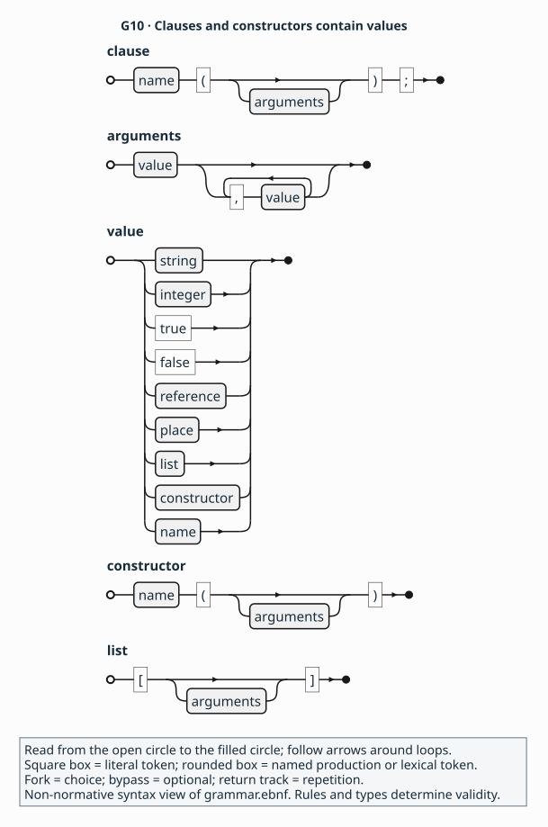
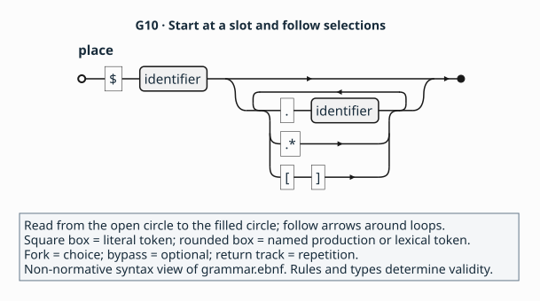
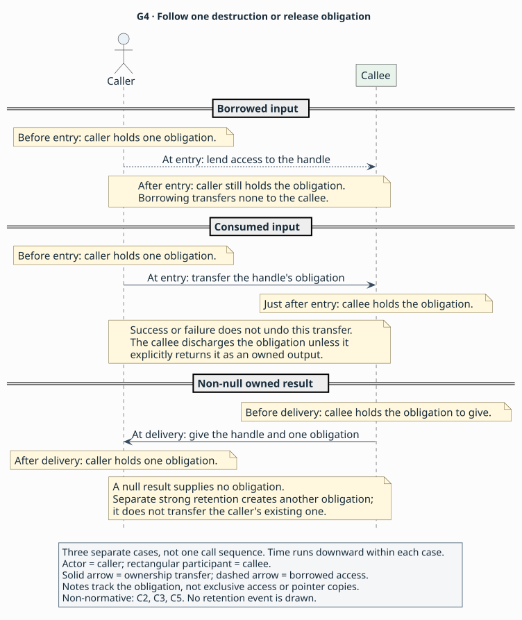

# How AIL states a contract

> **Purpose:** explanation — read AIL's semantic [clauses](../glossary.md#clause) as obligations between [callers and callees](../glossary.md#caller-and-callee).
> **Reader:** language designers who have met the API [binding](../glossary.md#binding) domain and want to understand the notation.
> **Before this:** [Using an API across languages](unsaid.md).
> **Status:** Draft 0.1 is a proposal under review through its specification
> and synthetic examples. Parser, validator and implementation development
> are future work.
> **Rules:** [`L1–L6`](../language.md#l1), [`C1–C8`](../contracts.md#c1) and [`A1–A5`](../profiles.md#a1) are canonical; the explanations here are non-normative.

Suppose a caller gets a view of a library's bytes. To use it safely, the caller
needs to know which object keeps the bytes alive and when to stop reading them.
If the library also accepts a [callback](../glossary.md#callback), the caller
needs to know when the library has finished using it. This page shows how AIL
records those answers. By the end, you should be able to follow the obligations
in the three
[conformance examples](../conformance.md#positive-specifications).

Those examples describe invented APIs using a synthetic fixture
[profile](../glossary.md#profile), a versioned semantic extension,
catalogue and [digest tokens](../glossary.md#digest-pin)
([`F1`](../profiles.md#f1)). Their stated behaviour belongs to those invented
APIs. Extracts below are labelled fragments because
the surrounding declarations and [package](../glossary.md#package) still matter.
The alternatives compare design possibilities. Their benefits and costs are
assessments of the published rules; draft 0.1 remains the contract under review.

The [overview's workflow map](../README.md#who-writes-and-uses-an-ail-description)
shows who writes, checks and uses an AIL description. This page looks inside
that description to explain the obligations on each call.

## From signature to contract

A program that owns a watch eventually calls `watch_close` to finish with it.
For this example, assume that closing the watch takes responsibility for
destroying it and completes successfully. The program then has no further close
to perform. That assumption supplies the contract for the domain page's C
declaration; an API author would need evidence that the library behaves this way.

AIL writes the operation as `fn watch_close`. Its `Watch` parameter is a
[handle](../glossary.md#handle) identifying the watch. The `input` clause says
that the call [consumes](../glossary.md#consume) it: responsibility passes to the
callee at entry. The `closed` block describes the successful return
([`L4`](../language.md#l4), [`C2–C3`](../contracts.md#c2),
[`C5`](../contracts.md#c5)).

Fragment — shows consumption and successful return for the invented watch.
A complete package would also supply the watch lifetime and nominal contracts,
[availability](../glossary.md#availability), the other effects,
[retention](../glossary.md#retention) and an [access path](../glossary.md#access-path).

<!-- ail-example: ../examples/concepts/contracts.ail region=watch-close -->
```ail
package example::watch version "1" {
  resource Watch {
    // Lifetime and nominal contracts omitted.
  }
  fn watch_close(watch: Watch) -> unit {
    execution(sync);
    completions([returned]);
    input($watch, consume);
    outcome closed {
      when(returned, any);
      meaning(success);
    }
  }
  // Header and remaining package context omitted.
}
```

The package braces locate both the `Watch` type and `watch_close` operation.
`watch: Watch` names a parameter and its type; `-> unit` says that the function
returns no value. Inside the function, `$watch` addresses that parameter.
A clause takes the form `name(arguments);`: parentheses group arguments,
commas separate them, and the semicolon ends the clause. `outcome closed`
opens a nested block describing one way this call finishes. Comments beginning
with `//` explain omitted context ([`L1`](../language.md#l1),
[`L2`](../language.md#l2), [`L4`](../language.md#l4), [`C1`](../contracts.md#c1)).

Now consider a program that owns a store of bytes and calls `view` to read
them. The program keeps responsibility for destroying the store. The call
returns a pointer to bytes held by that store, so the program also keeps the
store alive while using the pointer. This is the contract of the synthetic
buffer example below. The parameter list and arrow describe the values passed
and returned; the clauses connect those values to their obligations
([`C3`](../contracts.md#c3), [`C5`](../contracts.md#c5)).

Fragment — shows the input and returned [borrow](../glossary.md#borrow) of `view`. The complete
[buffer package](../examples/buffers.ail) also supplies `Store`, availability,
effects, retention, buffer facts and access paths.

<!-- ail-example: ../examples/concepts/contracts.ail region=view-borrow -->
```ail
fn view(store: Store) -> ptr<u8> {
  input($store, borrow);
  valid($store, call);
  outcome viewed {
    when(returned, any);
    meaning(success);
    state($result, valid);
    give($result, borrow(owner($store)));
    invalidated_by($result, []);
  }
}
```

Here `ptr<u8>` is a non-null pointer to unsigned eight-bit values. The angle
brackets supply the pointer's element type; `$result` addresses the returned
pointer ([`L4`](../language.md#l4), [`C1`](../contracts.md#c1)).

In the second body, `input($store, borrow)` lets the callee use the store while
leaving ownership with the caller. `valid($store, call)` requires the caller to
keep it usable for that invocation. Inside `viewed`, `give` describes the
returned pointer: the caller borrows access for the store's lifetime.
`invalidated_by($result, [])` says that no operation ends this access earlier
([`C1`](../contracts.md#c1), [`C3`](../contracts.md#c3), [`C5`](../contracts.md#c5)).

The caller therefore keeps responsibility for the store across `view`, while
`watch_close` takes responsibility for the watch. AIL states what happens to
an input's ownership in `input` and describes the returned values in an
[outcome](../glossary.md#outcome). Each outcome identifies a way the invocation
can finish, its [completion](../glossary.md#completion), and the values the
caller can use afterwards. AIL writes these facts as `name(arguments);`
clauses. The rule files define the permitted names and their meanings
([`L1`](../language.md#l1),
[`L4`](../language.md#l4), [`C3`](../contracts.md#c3), [`C5`](../contracts.md#c5)).

The clause railroad follows the same spelling. For `input($store, borrow);`,
`input` fills `name`; the two arguments are a [place](../glossary.md#place)
and a bare name.
In `give($result, borrow(owner($store)));`, the second argument contains
nested constructors. Their parentheses stay inside the outer clause's
parentheses; only the outer clause ends with a semicolon.



**Reading key:** read from open to filled circle; square boxes are literal
tokens and rounded boxes name productions or lexical tokens. Forks choose
alternatives, bypasses permit omission, and return arrows repeat a path.
These are grammar shapes; the cited contract rules determine which arguments
and locations each clause accepts. [Railroad source](../figures/g10-clause.puml).

Each clause lets the reader locate one obligation, at the cost of a longer
body and several rule lookups. Putting ownership in types is an alternative;
[Expressing ownership](choices.md#expressing-ownership) compares the forms, and
[Q3](choices.md#q3) records the missing rationale for draft 0.1's choice.
A complete function also states its effects and how a tool reaches its code
([`C3`](../contracts.md#c3), [`A2`](../profiles.md#a2)).

## Naming what a contract talks about

Suppose the caller reserves space for an integer and passes its address as
`length`. The library receives a pointer and writes an integer through it.
The pointer can be usable throughout the call even before the library has
written a usable integer. AIL needs a way to name each separately.

`$length` names the parameter value. A parameter or result position is a
[slot](../glossary.md#slot). Adding `.*` names the integer reached through that
pointer. Such a path to a value or storage is a [place](../glossary.md#place).
The following fragment first describes storage for one integer, then describes
the written integer on an outcome ([`C1`](../contracts.md#c1),
[`C4–C5`](../contracts.md#c4)).

Fragment — shows a pointer and its written integer. A complete package would
supply this constructed `read_length` operation's other contracts, including
input, direction, aliasing, contents and access clauses. The successful outcome
is shown inside its callable.

<!-- ail-example: ../examples/concepts/contracts.ail region=pointee -->
```ail
fn read_length(length: mutptr<u64>) -> unit {
  extent($length, one);
  outcome written {
    when(returned, any);
    meaning(success);
    state($length.*, valid);
  }
  // Other callable contracts omitted.
}
```

The synthetic `copy_bytes` writes a buffer instead of one integer. Its
`$destination[]` place names the initialized elements together. Here the
declared length is sixteen, and successful copying makes those sixteen
elements readable ([`C1`](../contracts.md#c1), [`C5`](../contracts.md#c5)).

Fragment — shows the destination buffer and its successful output state. The
complete [buffer package](../examples/buffers.ail) supplies `copy_bytes`, its
other contracts and the failure outcome.

<!-- ail-example: ../examples/concepts/contracts.ail region=buffer-place -->
```ail
fn copy_bytes(store: Store, destination: mutptr<u8>) -> bool {
  extent($destination, buffer(16, 16, elements));
  outcome copied {
    when(returned, equal($result, true));
    meaning(success);
    state($result, valid);
    state($destination[], valid);
  }
  // Failure outcome and other callable contracts omitted.
}
```

In the first case, `$length` is the pointer and `$length.*` is one integer.
In the second, `$destination[]` describes the buffer's initialized elements.
The principle is to address the object of each obligation explicitly. In
summary (non-normative), `.*` goes with extent `one`, `[]` with buffer extent,
and `.field` selects a record field. A validator checks each path against the
type and extent it follows. Selecting one pointee with `.*` therefore requires
a different extent from selecting buffer elements with `[]`
([`C1`](../contracts.md#c1)).



**Reading key:** follow open to filled circle. Square boxes spell literal
tokens; rounded boxes name lexical tokens. The bypass permits `$length` with
no selector. Take `.*` for `$length.*`, or the adjacent `[` and `]` boxes for
`$destination[]`; the brackets contain no index. The return path allows further
selections. Types and extent clauses determine which paths are meaningful
([`C1`](../contracts.md#c1)). [Railroad source](../figures/g10-places.puml).

The selector table keeps the pointer value distinct from the storage addressed
through it.

| Place | What it selects | Extent needed for traversal |
|---|---|---|
| `$length` | The pointer value | No traversal |
| `$length.*` | One integer through that pointer | `one` |
| `$destination[]` | Initialized buffer elements | `buffer(...)` |

The same distinction matters inside records. Suppose a returned record has an
integer field and a resource field named `handle`. Declaring the record valid
tells the caller it can inspect the result. The caller still needs to know
who destroys the resource in `handle`; `give($result.handle, owned)` supplies
that obligation. The integer field has no release obligation to transfer.

Fragment — locates the field selection in a constructed result record and
its returning function. A complete package would supply `Store`, the record's
nominal contracts, publication context and the function's other contracts.

<!-- ail-example: ../examples/concepts/contracts.ail region=record-leaf -->
```ail
record Created {
  field code: u64;
  field handle: Store;
  // Nominal contracts omitted.
}
fn make_created() -> Created {
  outcome created {
    when(returned, any);
    meaning(success);
    state($result, valid);
    give($result.handle, owned);
  }
  // Other callable contracts omitted.
}
```

The dot in `$result.handle` follows the record field. `state($result, valid)`
covers the record's scalar contents and shape; `give` addresses the resource
leaf's separate destruction obligation ([`C1`](../contracts.md#c1),
[`C5`](../contracts.md#c5)).

AIL calls a pointer, resource, object, interface or callback value a
[reference leaf](../glossary.md#reference-leaf), including when it occurs inside
an aggregate. Each such leaf needs its applicable contracts. A clause about a
pointer addresses that pointer unless its place explicitly follows the pointer
([`L4–L5`](../language.md#l4), [`C1`](../contracts.md#c1), [`C5`](../contracts.md#c5)).

AIL chooses typed paths rather than implicitly applying every clause throughout
an aggregate. This makes container and element obligations distinguishable, but
makes nested contracts longer. Inside the `view(store: Store)` declaration
shown above, `$store` addresses the parameter value. From elsewhere in the
package, `@view::store` identifies that function's parameter slot: `view`
locates the callable and `store` locates its parameter
([`L2`](../language.md#l2)). [Q4](choices.md#q4) asks about the cost of
learning these two spellings.

## Who owns what

Suppose a program creates a store, reads its bytes, and finally destroys it.
While reading, it remains responsible for eventually calling `destroy`.
When it calls `destroy`, the library takes over that responsibility. A binding
needs to preserve this sequence so the store is released exactly as its
contract requires.

A value delivered as [owned](../glossary.md#owned) brings one destruction or
release obligation. A [borrow](../glossary.md#borrow) grants access for a stated
period while leaving that obligation with its existing holder. These terms
describe responsibilities; exclusivity and enforcement are separate matters.
In particular, AIL borrowing does not imply Rust's static borrow checking
([`C2–C3`](../contracts.md#c2), [`C5`](../contracts.md#c5)).

Compare these entry contracts from the synthetic buffer example. The first
lets `view` use the store; the second hands the store to `destroy`.

Fragment — compares borrowing and consuming a store at entry. The complete
[buffer package](../examples/buffers.ail) supplies `Store`, the functions'
remaining clauses and the package context.

<!-- ail-example: ../examples/concepts/contracts.ail region=entry-transfer -->
```ail
fn view(store: Store) -> ptr<u8> {
  input($store, borrow);
  retain($store, none);
  valid($store, call);
  // Other callable contracts omitted.
}

fn destroy(store: Store) -> unit {
  input($store, consume);
  retain($store, none);
  // Other callable contracts omitted.
}
```

The caller remains responsible for destroying the store after `view`. With
[consumption](../glossary.md#consume), the callee takes over at entry on every
outcome. In this example `destroy` discharges it by destruction. Consumption
itself does not mean mutation of live contents, so its `mutation(none)` in the
full file is consistent ([`C2–C3`](../contracts.md#c2)).

Now compare delivery of a new store with delivery of a view into an existing
store. These are exit facts, separate from entry transfer.

Fragment — compares receiving a store with receiving its bytes. The complete
[buffer package](../examples/buffers.ail) supplies both functions' remaining clauses and `create`'s null outcome.

<!-- ail-example: ../examples/concepts/contracts.ail region=output-transfer -->
```ail
fn create() -> nullable<Store> {
  outcome created {
    when(returned, nonnull($result));
    meaning(success);
    state($result, valid);
    give($result, owned);
  }
  // Null outcome and other callable contracts omitted.
}

fn view(store: Store) -> ptr<u8> {
  outcome viewed {
    when(returned, any);
    meaning(success);
    state($result, valid);
    give($result, borrow(owner($store)));
    invalidated_by($result, []);
  }
  // Other callable contracts omitted.
}
```

The first gives the caller one destruction obligation for a non-null store.
The second gives access to bytes without giving a release obligation. A null
reference carries no obligation even when its outcome repeats `give(owned)`
([`C1`](../contracts.md#c1), [`C5`](../contracts.md#c5)).

The library may also need a value for later work. In the synthetic callback
API, the caller gives `subscribe` a handler to receive future notifications.
The call borrows the handler, leaving the caller's obligation in place. The
library then keeps its own strong reference so notifications can use the
handler after `subscribe` returns. Keeping a value beyond immediate use is
[retention](../glossary.md#retention); strong retention creates a separate
release obligation ([`C3`](../contracts.md#c3)).

Fragment — shows `subscribe` retaining a handler. The complete
[callback package](../examples/callbacks.ail) supplies the declaration,
schedule, outcomes and remaining clauses.

<!-- ail-example: ../examples/concepts/contracts.ail region=retention -->
```ail
fn subscribe(handler: Handler) -> Subscription {
  input($handler, borrow);
  retain($handler, strong(owner($result)));
  valid($handler, call);
  // Other callable contracts omitted.
}
```

Here `$result` is the returned subscription. `strong(owner($result))` ties the
library's retained handler to that subscription's lifetime. For an operation
that can fail to return an owner, this retention takes effect only on outcomes
that return the owner non-null and valid. On other outcomes the library
releases temporary retained references before completion ([`C3`](../contracts.md#c3)).

In summary (non-normative), `input(consume)` transfers an existing obligation,
`retain(strong(...))` creates an independent one, and `give(owned)` supplies one
to the caller. `retain(none)` promises no retention. A unique resource cannot be
strongly retained or [copied](../glossary.md#copy) without an explicit clone profile
([`C3`](../contracts.md#c3), [`C5`](../contracts.md#c5)).

Use the diagram to follow the same three ownership cases through the domain
page's [invented watch API](unsaid.md#a-small-api). Its `watch_view` borrows the
watch, leaving the program responsible for closing it. Its `watch_close` takes
that responsibility at entry and destroys the watch. A non-null owned result
from `watch_open` gives the program a new watch to close; null gives none.
These are separate possible contracts, with time running downward within each
case. A consuming operation takes the obligation even on failure. It discharges
that obligation unless it explicitly returns it as an owned output
([`C3`](../contracts.md#c3), [`C5`](../contracts.md#c5)).

Strong retention is a separate event, as the handler example shows. It creates
an additional release obligation while the caller keeps its own; that event
is outside this figure. Ownership also leaves exclusive access to other rules.



[Diagram source](../figures/g4-ownership.puml) ·
[How tools use these API facts](../README.md#who-writes-and-uses-an-ail-description)

AIL's choice exposes each event rather than compressing them into a single
“takes ownership” annotation. The cost is more clauses to reconcile. A single
annotation would be shorter, but would need additional meanings to distinguish
borrowing with strong retention from consumption without retention.

## How long a borrow lasts

After `view` returns, the program can keep the pointer and read the store's
bytes. In the synthetic immutable store, those bytes stay usable until the
store is destroyed. Consider instead a mutable store whose `replace` operation
can replace its storage. A pointer obtained before replacement can become
unusable even while the store itself remains alive.

AIL names the lifetime that bounds access with a [region](../glossary.md#region).
For this view, the region is the lifetime of its owner, `store`. It separately
names operations that end access earlier through
[invalidation](../glossary.md#invalidation). The first fragment is the immutable
case; the second is a constructed mutable variant
([`C1`](../contracts.md#c1), [`C5`](../contracts.md#c5)).

Fragment — shows call validity and the immutable view's lifetime. The complete
[buffer package](../examples/buffers.ail) supplies `Store`, the remaining
function clauses and the package context.

<!-- ail-example: ../examples/concepts/contracts.ail region=owner-borrow -->
```ail
fn view(store: Store) -> ptr<u8> {
  valid($store, call);
  outcome viewed {
    when(returned, any);
    meaning(success);
    state($result, valid);
    give($result, borrow(owner($store)));
    invalidated_by($result, []);
  }
  // Other callable contracts omitted.
}
```

Fragment — shows the constructed mutable view's earlier invalidator. A complete
package would also supply the mutable `Store` declaration and the remaining contracts for `view`
and `replace`. The owner parameter and mutation clause locate the invalidator.

<!-- ail-example: ../examples/concepts/contracts.ail region=mutable-borrow -->
```ail
fn view(store: Store) -> ptr<u8> {
  outcome viewed {
    when(returned, any);
    meaning(success);
    state($result, valid);
    give($result, borrow(owner($store)));
    invalidated_by($result, [@replace]);
  }
  // Other callable contracts omitted.
}

fn replace(store: Store) -> unit {
  mutation(arguments);
  // Other callable contracts omitted.
}
```

Read the first fragment in two stages. During `view`, the caller keeps `store`
valid because of `valid($store, call)`. After `view` returns, the caller keeps
the store alive for as long as it uses the returned bytes because of
`borrow(owner($store))`. The returned pointer's contract supplies that later
obligation.

In the mutable variant, the caller also stops using the old view when
`replace` starts. `invalidated_by` makes entry to the operation the cutoff,
even if that operation later fails. An empty list in the immutable case says
there is no such earlier operation; the owner's destruction still ends access
([`C1`](../contracts.md#c1), [`C5`](../contracts.md#c5)).

Use the timelines to locate the moment the program stops using returned bytes.
In each case, it first keeps the input usable while `view` runs. The result's
own contract then lets the program keep reading after the call completes.
For the immutable store, destruction ends that access. In the constructed
mutable case shown here, `replace` starts first and ends access to the old
view, even if replacement later fails. The store itself remains alive.

Time runs downward within each separate case; the spacing measures no duration.
The marked arrow ends mean that the view has become unusable. They do not
depict destruction of the program. Other call obligations and the mutable
variant's full operation contracts are outside this view.


[Borrow timing source](../figures/g5-borrow.puml) ·
[Ownership cases](#who-owns-what) ·
[How tools use these API facts](../README.md#who-writes-and-uses-an-ail-description)

Another example, the synthetic `fixed_bytes` constant, lends bytes belonging
to the loaded API instance. A caller can use them while that instance remains
loaded. The synthetic provider requires callers to stop using borrows before
unload. AIL calls that region `static`; its end is defined by the provider
([`C1`](../contracts.md#c1), [`F1`](../profiles.md#f1)).

Fragment — locates the static borrow on the synthetic constant. The complete
[object package](../examples/objects.ail) supplies extent, contents, access and
the remaining constant and package clauses.

<!-- ail-example: ../examples/concepts/contracts.ail region=static-borrow -->
```ail
constant fixed_bytes: ptr<u8> {
  give($result, borrow(static));
  invalidated_by($result, []);
  // Extent, contents, access and other constant clauses omitted.
}
```

Here `$result` addresses the constant's obtained value. A constant's output
clauses occur directly in its body ([`C7`](../contracts.md#c7)).

The three regions therefore name different boundaries (non-normative summary):

| Region | Boundary | Example |
|---|---|---|
| `call` | Completion of this invocation, including synchronous callbacks | `valid($store, call)` on `view` entry |
| `owner($store)` | Destruction of the owner or release of its final reference | The `view` result |
| `static` | End of the loaded API instance, with [provider](../glossary.md#provider)-defined shutdown | `give($result, borrow(static))` on synthetic `fixed_bytes` |

These meanings come from [`C1`](../contracts.md#c1); synthetic `static` ends at
provider unload ([`F1`](../profiles.md#f1)). To use a borrow after the call
returns, the caller needs a region that lasts beyond that call. The `call`
region ends too soon to describe a returned view with `borrow(call)`
([`C1`](../contracts.md#c1); mutation N07 in the
[conformance corpus](../conformance.md#rejection-mutations)).

The principle is to track both a lifetime boundary and earlier invalidators.
AIL chooses this split instead of a single “valid until next use” description.
It can name an owner independently of mutation, but a reader follows facts
across entry and outcome clauses. That cost is [Q5](choices.md#q5).
The mutable variant illustrates only the relationship: its omitted operation
contracts are needed to check whether the named invalidator is legal.

## Every way a call can end

After a call finishes, the caller needs a reliable way to find out what
happened. The synthetic `create` returns either a store or null. Both values
are safe to inspect: the store means creation succeeded, and null means it
failed. The synthetic `copy_bytes` instead returns a Boolean status and writes
through a separate destination pointer. The caller can always inspect the
Boolean, but can read the destination only after success.

AIL calls the way control finishes a [completion](../glossary.md#completion).
Both examples finish by returning. Their [outcomes](../glossary.md#outcome)
divide that completion into success and failure cases. Each case says which
values the caller can use ([`C3`](../contracts.md#c3), [`C5`](../contracts.md#c5)).

Fragment — shows `create` succeeding or failing. The complete
[buffer package](../examples/buffers.ail) supplies `Store`, the function's
other contracts and the package context.

<!-- ail-example: ../examples/concepts/contracts.ail region=null-outcomes -->
```ail
fn create() -> nullable<Store> {
  outcome created {
    when(returned, nonnull($result));
    meaning(success);
    state($result, valid);
    give($result, owned);
  }
  outcome allocation_failed {
    when(returned, null($result));
    meaning(failure);
    state($result, valid);
    give($result, owned);
  }
  // Other callable contracts omitted.
}
```

Fragment — shows `copy_bytes` succeeding or failing. The complete
[buffer package](../examples/buffers.ail) supplies `Store`, the function's
other contracts and the package context.

<!-- ail-example: ../examples/concepts/contracts.ail region=status-outcomes -->
```ail
fn copy_bytes(store: Store, destination: mutptr<u8>) -> bool {
  outcome copied {
    when(returned, equal($result, true));
    meaning(success);
    state($result, valid);
    state($destination[], valid);
  }
  outcome failed {
    when(returned, equal($result, false));
    meaning(failure);
    state($result, valid);
    state($destination[], invalid);
  }
  // Other callable contracts omitted.
}
```

The `create` function's null result is valid and observable, and represents
failure. It creates no ownership obligation. The `copy_bytes` Boolean result
is valid on both outcomes, but on failure the destination elements are unreadable. The caller
finds out what happened by testing the status. After failure, it leaves the
destination elements unread
([`C1`](../contracts.md#c1), [`C5`](../contracts.md#c5)).

The partition table shows why observable failure and unreadable output are
different: each returned value selects exactly one row for its operation.

| Operation and discriminator | Selected outcome | What the caller receives |
|---|---|---|
| `create`: non-null result | `created` — success | Valid store; one destruction obligation |
| `create`: null result | `allocation_failed` — failure | Valid null; no obligation |
| `copy_bytes`: `true` | `copied` — success | Valid status and destination elements |
| `copy_bytes`: `false` | `failed` — failure | Valid status; destination elements unreadable |

The `when` clause selects a case by testing a value, called the
[discriminator](../glossary.md#discriminator). Here that value is `$result`.
The caller can determine the case because the result is readable on every
returned outcome. `meaning` then labels the case as success or failure, and
`state` describes each value's [output state](../glossary.md#output-state)
([`C5`](../contracts.md#c5)).

Every possible result needs exactly one case. Null and non-null cover
`create`; true and false cover `copy_bytes`. For a signed integer status,
cases covering zero and positive values would leave negative values unanswered.
In summary (non-normative), outcomes for a completion can test one valid
discriminator. Together, those tests cover every possible value, and each
value selects exactly one outcome. Alternatively, one `any` outcome covers
the whole completion ([`C5`](../contracts.md#c5)).

A caller can also pass storage whose contents the library may read and replace.
AIL calls that direction `inout`. An outcome can promise to leave those
contents and their entry obligations unchanged with `state(unchanged)`.
If the call consumed an input obligation, returning even the same reference
requires an explicit transfer back: `state(valid)` and `give(owned)`.
The caller then has a stated obligation again ([`C3`](../contracts.md#c3),
[`C5`](../contracts.md#c5)).

The principle is that failure still has an output contract. AIL chooses a small,
checkable predicate vocabulary over arbitrary executable conditions. This
bounds coverage checking but leaves correlations across multiple
discriminators to profiles. It also preserves the API's error observation:
`meaning(failure)` alone does not turn a null or status into an exception.
These examples only return; thrown, cancelled or terminated completion needs
the corresponding signature and provider support
([`C3`](../contracts.md#c3), [`C5`](../contracts.md#c5)).

## Buffers and strings

When a library returns a pointer, the caller needs to know how much data it
can read from that address. When the caller supplies storage for output, the
library also needs to know how much space is available to write. AIL records
the readable length and allocated capacity together as the buffer's
[extent](../glossary.md#buffer-extent). It records how to interpret the data
separately in [contents](../glossary.md#contents).

Compare the synthetic sixteen-byte binary view with a constructed three-code-unit
UTF-8 string that includes space for its terminator.

Fragment — shows the extent and contents of `view`'s bytes. The complete
[buffer package](../examples/buffers.ail) supplies the declaration and its
other contracts.

<!-- ail-example: ../examples/concepts/contracts.ail region=binary-buffer -->
```ail
fn view(store: Store) -> ptr<u8> {
  extent($result, buffer(16, 16, elements));
  contents($result, binary);
  // Other callable contracts omitted.
}
```

Fragment — shows bounded UTF-8 text in a constructed example. A complete
package would supply `greeting`'s ownership and outcomes,
and the synthetic fixture profile, catalogue and digest tokens supplying UTF-8.

<!-- ail-example: ../examples/concepts/contracts.ail region=text-buffer -->
```ail
fn greeting() -> ptr<u8> {
  extent($result, buffer(3, 4, elements));
  contents($result, text("utf-8", nul));
  // Other callable contracts omitted.
}
```

The binary view has sixteen readable elements and no terminator convention.
The text has three payload code units, with a final zero in its fourth storage
position. Its length excludes that zero and its capacity includes it; embedded
zero code units are forbidden. This is a count of code units, not necessarily
characters ([`C4`](../contracts.md#c4), [`F1`](../profiles.md#f1)).

The storage comparison shows which positions count toward readable payload
and which provide terminator space.

| Example | Payload length | Storage capacity | Terminator |
|---|---|---|---|
| Synthetic binary view | 16 elements | 16 elements | No terminator convention |
| Constructed UTF-8 text | 3 code units | 4 code units | Zero in the fourth position, outside the payload length |

Length and capacity describe different things. A caller could reserve space
for sixteen bytes while having initialized none of them. The space exists,
but the bytes become readable only when an operation writes valid output.
For an `out` buffer, the library can write without reading the previous
contents; a valid output initializes the declared length ([`C4`](../contracts.md#c4)).

The storage still needs to be allocated and aligned whenever capacity is
positive, including when length is zero. A null buffer instead has both zero
length and zero capacity. In summary (non-normative), the caller supplies
input satisfying `0 <= length <= capacity`, and the callee supplies output
satisfying the same bound. A `nul` text buffer also reserves room for its
terminator ([`C4`](../contracts.md#c4)).

Direction and aliasing complete the storage picture. The synthetic
`copy_bytes` uses `direction($destination, out)` to say it does not read prior
contents, and `aliasing($destination, disjoint)` to prohibit overlap with other
accessed memory. Its `mutptr<u8>` and `mutation(arguments)` agree with writing
the buffer ([`C3`](../contracts.md#c3), [`C4`](../contracts.md#c4)).

Fragment — locates writable storage facts in `copy_bytes`. The complete
[buffer package](../examples/buffers.ail) supplies input obligations, the
success/failure outcomes shown above and the remaining callable contracts.

<!-- ail-example: ../examples/concepts/contracts.ail region=output-storage -->
```ail
fn copy_bytes(store: Store, destination: mutptr<u8>) -> bool {
  mutation(arguments);
  direction($destination, out);
  aliasing($destination, disjoint);
  extent($destination, buffer(16, 16, elements));
  contents($destination, binary);
  // Input, other effects, outcomes and access omitted.
}
```

The type follows `destination:` in the signature; each `$destination` in the
body addresses that same pointer parameter. Its `[]` output place, shown in
the outcomes above, addresses the elements written through it.

AIL separates storage bounds from how the caller interprets the bytes. That
requires authors to supply length and capacity even for a familiar byte-pointer
type. An alternative string contract could determine length by scanning for
a terminator. AIL requires a profile to define that scanned-buffer behaviour;
the core uses an explicit bound ([`C4`](../contracts.md#c4)).

The bound can still vary between calls. Where the API supplies a length in an
integer parameter or output, the extent can name that scalar slot instead of
using a fixed number. The applicable input or output contract establishes when
that length is valid ([`C4`](../contracts.md#c4)).

## Callbacks

Suppose a program passes a handler to receive integer notifications. One API
might invoke it once before the registration call finishes. Another might
store it and notify the program later. In the first case, the program can
finish with the callback state when the call completes. In the second, it
needs an event that tells it all later use has ended.

Values saved with the handler are its
[callback captures](../glossary.md#callback-captures). They need to remain usable
whenever the API can invoke the handler. This is why AIL describes both an
individual invocation and the schedule for using that callback
([`C2–C3`](../contracts.md#c2), [`C6`](../contracts.md#c6)).

Fragment — locates the signature and invocation clauses of the synthetic
callback type. The complete [callback package](../examples/callbacks.ail)
supplies `Handler`'s nominal, representation and remaining invocation contracts.

<!-- ail-example: ../examples/concepts/contracts.ail region=handler -->
```ail
callback Handler(value: u64) -> unit {
  execution(sync);
  concurrency(serial);
  reentrancy(forbidden);
  // Nominal, representation and remaining invocation contracts omitted.
}
```

`callback Handler(...)` declares a type with a callable signature. The `value`
parameter belongs to an invocation of that type. In `subscribe(handler: Handler)`
below, `handler` is instead the function's parameter holding such a callback.
`callback $handler { ... }` attaches a use schedule to that parameter; it
introduces no new callback type ([`C3`](../contracts.md#c3), [`C6`](../contracts.md#c6)).

The synthetic `Handler` declaration describes one invocation. Its
`execution(sync)` says that invocation completes before returning to its caller;
its [`concurrency(serial)`](../glossary.md#concurrency) and
[`reentrancy(forbidden)`](../glossary.md#re-entrancy) constrain uses of that
callback type ([`C2–C3`](../contracts.md#c2)). Compare two schedules for using
such a handler: the synthetic subscription stores it, while a constructed
call-scoped operation invokes it once before completing.

Fragment — shows the subscription's notification schedule. The complete
[callback package](../examples/callbacks.ail) supplies `subscribe`, including
its retention and outcome clauses.

<!-- ail-example: ../examples/concepts/contracts.ail region=subscription-schedule -->
```ail
fn subscribe(handler: Handler) -> Subscription {
  callback $handler {
    timing(after_return);
    count(0, many);
    scope(owner($result));
    executor(any);
    concurrency(serial);
    reentrancy(forbidden);
    quiescence(@unsubscribe);
  }
  // Other callable contracts omitted.
}
```

Fragment — shows a constructed call that invokes a handler within its own
scope. A complete package would supply `Handler`, the operation's other effects, outcome and access clauses.

<!-- ail-example: ../examples/concepts/contracts.ail region=call-schedule -->
```ail
fn notify(handler: Handler) -> unit {
  execution(sync);
  input($handler, borrow);
  retain($handler, none);
  valid($handler, call);
  callback $handler {
    timing(during_call);
    count(1, 1);
    scope(call);
    executor(any);
    concurrency(serial);
    reentrancy(forbidden);
    quiescence(return);
  }
  // Other callable contracts omitted.
}
```

For the subscription, `timing(after_return)` allows the API to start a
notification only after `subscribe` returns. `count(0, many)` permits zero
notifications and places no finite upper bound on how many may occur during
the subscription. The author is stating that the API permits this range of
counts. The registration call itself still completes synchronously ([`C3`](../contracts.md#c3),
[`C6`](../contracts.md#c6)).

For the constructed case, the handler starts during the call and finishes
before the call completes. `count(1, 1)` requires exactly one invocation if
that call's scope eventually ends. The condition matters: neither a callback
count nor synchronous execution promises that an operation will eventually
finish ([`C3`](../contracts.md#c3), [`C6`](../contracts.md#c6)).

To end the subscription, the caller invokes `unsubscribe`. A notification may
still be running when teardown starts. The destructor establishes that all
invocations have finished and no more can begin before it returns. That state
is [quiescence](../glossary.md#quiescence), and the return from `unsubscribe`
is the caller's boundary for relying on it ([`C6`](../contracts.md#c6)).

Calling this destructor inside the callback it waits for could make each wait
for the other. Its `requires(outside_callback(@subscribe::handler))` therefore
requires the caller to begin teardown from outside that callback invocation.
The retained handler belongs to the subscription's owner region. The
[provider](../glossary.md#provider) defines how the handler and its captures
are stored — their [representation](../glossary.md#representation) — and how
that stored value is released ([`C3`](../contracts.md#c3),
[`C6`](../contracts.md#c6), [`F1`](../profiles.md#f1)).

Fragment — locates the teardown precondition. The complete
[callback package](../examples/callbacks.ail) supplies the consuming input,
outcome and other contracts of `unsubscribe`.

<!-- ail-example: ../examples/concepts/contracts.ail region=outside-callback -->
```ail
fn unsubscribe(subscription: Subscription) -> unit {
  requires(outside_callback(@subscribe::handler));
  // Input, effects, outcome and access omitted.
}
```

`@subscribe::handler` names the slot of the registration function from outside
that function. Inside `subscribe`, `$handler` addresses the same parameter
locally. `requires` takes the `outside_callback` constructor as its argument
([`L2`](../language.md#l2), [`C3`](../contracts.md#c3)).

Use the callback timelines to find the point where the program knows the API
has finished using the handler. In the constructed case, registration completes
after the handler has finished, and that registration can start no further
invocation. The API retains no handler after the call.

The second case follows successful synthetic `subscribe`. The API keeps its
own strong reference to the handler for the subscription. After registration
returns, the picture shows one permitted notification. While that handler runs,
the program enters `unsubscribe` from outside the callback and transfers
responsibility for destroying the subscription. The handler finishes during
teardown. When `unsubscribe` returns, every invocation has finished and that
subscription can start no more.

Zero notifications are also permitted in the subscription case. The constructed
call invokes once if its scope eventually ends. Neither case promises eventual
completion of the enclosing operation. Read time downward within each case;
spacing measures no duration. Native scheduling and the machinery that releases
stored callback state are outside this view.


[Callback timing source](../figures/g7-callbacks.puml) ·
[Ownership cases](#who-owns-what) ·
[How tools use these API facts](../README.md#who-writes-and-uses-an-ail-description)

The principle is that invocation, schedule and teardown are separate contracts.
AIL chooses explicit timing, count, scope and quiescence rather than one
“asynchronous callback” annotation. That is more to write, but the shorter label
would leave these distinctions unanswered. A different teardown protocol, such
as a cancellation request with later acknowledgement, needs profile-defined
events and ordering; cancellation return cannot be labelled quiescence unless
it actually supplies that boundary ([`C6`](../contracts.md#c6)).

## Threads and sharing

Suppose a program moves sole ownership of a store from one thread to another.
That can be legal even when two threads are forbidden from using the store at
the same time. A different API might require every use on the main thread;
serializing calls on a worker thread would still violate that requirement.

AIL separates where a call can begin from whether calls may overlap. The
[executor](../glossary.md#executor) clause identifies the permitted thread or
execution context. [Concurrency](../glossary.md#concurrency) describes
independent calls that could overlap. A third case occurs when an active call
invokes client code which calls back into the API before the first call finishes.
AIL describes that nested entry through
[re-entrancy](../glossary.md#re-entrancy) ([`C2–C3`](../contracts.md#c2)).

Compare the synthetic store and counter. The store permits moving sole ownership
between executors; the counter is confined to the main thread. Their call
contracts supply the remaining restrictions.

Fragment — shows where callers can move and use a store. The complete
[buffer package](../examples/buffers.ail) supplies `Store`, `view` and their
other contracts.

<!-- ail-example: ../examples/concepts/contracts.ail region=store-threads -->
```ail
resource Store {
  sharing(transferable);
  isolation(none);
  // Lifetime and other nominal contracts omitted.
}
fn view(store: Store) -> ptr<u8> {
  executor(any);
  concurrency(serial);
  reentrancy(allowed);
  // Other callable contracts omitted.
}
```

Fragment — shows the counter's main-thread restriction. The complete
[object package](../examples/objects.ail) supplies `Counter`, `read_count` and
their other contracts.

<!-- ail-example: ../examples/concepts/contracts.ail region=counter-threads -->
```ail
object Counter {
  sharing(confined);
  isolation(main);
  // Lifetime and other nominal contracts omitted.
}
fn read_count(receiver: Counter) -> u64 {
  member(@Counter, instance);
  receiver($receiver);
  executor(main);
  concurrency(serial);
  reentrancy(allowed);
  // Other callable contracts omitted.
}
```

`Counter` and `read_count` are declarations at the same package level.
`member(@Counter, instance)` associates the function with that object type;
`receiver($receiver)` selects its ordinary named parameter as the receiver
([`L2`](../language.md#l2), [`L5`](../language.md#l5)).

In the first case, callers may enter on any executor but serialize independent
calls using the same store. In the second, callers serialize independent calls
using the same counter and make those calls on the main thread.
Both permit the
specified nested re-entry, which is distinct from independent overlap. A lock
alone does not satisfy the counter's executor restriction
([`C2–C3`](../contracts.md#c2)).

The comparison keeps executor permission, independent overlap and nested
re-entry on separate rows; granting one does not grant the others.

| Permission | Synthetic `Store` / `view` | Synthetic `Counter` / `read_count` |
|---|---|---|
| Moving or sharing the reference | Sole ownership is transferable | Reference is confined to main |
| Call entry | Any executor | Main thread |
| Independent calls using the same instance | Serialized | Serialized |
| Specified nested re-entry | Allowed | Allowed |

The type declaration establishes how callers may use its references. For example,
the counter's `isolation(main)` confines its use to the main thread, including
retaining, releasing and destroying it. The operation clauses then say how to
enter each call. This is the relationship between type-level
[isolation](../glossary.md#isolation) and per-call `executor`
([`C2–C3`](../contracts.md#c2)).

In summary (non-normative), [`sharing(shared)`](../glossary.md#shared) permits
references to cross executors; each operation still governs overlapping calls.
`isolation(none)` states that the type adds no isolation restriction; an
operation can still require a particular executor. Callback types apply their
sharing and isolation requirements to captured state, so that state supports
every use the callback type permits ([`C2`](../contracts.md#c2),
[`C6`](../contracts.md#c6)).

AIL records these permissions separately. An alternative “thread-safe” flag
would need a precise definition of which uses it allows. The separate clauses
make each permission visible, at the cost of checking that type and operation
contracts agree.

A source-language conformance flag answers another question: whether the type
satisfies a named source conformance. The synthetic counter records
`fixture::sendability(nonconforming)` alongside its call restrictions.
That fixture fact describes a synthetic conformance state; a real Swift
provider would need evidence from the actual source language and compiler
([`C2`](../contracts.md#c2), [`F1`](../profiles.md#f1)).

Fragment — locates the synthetic source-conformance clause. The complete
[object package](../examples/objects.ail) selects `fixture` and supplies the
other nominal and package contracts.

<!-- ail-example: ../examples/concepts/contracts.ail region=sendability -->
```ail
object Counter {
  fixture::sendability(nonconforming);
  // Lifetime, sharing, isolation and other nominal contracts omitted.
}
```

The `fixture::` prefix selects the profile's vocabulary; `sendability` is
its clause name. The provider selection is introduced in
[What it depends on](packages.md#what-it-depends-on)
([`L2`](../language.md#l2), [`A1`](../profiles.md#a1)).

## Lifecycles and patterns

After obtaining an owned value, the caller needs to know how to release it.
For the synthetic store, it calls a destructor once. For the counter, it
releases its own reference; other parties may still hold references that keep
the object alive. AIL records this discipline in the type's
[lifecycle](../glossary.md#lifecycle) ([`C2`](../contracts.md#c2)).

Compare the synthetic store's unique handle with the counter's counted
references.

Fragment — compares unique destruction and reference counting. The complete
[buffer](../examples/buffers.ail) and [object](../examples/objects.ail) packages
supply the types' other contracts and the referenced destructor. `fixture` selects their
synthetic profile, whose catalogue and digest tokens appear in those files.

<!-- ail-example: ../examples/concepts/contracts.ail region=lifecycles -->
```ail
// In example::buffers:
resource Store {
  lifecycle(unique, @destroy);
  // Other nominal contracts omitted.
}
// In example::objects:
object Counter {
  lifecycle(refcounted, runtime(fixture, "retain"), runtime(fixture, "release"));
  // Other nominal contracts omitted.
}
```

The store's owned handle carries one destruction obligation. The counter can
have several owned references, each carrying its own release obligation.
Retaining creates another owned reference; releasing the final reference
destroys the counter. In the unique case, destruction
consumes the handle at entry and invalidates dependent borrows before returning
([`C2`](../contracts.md#c2), [`F1`](../profiles.md#f1)).

Use the state diagram to track who is responsible for destroying one synthetic
immutable store. If `create` returns a store, the program receives that
responsibility. If it returns null, the program has nothing to destroy.
Calling `view` lends access to the bytes and leaves responsibility with the
program. At `destroy` entry, responsibility passes to the library. The library
destroys the store before returning, ending the program's use of its borrowed
views and discharging the obligation.

Rounded boxes show states; arrows follow changes in responsibility. A loop
returns to the same responsibility. This view follows a unique store;
reference counting and the separate ordering pattern below are outside its scope.


[Resource state source](../figures/g6-lifecycle.puml) ·
[Borrow timelines](#how-long-a-borrow-lasts) ·
[How tools use these API facts](../README.md#who-writes-and-uses-an-ail-description)

Tools may also need to recognize a relationship between declarations. The
buffer example explicitly connects the resource type to its release operation.
AIL calls the reusable form of such a relationship a
[pattern](../glossary.md#pattern). The pattern below gives names to the two
participants; its [instance](../glossary.md#pattern-instance) identifies
`Store` and `destroy` as those participants ([`L6`](../language.md#l6)).

Fragment — connects `Store` to its destructor. The complete
[buffer package](../examples/buffers.ail) supplies the participant declarations
and their contracts.

<!-- ail-example: ../examples/concepts/contracts.ail region=lifetime-pattern -->
```ail
package example::buffers version "1" {
  pattern lifetime {
    role resource_type: type one;
    role release: operation one;
    law(releases, release, resource_type);
  }
  instance store_lifetime: lifetime {
    bind(resource_type, [@Store]);
    bind(release, [@destroy]);
  }
  // Header and remaining package context omitted.
}
```

A constructed ordering pattern instead requires a successful `prepare` before
entry into `read_prepared`, on the same resource instance.

Fragment — shows a constructed preparation-before-use relationship. A complete
package would supply `Store` and the operation contracts establishing
successful preparation and restricting subsequent use. The signatures locate
the subject slots; their comments are explanatory, not contract clauses.

<!-- ail-example: ../examples/concepts/contracts.ail region=ordering-pattern -->
```ail
package example::prepared version "1" {
  fn prepare(store: Store) -> unit {
    // Successful preparation establishes the ordering precondition.
    // Other callable contracts omitted.
  }
  fn read_prepared(store: Store) -> unit {
    // Requires successful preparation of this same store.
    // Other callable contracts omitted.
  }
  pattern prepared_use {
    role preparation: operation one;
    role use: operation one;
    law(before, preparation, use);
  }
  instance prepared_read: prepared_use {
    bind(preparation, [@prepare]);
    bind(use, [@read_prepared]);
    subject(preparation, @prepare::store);
    subject(use, @read_prepared::store);
  }
  // Header and remaining package context omitted.
}
```

In `prepared_use`, `preparation` and `use` are names for the two jobs that
operations fill. Each is a [role](../glossary.md#role). `operation one` says
the role takes exactly one operation; `one` is its
[cardinality](../glossary.md#cardinality). The
[pattern instance](../glossary.md#pattern-instance), `prepared_read`, assigns
`prepare` and `read_prepared` to those jobs ([`L6`](../language.md#l6)).

Both functions take a store, but callers could pass different stores to them.
The two `subject` clauses identify which parameter each function uses as the
resource being tracked. The law then requires successful preparation on the
same resource instance before use. Both subject parameters have the same
nominal resource type ([`L6`](../language.md#l6)).

The role mapping separates the fixture's release relationship from the
constructed ordering requirement; the latter applies to the same resource
instance, not merely to matching parameter names.

| Pattern instance | Role bindings | Required relationship |
|---|---|---|
| Synthetic `store_lifetime` | `resource_type` → `Store`; `release` → `destroy` | `destroy` agrees with the unique destructor |
| Constructed `prepared_read` | `preparation` → `prepare`; `use` → `read_prepared` | Successful preparation precedes use entry on the resource identified by both `store` subject slots |

The principle is that relationships impose obligations rather than describe a
usual workflow. In summary (non-normative), core `releases` agrees with the
type's declared unique destructor; core `before` adds a state precondition to
the later operation. A role binding is not a second lifecycle definition, and
a successful preparation on one store does not satisfy the order for another
([`L6`](../language.md#l6)).

AIL chooses two typed core laws over arbitrary prose laws or a general state
machine language. The cost is limited expressiveness: richer laws require a
profile with operands, obligations and validation. The ordering fragment does
not itself provide a full lifecycle or prove the native implementation obeys
it ([`L6`](../language.md#l6), [`C8`](../contracts.md#c8)).

<a id="what-the-core-leaves-to-profiles"></a>

## Extending the language with profiles

Suppose an API operation suspends and delivers its result later. A binding
needs to know how the operation resumes and how the result reaches its caller.
The core spelling `execution(async)` identifies the kind of execution, while
a [profile](../glossary.md#profile) supplies the additional rules for those
events. A profile is a versioned language extension. A
[provider](../glossary.md#provider) supplies its definition and support for
interpreting or implementing it ([`C3`](../contracts.md#c3), [`A1`](../profiles.md#a1)).

Compare a core execution fact admitted by the synthetic fixture with one that
needs additional semantics.

Fragment — shows synchronous execution with returned completion. The complete
[buffer package](../examples/buffers.ail) supplies `Store`, `view`'s other
contracts and the package context.

<!-- ail-example: ../examples/concepts/contracts.ail region=sync -->
```ail
fn view(store: Store) -> ptr<u8> {
  execution(sync);
  completions([returned]);
  // Other callable contracts omitted.
}
```

Fragment — shows the asynchronous form. A complete package would need a
profile defining suspension, scheduling and completion delivery, along with
the callable's other contracts. Those semantics exceed the synthetic fixture.

<!-- ail-example: ../examples/concepts/contracts.ail region=async -->
```ail
fn fetch(store: Store) -> ptr<u8> {
  execution(async);
  completions([returned]);
  // Other callable contracts omitted.
}
```

The first completes before returning control. The second needs a profile to say
how suspension and completion work; changing that one word in a synthetic
fixture package is rejected for unsupported semantics, not accepted as an
unfinished contract ([`C3`](../contracts.md#c3), [`F1`](../profiles.md#f1);
N30 in the [conformance corpus](../conformance.md#rejection-mutations)).

Additional definitions are also needed to pass values to an implementation.
For a record argument, caller and callee need to agree where each field is
stored. An [ABI entry](../glossary.md#abi-entry) and the access provider supply
that representation and the calling mechanism. The core's ordered field list
states the record's contents; the selected provider supplies the layout rules
([`A1–A3`](../profiles.md#a1)).

In summary (non-normative), profiles add typed vocabulary and obligations while
preserving core requirements. A consumer checks whether it understands the
selected definitions before claiming complete validation ([`A1`](../profiles.md#a1)).

The principle is to make the boundary explicit. AIL chooses a common core plus
versioned providers over putting every source language and runtime mechanism
in the core. That keeps native distinctions available, but makes interpretation
depend on a larger body of specified rules. Uninterpreted annotations would be
an easier extension mechanism, at the cost of consumers disagreeing about
obligations; draft 0.1 rejects unknown normative vocabulary
([`L1`](../language.md#l1), [`A1`](../profiles.md#a1)).

[Validation](../glossary.md#validation) checks that the description supplies
required facts and that those facts agree. For example, it checks that an
owner reference names a suitable declaration. Evidence that a library actually
keeps its bytes alive comes from implementation review and testing. A binding
generator also needs the capability to preserve the contract in its chosen
target language ([`C8`](../contracts.md#c8), [`A5`](../profiles.md#a5)).

Next: [Packages, environments and access paths](packages.md), then
[Design choices, limits and open questions](choices.md).
For a guided exercise, follow [Describing a small API](../tutorial/README.md).
See [the canonical contract rules](../contracts.md) for exact obligations. Return to the
[overview](../README.md) for the document map or the [domain explanation](unsaid.md)
for the failures these contracts prevent.
