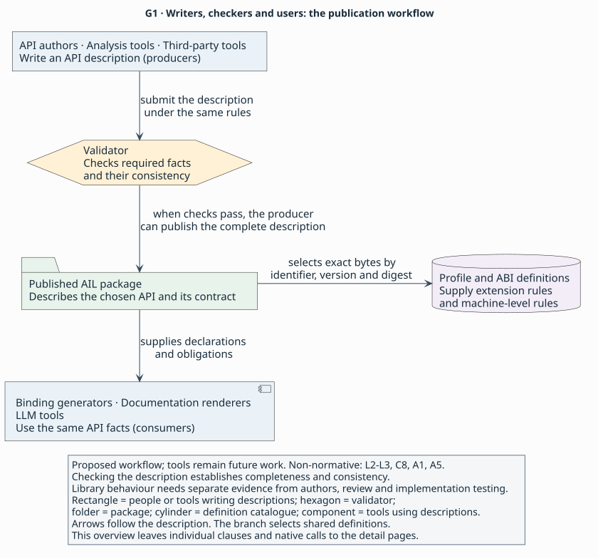

# Packages, environments and access paths

> **Purpose:** explanation — understand what a [package](../glossary.md#package) claims and how its operations reach code.
> **Reader:** language designers who have met [binding](../glossary.md#binding) obligations and AIL's contract [clauses](../glossary.md#clause).
> **Before this:** [What a signature leaves unsaid](unsaid.md) and [How AIL states a contract](contracts.md).
> **Status:** draft 0.1, a proposal under review; no parser, validator or implementation exists.
> **Rules:** [`L2–L5`](../language.md#l2) and [`A1–A5`](../profiles.md#a1) are canonical; this page gives non-normative explanations.

A [package](../glossary.md#package) brings a contract together with the scope
in which it holds and the definitions needed to interpret it. The examples here
use the synthetic fixture [profile](../glossary.md#profile) (a semantic extension,
not a preferences preset), catalogue and
[digest tokens](../glossary.md#digest-pin) from [`F1`](../profiles.md#f1).
They describe invented APIs, not real Objective-C or Swift implementations.

The context map shows why a package pins definitions and supplies one contract
to different consumers. Producers submit that contract for completeness and
consistency checks; this page zooms into the resulting package and its access
paths. The map omits individual clauses and native calls
([`L2–L3`](../language.md#l2), [`C8`](../contracts.md#c8),
[`A1`](../profiles.md#a1), [`A5`](../profiles.md#a5)).



[Context map source](../figures/g1-context.puml)

## Four identities

A binding consumer needs to identify both the operation it promises to callers
and the mechanism it uses to invoke that operation. Those names can differ.
In the synthetic [object example](../examples/objects.ail), `read_count` has a
message path named `objc_like` and a source-call path named `swift_like`.
Both implement the same getter. By comparison, the synthetic
[buffer example](../examples/buffers.ail) gives `view` one symbol path.

The getter separates four kinds of identity:

| Identity | What it identifies | Synthetic example |
|---|---|---|
| Semantic declaration | The operation or type in the contract | `example::objects`, version `1`, declaration `read_count` |
| [Source declaration](../glossary.md#source-identity) | A declaration as a source profile names it | `source(fixture, "Outer.Counter")` on `Counter` |
| [Access path](../glossary.md#access-path) | A named way to reach code, with its access identity | `objc_like` uses selector `currentCount`; `swift_like` uses source callable `Outer.Counter.currentCount.get` |
| [ABI](../glossary.md#abi) or profile selection | The versioned definition that interprets a path or source fact | `native` selects `example.fixture-abi` version `1`; `fixture` selects `example.fixture` version `1`, each with a synthetic digest token |

In summary (non-normative), [canonical declaration identity](../glossary.md#canonical-identity) is the package name,
package version and declaration name. A `source` clause records a
[source identity](../glossary.md#source-identity), interpreted by its profile.
An [access path](../glossary.md#access-path) supplies its own mechanism and
identity. A source spelling alone does not create a path
([`L2`](../language.md#l2), [`L5`](../language.md#l5), [`A2`](../profiles.md#a2)).

These distinctions let two access mechanisms implement one contract without
giving that contract two identities. AIL chooses explicit names over inferring
identity and dispatch from source spelling. The cost is more names to author
and relate. The synthetic getter illustrates the separation; its names do not
establish actual Swift or Objective-C support ([`F1`](../profiles.md#f1)).

## What a package claims

An API author may describe a small, usable portion of a larger API. That differs
from describing an operation while leaving its release protocol unstated.
The synthetic buffer package claims an immutable sixteen-byte store and its
complete lifetime API. The object package instead claims a reference-counted
object, a property and two faithful call paths. Each states its own
[surface](../glossary.md#surface), the subset and release it covers.

Fragment — omits the containing package, declarations,
[environment](../glossary.md#environment) and synthetic
fixture profile, catalogue and digest tokens; not a publishable package.

<!-- ail-example: ../examples/buffers.ail lines=3-4 -->
```ail
  surface("A synthetic immutable sixteen-byte store and its complete lifetime API.");
  exports([@Store, @create, @destroy, @view, @copy_bytes, @store_lifetime]);
```

In summary (non-normative), `surface` describes the coverage claim and
[`exports`](../glossary.md#exports) names the public roots. The
[dependency closure](../glossary.md#dependency-closure) includes the referenced
declarations and pinned dependencies needed to interpret and use those roots;
private support declarations remain authoritative. Following `view` reaches
`Store`, whose [lifecycle](../glossary.md#lifecycle) refers to `destroy`. Omitting that destructor is not
equivalent to excluding an unrelated API from the surface
([`L2–L3`](../language.md#l2), [`C2`](../contracts.md#c2)).

The publication unit is therefore a complete declared subset. A signature-only
extract is useful as a view, but does not become a complete package merely by
listing fewer exports. Compared with requiring an entire library at once, this
choice permits bounded publication; its cost is stating the boundary honestly
and retaining everything it depends on. [Validation](../glossary.md#validation) checks the declared scope,
not its truth against a library's implementation ([`L3`](../language.md#l3)).

The package diagram makes export membership distinct from dependency
membership: referenced private support remains authoritative without becoming
a public root. It also locates exact environments and the package, profile and
ABI pins explained below. This is a schematic structure, not an additional
fixture package; the frozen examples define their types locally, and `destroy`
is itself exported. The view omits individual declaration clauses.


[Package structure source](../figures/g2-package.puml)

## Where it holds

A contract can be established for one configuration without being established
for every later platform release. An [environment](../glossary.md#environment)
names an exact configuration. The synthetic buffer package declares a target
and platform; the object package also pins a toolchain because its source-call
path needs one.

Fragment — omits the containing synthetic buffer package and its other items;
not a publishable package.

<!-- ail-example: ../examples/buffers.ail lines=7-10 -->
```ail
  environment test {
    target("fixture64");
    platform("fixture", "1");
  }
```

Fragment — omits the containing synthetic object package and its other items;
not a publishable package.

<!-- ail-example: ../examples/objects.ail lines=7-11 -->
```ail
  environment test {
    target("fixture64");
    platform("fixture", "1");
    toolchain("fixture-compiler", "1");
  }
```

Both aliases happen to be `test`; they describe different configurations.
When resolving imports, configuration values determine the match, not alias
spelling. A declaration's [`available`](../glossary.md#availability) list names
the local environments where it is offered. Referenced declarations need to
be available wherever the referencing use is available. A changed signature
or contract needs distinct declarations with disjoint availability or distinct
identities ([`L3`](../language.md#l3)).

Exactness bounds the claim. An unlisted configuration is outside it, rather
than evidence of API absence. Version ranges are an alternative; draft 0.1
chooses exact values and incurs the cost of enumerating configurations. The
benefit is a stated set against which reference and access coverage can be
checked; no recorded evidence establishes that this scales to a large platform
matrix. Runtime support of an optional member is a separate receiver capability
question ([`L3`](../language.md#l3), [`C3`](../contracts.md#c3)).

## What it depends on

A consumer needs the same definitions the producer used. A package
[import](../glossary.md#import) brings
in declarations; a catalogue selection brings in rules for interpreting them.
For example, a constructed import of a separate store package could make its
`Store` type available as `StoreAPI::Store`. The existing synthetic examples
define their own types locally, but still select `fixture` and `native` with
`use profile` and `use abi` ([`L2`](../language.md#l2)).

In summary (non-normative), imports pin package name, version and digest and
introduce an alias. Catalogue selections pin identifier, version and digest.
Package digests identify exact document bytes; catalogue digests identify exact
provider manifest bytes. A [resolution set](../glossary.md#resolution-set)
explicitly supplies dependencies.
Validation neither fetches them nor executes provider code implicitly
([`L2`](../language.md#l2)).

The pin table separates an author's local alias from the identity and bytes
that every consumer resolves.

| Dependency | Identity selected | Bytes fixed by its digest |
|---|---|---|
| Imported package | Package name and version | Package document |
| Profile selection | Profile identifier and version | Profile provider manifest |
| ABI selection | ABI identifier and version | ABI provider manifest |

Compare two aliases for the same package name/version and digest with two
aliases that pin different digests for that name/version. Renaming the second
alias cannot repair the latter conflict: one identity needs one digest
throughout the full dependency closure. The same consistency rule applies
separately to profile and ABI identities, and imports form an acyclic graph
([`L2`](../language.md#l2); mutations N28–N29 in the
[conformance corpus](../conformance.md#rejection-mutations)).

AIL chooses exact pins and explicit resolution over implicit discovery of a
locally installed version. This makes dependency selection inspectable, at the
cost of preparing the complete resolution set and updating pins when bytes
change. A digest establishes byte identity, not trust in the author; installation
and trust remain tooling decisions ([`L2`](../language.md#l2)).

## Reaching the code

Knowing a contract does not tell a consumer how to call it. The synthetic getter
can receive an object message, or be called through source compilation. Its two
paths keep the same main-thread, [borrowed](../glossary.md#borrow)-receiver and
result obligations. Borrowing grants access without transferring ownership;
it does not imply Rust's static borrow checking.

Fragment — omits the containing `read_count` declaration, package and synthetic
fixture profile, catalogue and digest tokens; not a publishable package.

<!-- ail-example: ../examples/objects.ail lines=44-55 -->
```ail
    access objc_like in [test] {
      abi(native, "object-message");
      via(fixture, "message", "currentCount");
      mapping(identity);
      compatibility(stable);
    }
    access swift_like in [test] {
      abi(native, "source");
      via(fixture, "source-call", "Outer.Counter.currentCount.get");
      mapping(identity);
      compatibility(source, "fixture-build");
    }
```

In summary (non-normative), each access path supplies four facts
([`A2`](../profiles.md#a2), [`A4`](../profiles.md#a4)):

| Clause | Question answered | Difference between these paths |
|---|---|---|
| `abi` | Which [ABI entry](../glossary.md#abi-entry) and [calling convention](../glossary.md#calling-convention) govern the call? | `object-message` versus `source`, within the synthetic `native` entry |
| `via` | Which profile mechanism and identity reach the code? | An exact selector versus a source callable spelling |
| `mapping` | How does the semantic signature become that call? | Both use the [provider](../glossary.md#provider)'s faithful identity [mapping](../glossary.md#mapping); message dispatch makes the receiver implicit |
| `compatibility` | In which [compatibility domain](../glossary.md#compatibility-domain) can the [representation](../glossary.md#representation) be used? | The synthetic ABI's stable domain versus the pinned `fixture-build` source recipe |

A [mapping](../glossary.md#mapping) accounts for parameters, results, auxiliary
native arguments and [completion](../glossary.md#completion) modes exactly once. `identity` relies on a
total, faithful provider-defined lowering; it does not promise identical
physical argument lists. Moving a receiver into implicit dispatch preserves
the semantic operation. Hiding an observable success status would change the
operation and needs a different declaration ([`A2`](../profiles.md#a2)).

Path order supplies no preference. A consumer chooses explicitly or uses a
configuration policy, and every chosen path implements the whole contract.
Every available environment needs at least one path. Compared with a single
inferred route, this requires a choice or configuration policy from the consumer,
but lets it use alternatives ([`A2`](../profiles.md#a2)).

Compatibility is similarly specific. `stable` refers to the ABI entry's
guaranteed domain. `artifact` instead refers to a resolved built artifact set;
a compiler version alone is insufficient. `source` names a fully specified
recipe pinning source dependencies, compiler, options, interfaces and the build
procedure. A source compiler can establish compatibility for that build without
promising independent binary interoperability ([`A4`](../profiles.md#a4)).

The access diagram shows two alternatives converging on the same synthetic
ABI entry while choosing different conventions. Both use the synthetic
fixture profile and identity mapping, and both implement the whole getter
contract. Their `test` environment is `fixture64`, platform `fixture` version
`1`, with `fixture-compiler` version `1`; their catalogue selections use the
synthetic digest tokens described below. This view zooms into access selection
and omits native calling algorithms. Arrow order is not a selection policy.


[Access structure source](../figures/g3-access.puml)

Data access also needs a mechanism: `fixed_bytes` obtains the address of array
storage, while `pointer_value` loads the pointer held in a variable. Their
`ptr<u8>` types alone cannot choose between those operations
([`A3`](../profiles.md#a3), [`F1`](../profiles.md#f1);
[object example](../examples/objects.ail)).

The data comparison shows why the same result type cannot select an access
mechanism on its own.

| Synthetic declaration | Access obtains | Result type |
|---|---|---|
| `fixed_bytes` | The address of array storage | `ptr<u8>` |
| `pointer_value` | The pointer loaded from a variable | `ptr<u8>` |

## Profiles and ABI entries

A [provider](../glossary.md#provider) supplies definitions and the tooling
support needed to interpret or realize them. A profile is a semantic extension,
not a preferences preset. Compare the synthetic profile, which defines
`message` and `source-call`, with the synthetic ABI entry, which supplies their
conventions and representations. Selecting a convention alone leaves layout
and runtime requirements unanswered ([`A1`](../profiles.md#a1),
[`F1`](../profiles.md#f1)).

In summary (non-normative), a profile manifest names its identifier, version and
supported language versions. It defines its vocabulary's types,
arity, scope, applicability, defaults if any, conflicts and companion clauses.
It also defines source and environment interpretation, obligations, validation,
dependencies, access mappings, representation requirements, a canonical machine
view and lossless printing rules. An ABI manifest defines accepted environments,
type and call lowering, aggregate layout, [callback](../glossary.md#callback) entry, runtime prerequisites
and compatibility conditions ([`A1`](../profiles.md#a1)).

The package references these definitions. It does not implement register or
stack algorithms. A record's field order is a semantic fact; native size,
alignment and offsets need a complete [representation](../glossary.md#representation) recipe for the selected
boundary. Conflicting recipes or no applicable recipe fail validation
([`A1`](../profiles.md#a1), [`A3`](../profiles.md#a3)).

The alternative is to put every runtime mechanism in the core. Profiles keep
those definitions separate, at the cost of additional dependencies and uneven
consumer support. A consumer identifies unsupported dependencies before claiming
complete validation. A syntax reader may preserve unsupported text without
calling it a validated authoritative model ([`A1`](../profiles.md#a1)).

## The synthetic fixture

The examples need a concrete interpretation so that their contracts can be
inspected. [`F1`](../profiles.md#f1) defines a synthetic fixture profile and ABI
catalogue for that purpose. Compare its synchronous symbol call in `view` with
its source-build getter in `read_count`: both have defined mechanisms. Merely
changing a fixture call to `execution(async)` needs additional semantics that
this synthetic profile does not supply ([`C3`](../contracts.md#c3),
[`F1`](../profiles.md#f1); mutation N30).

The synthetic fixture supports `fixture64`, platform `fixture` version `1`,
and optionally `fixture-compiler` version `1`. Its pointers, [handles](../glossary.md#handle) and object
references are 64 bits; these facts describe an abstract test provider, not the
host machine. Its callback representation supports [retention](../glossary.md#retention) without a separately
visible context argument. Owner-scoped callbacks may start after registration
returns even though callable entry itself is synchronous
([`F1`](../profiles.md#f1), [`C6`](../contracts.md#c6)).

The synthetic digest tokens are `sha256:` followed by 64 `a` digits for the
profile and 64 `b` digits for the ABI. They are test resolution tokens, not
hashes of these Markdown files. Outside fixture mode, ordinary digest resolution
rejects them unless real manifests happen to hash to them; fixture mode cannot
publish production packages ([`L2`](../language.md#l2), [`F1`](../profiles.md#f1)).

Using a synthetic catalogue instead of a production provider isolates the
contract examples, at the cost of demonstrating no real platform interoperability.
The [conformance record](../conformance.md#verification-record) reports historical
static checks; it supplies no runnable native implementation.

## One contract, several views

A documentation reader and a machine consumer need different presentations of
the same facts. For the synthetic `view`, prose can say that the caller borrows
sixteen bytes while keeping the store alive. A machine view can instead expose
`owner: "store"` alongside length, transfer and invalidator fields. The
[two-view example](../conformance.md#two-views-of-one-contract) shows both and
keeps a reference to the complete declaration.

In summary (non-normative), a [projection](../glossary.md#projection) retains
access to the full contract: identity, types, access alternatives, pins,
[availability](../glossary.md#availability), [outcomes](../glossary.md#outcome), callback schedules and other obligations. An excerpt
does not become an authoritative package by changing its format. A scoped
target-language wrapper may add restrictions, but labels them as its own and
preserves the original contract in its view ([`A5`](../profiles.md#a5),
[`C8`](../contracts.md#c8)).

Compare reordering declarations with reordering parameters. Semantic equality
ignores the first but preserves the second; it also preserves meaningful list
order, pins and outcome partitions. Comments and navigation are outside semantic
equality but still survive an authoring round trip. The draft does not define
a canonical byte serialization ([`A5`](../profiles.md#a5);
[round-trip obligations](../conformance.md#parser-validator-and-round-trip-obligations)).

One authority avoids separately maintained binding and prose contracts, at the
cost of retaining connections from each convenient view to the complete facts.
Validation remains consumer-independent. A binding generator may still refuse a
valid package when it cannot preserve the contract for its selected target,
environment and path; that limitation is distinct from invalid AIL
([`A5`](../profiles.md#a5)).

Next: [Design choices, limits and open questions](choices.md).
Then write a complete package in [Describing a small API](../tutorial/README.md).
Return to [How AIL states a contract](contracts.md) for semantic obligations,
or [the overview](../README.md) for the document map.
