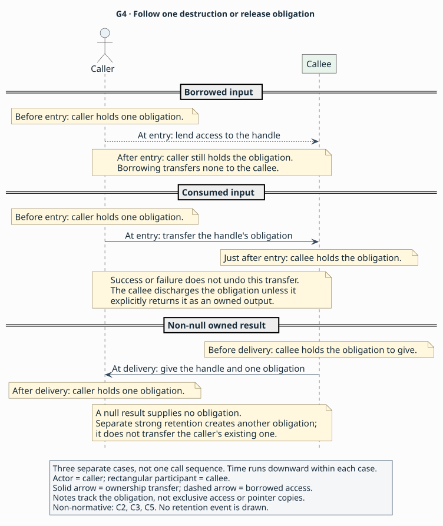

<a id="what-a-signature-leaves-unsaid"></a>

# Using an API across languages

> **Purpose:** explanation — understand the conditions for using an API correctly from another language.
> **Reader:** language designers who can read C, but are new to API binding.
> **Before this:** nothing; [the overview](../README.md) introduces AIL's purpose.
> **Status:** Draft 0.1 is a proposal under review through its specification
> and synthetic examples. Parser, validator and implementation development
> are future work.
> **Rules:** [`C1–C6`](../contracts.md#c1) define the obligations below; [`A1–A5`](../profiles.md#a1) define access and consumer agreement.

Suppose a program uses a C library from another language. Code between the
program and the library arranges calls, passes values and presents the results
in a form the program can use. That code is an
[API binding](../glossary.md#binding). It uses a
[foreign-function interface (FFI)](../glossary.md#ffi) to make calls and represent
arguments across the language boundary.

The binding also needs to respect the library's rules. If the library lends
some bytes until an object is destroyed, the program can read those bytes only
while that object keeps them alive. The rules describing what callers provide
and what the implementation promises form the
[binding contract](../glossary.md#binding-contract). The following invented API
shows how those rules affect ordinary calls.

## A small API

**Synthetic C header fragment — an invented watch API for discussing possible
contracts.** The declarations provide the types and operations; each section
then considers alternative promises an implementation could make.

```c
#include <stddef.h>

typedef struct Watch Watch;
typedef void (*Notice)(void *context, unsigned event);

Watch *watch_open(Notice notice, void *context);
const unsigned char *watch_view(Watch *watch, size_t *length);
void watch_close(Watch *watch);
```

Here is the intended use of these names. The program calls `watch_open` to
start observing something and supplies `notice`, a function to receive events.
On a successful open, the returned `Watch *` identifies the watch in later
calls. Such a value is a [handle](../glossary.md#handle): the program passes it
back to the library to work with an entity whose internal layout is hidden.

The program calls `watch_view` to get a pointer to bytes associated with the
watch. It also passes the address of a `size_t` variable where the library can
write the length. The pointer provides a *view* of the bytes. Finally, the
program calls `watch_close` to end the watch. For each of these calls the
program is the [caller](../glossary.md#caller-and-callee), and the library
function is the callee.

When an event occurs, the library invokes `notice`. A function supplied for the
API to invoke is a [callback](../glossary.md#callback). For that invocation,
the library becomes the caller. It passes an event number and the supplied
`context` pointer, which can identify the program state that should receive the
notification.

In `watch_view`, `length` is the pointer argument supplied by the caller.
The C expression `*length` refers to the `size_t` storage at that address,
where the library can write a count. Later sections compare what callers may
read from that storage on success and failure.

These values need to remain usable for different amounts of time. The watch
can be live or destroyed. The bytes can be readable or already replaced. A
notification can be waiting, running or finished. The following sections
compare contracts that relate these states. They are alternative cases to
reason about, rather than one complete implementation of this header.

<a id="what-the-header-does-not-say"></a>

## The caller's and implementer's obligations

### Who is responsible for releasing a value?

Suppose a successful `watch_open` returns a new watch that the caller eventually
closes. Compare that with a function lending an existing watch which somebody
else will close. The returned pointer could look identical in both cases. If
the binding never closes a watch it owns, it leaks the resource; if it closes a
watch it was only lent, it can leave the actual owner using a destroyed watch
or attempting a second destruction.

The first result is [owned](../glossary.md#owned): it comes with a responsibility
to release it according to the API's rules. The second is a
[borrow](../glossary.md#borrow): the recipient may use it for a stated period,
while the existing owner keeps the release responsibility. AIL's borrow
describes that agreement; it implies no Rust-style exclusivity or static borrow
checking. Moving that responsibility from one party to another is
[ownership transfer](../glossary.md#ownership-transfer).

For a newly created watch, successful `watch_open` would give that responsibility
to the caller. A `watch_view` that only uses the watch during the call would
borrow it, leaving the caller responsible for closing it. A `watch_close` that
takes over and discharges the obligation would
[consume](../glossary.md#consume) its argument. After passing ownership to
`watch_close`, the caller has no second close to perform. AIL's general
consumption rule transfers responsibility at entry, including when a consuming
operation later reports failure. The callee then discharges the obligation
unless it explicitly returns it as an owned output ([`C3`](../contracts.md#c3)).

Use the figure to identify who closes the watch in three separate cases:
`watch_view` borrows it, `watch_close` consumes it, and `watch_open` returns a
new owned watch. Time runs downward within each case. A non-null
owned result gives the caller one obligation; null gives none. The cases
illustrate possible contracts for discussion (non-normative;
[`C2`](../contracts.md#c2), [`C3`](../contracts.md#c3), [`C5`](../contracts.md#c5)).



[Diagram source](../figures/g4-ownership.puml) ·
[How tools use these API facts](../README.md#who-writes-and-uses-an-ail-description)

AIL records the type's release discipline and each operation's transfers
separately. For a unique resource, the owner performs one destruction. For a
reference-counted object, several parties may each own a reference to the same
object; each party releases its own reference. Thus *owned* describes an
obligation, while exclusive access depends on other rules.

The callee might also [retain](../glossary.md#retention) a separate reference
for later use. With strong retention, it acquires its own release obligation
while the caller keeps the original one. This is a different arrangement from
consuming the caller's reference. These are non-normative summaries of
[`C2`](../contracts.md#c2), [`C3`](../contracts.md#c3) and
[`C5`](../contracts.md#c5).

### How long can the caller use a view?

Suppose `watch_view` lends bytes from its watch. In one contract the bytes remain
usable until the watch is destroyed. In another, the next call to `watch_view`
refreshes internal storage and invalidates the previous view, even though the
watch is still alive. In the first case the caller keeps the watch alive while
reading its bytes. In the refresh case, a binding also needs to prevent use of
an older view after the next refresh starts. A target-language object can still
hold the old address after the library has freed or repurposed that storage.

[Borrow validity](../glossary.md#borrow-validity) says how long borrowed access
is usable. A [region](../glossary.md#region) names the lifetime that bounds it,
such as the watch's lifetime. An operation that ends that usability earlier
causes [invalidation](../glossary.md#invalidation). The pointer can remain
non-null and have the same C type after invalidation; the contract tells the
binding when access ends.

In AIL, an input used only during a call can have the call as its region.
A returned view needs a region that survives the return so the caller can use
it: either a named owner's lifetime or the loaded API instance's lifetime.
Each returned borrow also lists its earlier invalidating operations, with an
empty list when there are none. For the refresh case, invalidation happens
when the listed operation begins, and that operation states the corresponding
mutation. These are non-normative summaries of
[`C1`](../contracts.md#c1) and [`C5`](../contracts.md#c5).

Compare when the caller stops reading the old view under these two possible
contracts. Keeping the watch alive is enough only in the first case.

| Possible `watch_view` contract | When the old view stops being usable | What the caller arranges |
|---|---|---|
| Bytes last until watch destruction | When the watch is destroyed | Finish reading before closing the watch |
| A later `watch_view` refreshes the bytes | At entry to that refresh, or at watch destruction, whichever comes first | Finish reading before either event |

### How many bytes exist, and what do they contain?

Suppose a successful view reports a length of three. Three initialized binary
bytes can occupy exactly three bytes of storage. A three-code-unit,
zero-terminated string needs room for a fourth code unit, its terminator. Reading
until zero in the binary case can overrun the allocation. Treating string
capacity as its text length can expose bytes that are not part of the text.

The following cases compare the readable payload with the required storage.
The extra zero belongs to the text's storage, while its reported length counts
the preceding code units.

| Possible contract | Reported length | Minimum storage for this case | Readable payload |
|---|---|---|---|
| Binary bytes | 3 bytes | 3 bytes | All 3 bytes, even if one is zero |
| Zero-terminated text | 3 code units | 4 code units, including the terminator | The 3 code units before the terminator |

[Buffer extent](../glossary.md#buffer-extent) distinguishes readable initialized
length from allocated capacity, and names the units. [Contents](../glossary.md#contents)
distinguish binary data from text with an encoding and a termination convention.
For `watch_view`, the caller uses the reported length to decide how much it may
read, then interprets those elements according to the contents contract.

AIL's core buffer contract records both length and capacity in stated units.
For zero-terminated text, length excludes the final zero code unit and capacity
includes it. Some APIs instead supply a pointer whose bound can only be found
by scanning for a terminator. Describing that case requires an extension with
its own rules, called a [profile](../glossary.md#profile). The profile defines
the scanned-buffer contract. Separately, the caller supplies writable storage
for the `length` variable itself, and keeps that storage usable during the call.
These are non-normative summaries of
[`C3`](../contracts.md#c3) and [`C4`](../contracts.md#c4).

### What can the caller read when a call fails?

Suppose `watch_view` returns null on failure. One contract could promise that it
also writes zero to `*length`; another could leave that storage uninitialized.
A binding can read the length on the first failure path because the library
has written a usable value there. On the second path it has to leave the length
unread. Reading uninitialized output can make the binding treat arbitrary data
as a byte count.

The same null failure result permits different reads depending on the output
promise. Use this comparison to separate the failure signal from output validity.

| Possible failure contract | Returned pointer | What the caller may read from `*length` |
|---|---|---|
| Library writes zero | Null | The initialized value zero |
| Library leaves the output uninitialized | Null | Nothing; the caller leaves it unread |

An [outcome](../glossary.md#outcome) identifies a case that the caller can
distinguish when the call finishes, explains its meaning, and describes its
outputs. In the example above, null signals failure. Another API might use null
for a successful “no value” answer. The author therefore records both the test
that identifies the case and what that case means.

AIL distinguishes ways a call finishes, such as returning or throwing, as
[completions](../glossary.md#completion). For each completion, its outcomes
cover every possibility exactly once. The caller can inspect a valid output,
including a valid null result. An invalid output remains unreadable, even for a
null test. A binding preserves the way the API reports failure. If the API
returns a status code, the binding exposes that code; an operation that reports
failure differently needs a separate description. These are non-normative summaries of
[`C3`](../contracts.md#c3) and [`C5`](../contracts.md#c5).

### Which calls may run together, and where?

Suppose a watch accepts calls on any thread, provided callers serialize access.
Compare a watch whose calls are restricted to the main thread. For the first,
the caller can use a lock to keep calls from overlapping. For the second, it
also needs to arrange entry on the main thread. These are two separate
conditions: where a call may start and whether independent calls may overlap.

An [executor](../glossary.md#executor) identifies where execution is allowed;
[concurrency](../glossary.md#concurrency) describes independent overlap.
[Re-entrancy](../glossary.md#re-entrancy) concerns calls nested inside an active
call. Suppose an operation on an existing watch invokes `notice` before that
operation finishes, and the callback uses its context to call `watch_view` on
the same watch. The second call enters while the first is still active. An API
that permits this has to support that nested use; an API that forbids it requires
the callback to arrange any further call after the outer call has finished.
Entering anyway can expose partially updated state or deadlock on a lock held
by the outer call.

The binding needs an answer to each question:

| Contract dimension | Question the binding needs answered |
|---|---|
| Entry executor | Where may the caller enter the operation? |
| Concurrency | May independent calls overlap? |
| Re-entrancy | May a nested call enter on the same receiver or resource while an earlier call is active? |

AIL also records rules that belong to a type. A
[shared](../glossary.md#shared) reference may cross executors, so different
execution contexts can hold references to the same entity. Its operations still
say whether calls can overlap. A confined type instead restricts use to its
stated executor; that restriction is its
[isolation](../glossary.md#isolation). Each callable then states its own entry,
overlap and nested-call rules, and callback registrations state when callbacks
can run. These are non-normative summaries of [`C2`](../contracts.md#c2),
[`C3`](../contracts.md#c3) and [`C6`](../contracts.md#c6).

### When is it safe to discard callback state?

Suppose all notifications finish before `watch_open` returns. The caller could
then use temporary context storage. Compare a watch that stores `notice` and
`context` and delivers notifications later. In that case the caller keeps the
context alive after return so later invocations can use it. Discarding it early
leaves a later callback with a dangling pointer.

Now compare two teardown promises: one requests that delivery stop; the other
returns only when no callback is running or can start. The second establishes
[quiescence](../glossary.md#quiescence): every invocation has finished and further
invocations are prevented. The caller can then release state kept alive for
those callbacks. Under the first promise, it needs a separate indication that
invocations have finished. If a callback itself calls a teardown operation that
waits for that callback to finish, each waits for the other and teardown can
deadlock.

[Callback captures](../glossary.md#callback-captures) are the state a callback
needs, here reachable through `context`. The normative rules also call this a
callback's “closure”. Each invocation needs that state to remain usable, whether
it runs during registration or later.

The schedule also tells the caller how many notifications may occur. One
registration could promise one invocation before its scope ends; another could
permit any number, including zero. Both could start notifications after
registration returns. Count, start timing, executor, permitted overlap and
teardown therefore each need an answer. Counts apply if the registration's
scope eventually ends; they supply no deadline or promise that it will end
([`C6`](../contracts.md#c6)).

In summary (non-normative): AIL describes a callback type separately from the
schedule of each registration. The type describes one invocation; the
registration says when those invocations can occur. The core supports two
lifetime arrangements. In the first, all invocations finish within the
registration call. In the second, registration returns a unique owner, such as
the watch, and its destructor establishes quiescence before returning
([`C2`](../contracts.md#c2), [`C6`](../contracts.md#c6)).

When the destructor waits for callbacks to finish, the caller invokes it from
outside those callbacks. A profile can instead define a protocol that permits
teardown from a callback without deadlocking. Cancellation with a separate
acknowledgement also needs a profile: its rules specify the events and their
ordering, so the caller can identify when state is safe to release
([`C6`](../contracts.md#c6)).

These possible contracts place the last use of callback state at different
events. Use the table to decide which event the caller needs to wait for before
releasing state kept alive for notifications.

| Possible notification contract | Event after which callback state is no longer needed |
|---|---|
| All invocations finish within `watch_open` | Return from `watch_open` |
| Notifications continue until quiescent watch destruction | Return from the destructor, with no invocation running or able to start |
| Cancellation only requests a stop | A separate acknowledgement establishing quiescence, under a profile that defines that protocol |

<a id="why-the-signature-cannot-be-the-contract"></a>

## A shared description for API tools

Suppose the API author establishes that `watch_view` lends bytes until the
watch is closed, with no earlier refresh that invalidates them. A binding
generator could use that information to ensure a view keeps access to a live
watch for as long as the program can read it. A documentation renderer could
explain the permitted sequence: open, obtain and read a view, finish using it,
then close. An LLM tool helping with the same API could use that sequence when
suggesting code. All three tools need the same lifetime fact, alongside the
function signature.

AIL puts those facts in a [package](../glossary.md#package). The author states
which API operations it covers — its [surface](../glossary.md#surface) — and
supplies their contracts. A package covering these watch operations also needs
the `Watch` and `Notice` declarations, the types used by those declarations,
and any definitions they depend on in turn. That complete set of dependencies
is the [dependency closure](../glossary.md#dependency-closure).

A proposed validator would check that the package names existing declarations,
supplies each applicable fact and contains compatible statements. For example,
it would check that a borrow's named owner is a suitable non-null resource or
object, valid on the relevant outcome. This is
[validation](../glossary.md#validation). Demonstrating that a library really
keeps its bytes alive for the stated time requires separate implementation
evidence. These are non-normative summaries of [`C1`](../contracts.md#c1),
[`L2–L3`](../language.md#l2) and [`C8`](../contracts.md#c8).

The [overview's workflow and map](../README.md#who-writes-and-uses-an-ail-description)
show how people and analysis tools would produce packages for these consumers.
All producers meet the same completeness requirements. This choice makes
authoring demanding: the producer has to settle a required lifetime fact before
publishing the description. The [design discussion](choices.md) examines that
cost.

## Reaching the code

A binding also needs a way to reach the implementation. For a C function, it
might locate a named linker symbol and call the function at that address. For
an object method, it might ask the runtime to send a message to a receiver.
When the API is available only through source code, a compiler might build a
small piece of code that makes the call. An
[access path](../glossary.md#access-path) records which mechanism to use, how it
identifies the operation, and the conditions under which it works. The API's
source name and the mechanism for calling it are recorded separately
([`A2`](../profiles.md#a2)).

The [application binary interface (ABI)](../glossary.md#abi) governs how values
and calls cross the machine boundary: how values are represented and laid out,
how arguments and results are passed, and which runtime facilities are needed.
A [calling convention](../glossary.md#calling-convention) specifies the protocol
for entering a callable and passing arguments and results within that larger
definition. If caller and callee agree on argument passing but disagree on where
a record's fields are stored, the callee can still read the wrong data
([`A1`](../profiles.md#a1), [`A3`](../profiles.md#a3)).

AIL packages select definitions of those mechanics that tools can share. An
[ABI entry](../glossary.md#abi-entry) defines the
[representations](../glossary.md#representation) and calling conventions.
A profile can define an additional type or access mechanism and the rules for using it.
A [provider](../glossary.md#provider) supplies a manifest describing such a
definition and tooling that interprets or implements it. A package selects the
definition by identifier, version and a [digest pin](../glossary.md#digest-pin)
for its exact contents, allowing consumers to agree on which rules to apply.

For access through a call built by a source compiler, the profile names a build
recipe with the sources, compiler and options needed to build the call.
Compatibility is then established for that build. For binary access that remains compatible across independent
builds, the provider needs to guarantee compatible representations and runtime
requirements. These are non-normative summaries of [`A1`](../profiles.md#a1)
and [`A4`](../profiles.md#a4).

For this header, a [mapping](../glossary.md#mapping) would need to account for
both the callback and its context argument: the consumer needs to know how the
callback reaches the right program state when invoked. This remains an
illustration of a mapping requirement, with no complete mapping supplied for
this C header. The existing [synthetic callback example](../examples/callbacks.ail)
uses a synthetic fixture profile, catalogue and digest tokens whose callback
representation has no separately visible context argument. It describes a
different API ([`A2`](../profiles.md#a2), [`F1`](../profiles.md#f1)).

Tools can present one contract in several forms. A documentation page might
explain a lifetime in prose; a typed object model might expose the owner and
invalidators as fields. Each is a [projection](../glossary.md#projection) of the
contract, retaining access to the same facts. A convenience operation that
hides a meaningful success status changes what callers can observe; the producer
describes it with a distinct declaration. A valid package can also exceed a
particular binding generator's capabilities. That generator reports its own
limitation separately from the package's validity (non-normative;
[`A2`](../profiles.md#a2), [`A5`](../profiles.md#a5)).

<a id="what-your-language-design-knowledge-covers-and-where-it-misleads"></a>

## Reading AIL's terms

Your knowledge of types and notation helps you judge how AIL expresses these
distinctions. Some terms also have familiar meanings in other languages. The
following non-normative examples show how to read them here; the linked rules
supply the exact requirements.

**Borrow, owned and consume describe release responsibilities.** A call that
borrows the watch leaves its owner responsible for closing it. An owned result
gives the caller an obligation, and a consuming call takes that obligation at
entry, on failure as well as success. Borrowing in AIL does not imply Rust's
static checking or exclusivity. An owned reference can refer to an object that
other parties also own references to
([`C1–C3`](../contracts.md#c1), [`C5`](../contracts.md#c5)).

**Shared describes where references may go.** References to a shared watch
could pass between executors; its operations would still govern overlapping
calls. The caller follows both rules, for example by serializing access after
moving a reference to another thread. Safe concurrent mutation requires the
operation's permission ([`C2–C3`](../contracts.md#c2)).

**[Copy](../glossary.md#copy) describes an independent semantic value.** Under
a profile that defines copy retention, a callee could keep a copy of supplied state rather than another
reference to the original state. The profile defines what that copy means.
Copying pointer bits merely gives another copy of the same address; strong
retention keeps another reference to the same entity. AIL's term also differs
from Rust's `Copy` trait. The synthetic fixture profile used by the examples
does not support copy retention ([`C3`](../contracts.md#c3), [`F1`](../profiles.md#f1)).

**A profile defines a language extension.** For example, a profile can define
how a message selector identifies an object method, including the rules a tool
checks before using that access path. This is a versioned semantic definition,
rather than the preferences preset or performance measurement the word can
mean elsewhere ([`A1`](../profiles.md#a1)).

**Dependency closure and callback captures name different things.** To interpret
the watch package, a tool follows all its referenced declarations and pinned
definitions; that set is the dependency closure. To invoke `notice`, the
library needs the callback's saved program state; those values are callback
captures. The normative text uses “closure” for both, so these explanations
qualify the word ([`L2–L3`](../language.md#l2), [`C2`](../contracts.md#c2)).

## Where next

Continue to [How AIL states a contract](contracts.md) to see these obligations
in AIL, using the [glossary](../glossary.md) for terms. For exact obligations,
see [the memory and behavioural rules](../contracts.md).

To see which package or function each name belongs to before reading a rule, use the
[package shell](../language.md#l1) and
[two-package language model](../language.md#l2). Those examples introduce
declarations, imports, member functions and their parameters and results.
They describe a separate invented canvas API; the watch header here remains
an illustration of possible domain contracts.

Continue through [Packages, environments and access paths](packages.md) and
[Design choices, limits and open questions](choices.md) after the contract page.
Then try [Describing a small API](../tutorial/README.md) to write a contract in steps.
Return to [the overview](../README.md) for the full document map.
