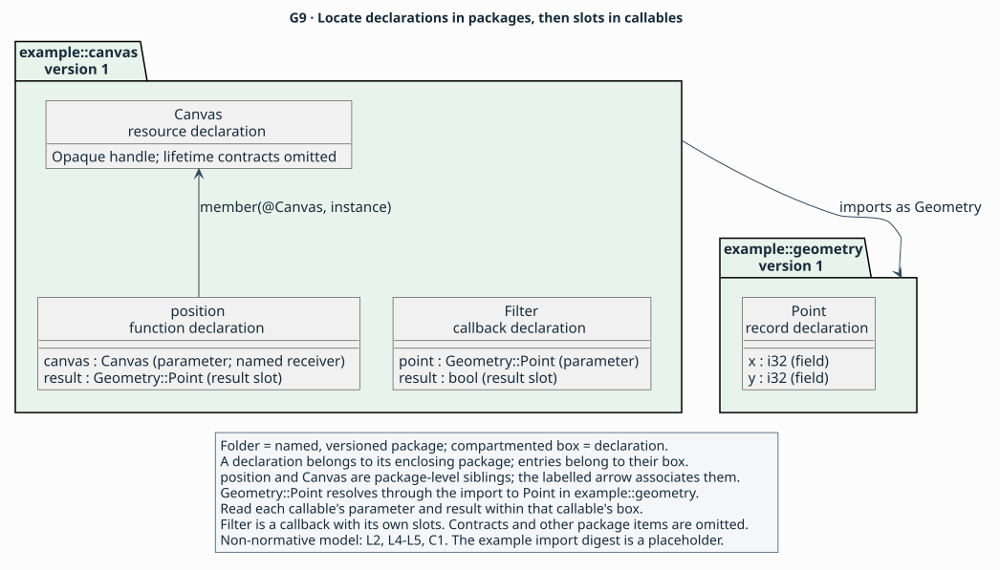

# Language and publication rules

<!-- reading-aid: page-context -->
> **Purpose:** rules with reading aids — follow AIL's notation, identities and publication requirements.
> **Reader:** language designers reading the proposal, and API authors or tool implementers checking exact rules.
> **Before this:** [A model of API behaviour and binding obligations](explanation/model.md); [Using an API across languages](explanation/unsaid.md) introduces the binding domain.
> **Status:** Draft 0.1 is a proposal under review through its specification
> and synthetic examples. Parser, validator and implementation development
> are future work.
> **Rules:** [L1](#l1), [L2](#l2), [L3](#l3), [L4](#l4), [L5](#l5) and [L6](#l6) below, together with the [grammar](grammar.ebnf), are canonical.

Each bordered **Reading aid (non-normative)** explains an example. The rule
text outside the border states the requirements. The examples describe
invented APIs. Fragments show selected facts and name their missing context;
[conformance examples](conformance.md#positive-specifications) supply complete
contracts within the synthetic fixture's scope. For a progressive exercise,
start with the [tutorial](tutorial/README.md).
<!-- /reading-aid -->

Normative draft 0.1. **MUST**, **MUST NOT**, **SHOULD** and **MAY** express
requirements, prohibitions, recommendations and permissions in this draft.
Rules have stable identifiers for diagnostics; wording can change during review.

<a id="l1"></a>

## L1. Text and syntax

<!-- reading-aid: l1-shell -->
<blockquote>

<a id="reading-aid-non-normative-a-document-contains-a-package"></a>

**Reading aid (non-normative): a document contains a package**

L1 connects [The published description](explanation/model.md#description)
to [Writers, checkers and users](explanation/model.md#agreement): the document
identifies an API account and the language rules used to interpret it.

An AIL document describes an API through a named, versioned
[package](glossary.md#package). In this fragment, `example::geometry` is the
package name and `"1"` is its version. Inside the package, `record Point`
introduces a declaration with two fields. `surface(...)` and `exports(...)`
are [clauses](glossary.md#clause): they state facts about that package.
The `language` header selects the AIL version; the package version identifies
the API description independently ([L1](#l1), [L2](#l2)).

Fragment — shows the document shell and a record. A complete package also
supplies an environment, availability, deprecation, sharing and isolation.

<!-- ail-example: examples/rule-reading/syntax.ail region=shell -->
```ail
language "0.1";
package example::geometry version "1" {
  surface("An invented point API, release 1.");
  exports([@Point]);
  record Point {
    field x: i32;
    field y: i32;
    // Environment, availability and nominal contracts omitted.
  }
}
```

`exports([@Point])` makes `Point` a public root of the description. The fields
belong to that record; the publication clauses describe the package that
contains it. [L2](#l2) explains how `@Point` identifies the declaration, and
[L3](#l3) explains the completeness claim made by exporting it.

A package can also contain imports, provider dependencies and environments.
The [package-shell grammar](reference/notation.md#shell) locates these items;
the [clause grammar](reference/notation.md#clause) gives their common fact syntax.
L3 determines which facts a complete description needs, even where the grammar
admits a document without them.

</blockquote>
<!-- /reading-aid -->

A document MUST be valid UTF-8 without a byte-order mark. Identifiers contain
ASCII letters, digits and underscores, begin with a letter or underscore, and
are case-sensitive. Integers are decimal, have arbitrary mathematical precision
while parsing, and have no leading zero except `0`; `-0` is forbidden. A string
uses JSON double-quoted string syntax, including escapes; lone surrogate escapes
are invalid. Strings retain their decoded Unicode sequence without normalization.
Whitespace is space, tab, CR or LF. `//` comments end at a line break or EOF;
`/* ... */` comments do not nest. Comments have no semantics. Tokens use longest
match. Punctuation in [the grammar](grammar.ebnf) is literal.

<!-- reading-aid: l1-tokens -->
<blockquote>

<a id="reading-aid-non-normative-read-tokens-before-their-meaning"></a>

**Reading aid (non-normative): read tokens before their meaning**

In the shell, `Point` and `point` would be different identifiers; `point_2`
is also an identifier, while `2point` cannot be one. The integer spellings `0`
and `-12` follow [L1](#l1); `01` and `-0` violate it. The dots in a version
such as `"1.2"` belong to a string, whose contents L2 treats as opaque.
A string such as `"line\nnext"` contains a decoded newline; its escape is
not an instruction to evaluate an expression.

The `//` line in the shell is a comment, as would be `/* field description */`.
It explains an omission to the reader and supplies no contract. By contrast,
`true` and `false` are Boolean values: they cannot be used as declaration names.
A contextual keyword such as `record` can still be a name where the grammar
expects an identifier, subject to L2's reserved core type names.

</blockquote>
<!-- /reading-aid -->

Grammar keywords are contextual: their production determines their meaning;
the same spelling may name a clause or a declaration where a name is expected.
`true` and `false` are Boolean tokens, never identifiers. A constructor and bare name in a
value are distinguished by the following `(`. No evaluation, interpolation,
conditional compilation, includes or executable annotations occur during parsing.

<!-- reading-aid: l1-clauses -->
<blockquote>

<a id="reading-aid-non-normative-clauses-contain-values"></a>

**Reading aid (non-normative): clauses contain values**

A clause records a fact about its containing subject. Here `deprecated`
describes `Point`, `since("2")` records when deprecation began, and the message
guides readers toward an alternative. This is advisory information in
[The published description](explanation/model.md#description); availability
separately determines where `Point` is offered ([L1](#l1), [L5](#l5)).

Fragment — shows a deprecation clause in a record. The header, package context,
fields and other nominal contracts are omitted. The message is illustrative;
it does not resolve or import a declaration named `Position`.

<!-- ail-example: examples/rule-reading/syntax.ail region=clause -->
```ail
package example::geometry version "2" {
  record Point {
    deprecated(since("2"), "Use Position instead.");
    // Header, package context, fields and nominal contracts omitted.
  }
}
```

Compare `deprecated(no);`, which states that the declaration is not deprecated.
L5 defines both alternatives. A made-up `deprecated(maybe);` has the generic
clause shape but fails L1's closed vocabulary: it supplies no recognized
deprecation fact. Parsing is only the first part of checking a description.

The values also have different jobs: `since("2")` supplies a version to the
deprecation fact, while `@Point` in `exports([@Point])` identifies a declaration.
The [clause and values grammar](reference/notation.md#clause) gives the exact
forms; L1 and L5 determine which values each clause admits.

</blockquote>
<!-- /reading-aid -->

The header MUST be `language "0.1";`. A parser may accept the general grammar
before diagnosing unsupported versions. Clause syntax is deliberately uniform;
its vocabulary is closed and typed by this document, [contracts](contracts.md)
and [profiles](profiles.md). Parseable does not imply valid. An unknown clause,
constructor or enum value is an error, except inside a recognised profile's
namespace. A profile's vocabulary MUST be equally closed and typed.

<a id="l2"></a>

## L2. Identity and dependencies

<!-- reading-aid: l2-model -->
<blockquote>

<a id="reading-aid-non-normative-locate-the-declarations-first"></a>

**Reading aid (non-normative): locate the declarations first**

L2 expresses identity and dependencies in
[The published description](explanation/model.md#description), so a reader
can locate each declaration and follow the definitions it uses.

Consider two invented API descriptions. `example::geometry` defines a `Point`
record containing coordinates. `example::canvas` defines a `Canvas` resource
and an operation that reads its position as a `Point`. The caller passes a
`Canvas` handle to that operation while the API keeps the canvas's internal
layout hidden. AIL describes this kind of handle as an
[opaque resource](glossary.md#opaque-resource), with its own lifetime contract ([L4](#l4),
[C2](contracts.md#c2)). These fragments focus on where the declarations live.

Start with the geometry package. Its `Point` declaration is **local** when
reading that package: its definition belongs to this package
([L2](#l2)).

Fragment — shows the first package and its record. Publication clauses,
environments, availability and nominal contracts are omitted.

<!-- ail-example: examples/rule-reading/geometry.ail -->
```ail
// Fragment: field structure only; no complete publication contract.
language "0.1";
package example::geometry version "1" {
  record Point {
    field x: i32;
    field y: i32;
    // Publication, environments and nominal contracts omitted.
  }
}
```

Now read the canvas package. Its import assigns the local alias `Geometry`
to the other package. From here, `Canvas` and `position` are local
declarations, and `Geometry::Point` identifies an **imported** declaration.
The alias gives this package a spelling for the dependency; it leaves `Point`
owned by `example::geometry` ([L2](#l2)).



This language-containment detail of
[The published description](explanation/model.md#description) locates
declarations in packages and slots in callables.
`Canvas` and `position` sit at the same package
level. A separate member relation associates `position` with `Canvas`.
The import relation leads from the canvas package to the geometry package;
the result type follows that import to `Point`. These containment and reference
relations explain the names in the next fragment.

**Reading key:** folders contain the declarations of one named/versioned
package. A declaration box contains its fields or signature slots. Labelled
arrows show import and member relations. `Filter`, introduced in the next
reading aid, has its own `point` and Boolean `result` slots; `position` has
`canvas` and a Point `result`. The type labels follow the same import alias.

Fragment — shows the second package, its import and a member function. The
all-zero digest is a **placeholder**, not the hash of the geometry fragment.
This is not a resolvable package. A complete description needs exact dependency
bytes and their digest, publication and environment clauses, a resource lifetime,
and the function's remaining effects, outcomes and access paths.

<!-- ail-example: examples/rule-reading/canvas.ail region=model -->
```ail
language "0.1";
package example::canvas version "1" {
  import example::geometry version "1"
    digest "sha256:0000000000000000000000000000000000000000000000000000000000000000"
    as Geometry;
  resource Canvas {
    // Lifetime and other nominal contracts omitted.
  }
  fn position(canvas: Canvas) -> Geometry::Point {
    member(@Canvas, instance);
    receiver($canvas);
    input($canvas, borrow);
    retain($canvas, none);
    valid($canvas, call);
    // Effects, outcomes, access and publication context omitted.
  }
}
```

`member(@Canvas, instance)` states the member relation explicitly. The function
has an ordinary parameter called `canvas`; `receiver($canvas)` designates that
parameter as its receiver. A reader can find both declarations at package
level without searching inside `resource Canvas` ([L2](#l2), [L5](#l5)).

The [canonical identity](glossary.md#canonical-identity) of this operation is
`(example::canvas, "1", position)`. For the imported record it is
`(example::geometry, "1", Point)`. Renaming the import alias from `Geometry`
to `Geo` changes how this package writes references to `Point`; the record's
identity tuple remains the same. An operation named `position` in another
package has a different tuple. Two overloads in this package would need distinct
local declaration names ([L2](#l2)).

For the larger package picture, see [Packages, environments and access paths](explanation/packages.md).

</blockquote>
<!-- /reading-aid -->

A package has a qualified name and an opaque, nonempty version string. Its
canonical identity is `(package name, package version, declaration name)`.
Members are top-level declarations with a `member` clause; they are not nested
inside a nominal type. All local declaration names are unique, including
overloads. External/source names do not determine identity.

<!-- reading-aid: l2-references -->
<blockquote>

<a id="reading-aid-non-normative-names-references-and-callable-slots"></a>

**Reading aid (non-normative): names, references and callable slots**

To identify [Operations and their values](explanation/model.md#operations),
distinguish a declaration's identity from the value a clause addresses during
one invocation.

The `position` signature gives its parameter the bare type name `Canvas` and
its result the imported type name `Geometry::Point`. The `@Canvas` in its
`member` clause instead selects a declaration as a clause argument. These
spellings use the same name resolution; the grammar distinguishes a type
position from a reference value ([L2](#l2), [L4](#l4)).

`position` receives a `canvas` parameter and returns a point. Each of those
positions in its signature is a [slot](glossary.md#slot); a callable that can
throw also has a slot for its declared thrown value. To name a
slot from outside the function, include the function's name: `@position::canvas`
or `@position::result`. Inside it, the [place](glossary.md#place) `$canvas`
addresses the parameter for clauses such as `input` and `valid`. The member
example says that the caller lends this handle for the call; the callee retains
no reference after it ([C1](contracts.md#c1), [C3](contracts.md#c3)).

A callback declaration has its own signature and slots. Imagine a callback
that receives a point and returns a Boolean decision. Its result belongs to
that callback invocation, separately from any operation that might register
it ([C3](contracts.md#c3), [C6](contracts.md#c6)).

Fragment — shows `Filter` in the same canvas package. The header, `Geometry`
import, publication context, invocation and nominal contracts, and callback
representation are omitted. The displayed outcome describes a successful
return of either Boolean value ([C5](contracts.md#c5)).

<!-- ail-example: examples/rule-reading/canvas.ail region=callback -->
```ail
package example::canvas version "1" {
  callback Filter(point: Geometry::Point) -> bool {
    outcome decided {
      when(returned, any);
      meaning(success);
      state($result, valid);
    }
    // Invocation, representation and nominal contracts omitted.
  }
  // Header, Geometry import and publication context omitted.
}
```

Within `Filter`, `$result` addresses the Boolean returned by that invocation.
A reference from elsewhere is `@Filter::result`. The same `result` spelling
in `@position::result` names the point returned by `position`.
Use the definitions above to follow each spelling ([L2](#l2), [C1](contracts.md#c1)):

| Spelling, read in `example::canvas` | What it selects |
|---|---|
| `@Canvas` or `@position` | A local declaration |
| `@Geometry::Point` | `Point` in the imported `example::geometry` package |
| `@position::canvas` | The parameter of the member function |
| `@position::result` | That function's result slot, typed `Geometry::Point` |
| `@Filter::point` | The callback parameter |
| `@Filter::result` | The callback's Boolean result slot |
| `$canvas` inside `position` | The callable-local parameter place |
| `$result` inside `Filter` | The callable-local result place |
| `Canvas`, `Geometry::Point`, `bool` in signatures | Type names, written without `@` |

[L6's slot-binding example](#reading-aid-non-normative-bind-roles-to-participants)
uses these slot references as actual clause arguments. [C1](contracts.md#c1)
explains longer places such as `$result.x`, which selects the coordinate field
of `position`'s result.

`@Geometry::Point` and `@position::result` have the same reference form but
resolve to different subjects: an imported declaration and a local callable's
result slot. The [language-containment view](#l2) locates those subjects;
the [names and references grammar](reference/notation.md#names) supplies
their spellings. L2 determines resolution from the containing package.

Both functions and callback declarations use the
[callable grammar](reference/notation.md#callable). Their bodies can describe
[outcomes](contracts.md#c5), [callback registrations](contracts.md#c6) and
[access paths](profiles.md#a2), as the relevant rules permit. Here `position`
describes the call that reads a point; `Filter` describes the callback invocation
that receives one and returns a Boolean decision.

The [place grammar](reference/notation.md#places) supplies field, pointee and
element selections. `$result.x` addresses one coordinate of `position`'s
returned point. An element selection addresses every element uniformly;
[C1's located examples](contracts.md#c1) explain its type and extent requirements.

</blockquote>
<!-- /reading-aid -->

An import pins a package name, version and digest and introduces an alias.
`@Alias::name` addresses an imported declaration; `@name` addresses a local one.
`@operation::parameter` and `@operation::result` address slots; `receiver` is an
ordinary explicitly named parameter. A callback's slots use the same convention.
Import aliases and local declarations MUST NOT collide. Bare type names resolve
identically without `@`. No implicit package lookup or overload resolution occurs.
The names `result`, `exception` and `completion` cannot be parameter names.
Parameter names MUST be unique within a callable; outcome names MUST also be
unique within that callable. All core type and type-constructor names in L4 are
reserved against declaration/import/environment/provider aliases. They cannot be
shadowed; `u8` always denotes the core unsigned eight-bit type.

<!-- reading-aid: l2-scope-pins -->
<blockquote>

<a id="reading-aid-non-normative-check-each-name-in-its-scope"></a>

**Reading aid (non-normative): check each name in its scope**

In the canvas fragment, `Geometry` names an import and `Canvas` names a local
declaration. Those distinct names can coexist. Reusing `Geometry` for the
resource makes the import and declaration collide ([L2](#l2)).

Invalid fragment — the resource name collides with the import alias under
[L2](#l2). This is a naming-only mutation: the header and contracts are omitted,
and the digest remains a placeholder. Even with the missing context and a real
pin supplied, the collision would remain.

<!-- ail-example: examples/rule-reading/invalid.ail region=collision -->
```ail
package example::canvas version "1" {
  import example::geometry version "1"
    digest "sha256:0000000000000000000000000000000000000000000000000000000000000000"
    as Geometry;
  resource Geometry { }
}
```

Different callables may each have a parameter called `canvas`, because each
parameter is located within its callable. Within one signature, two parameters
cannot share that name ([L2](#l2); compare conformance mutation N03).

Invalid fragment — duplicate parameters are rejected under [L2](#l2).
The header, `Canvas` declaration and all contracts are omitted to isolate the
signature. Supplying those facts would leave the duplicate parameter failure.

<!-- ail-example: examples/rule-reading/invalid.ail region=duplicate-parameter -->
```ail
package example::canvas version "1" {
  fn compare(canvas: Canvas, canvas: Canvas) -> bool { }
}
```

The same distinction applies to outcomes: `decided` may be an outcome name in
each of two callables, but twice inside `Filter` would fail L2 (N33). The names
`result`, `exception` and `completion` are unavailable as parameter names.
A declaration named `Byte` can be an alias for `u8`; a declaration named `u8`
would try to shadow the core type and is rejected (N04). Imports, environments
and provider aliases share the declaration namespace and its core-name
restriction ([L2](#l2)).

<a id="reading-aid-non-normative-supply-the-exact-dependencies"></a>

**Reading aid (non-normative): supply the exact dependencies**

To turn the canvas fragment into a resolvable description, its author would first
finish the geometry document, compute SHA-256 over that document's exact bytes,
and replace the placeholder pin. The tool checking canvas then needs both
packages in an explicitly supplied [resolution set](glossary.md#resolution-set).
The alias tells it where to look within that supplied set; it does not request
a download ([L2](#l2)).

A comment edit in the geometry document changes its bytes and hence its package
digest, even though comments carry no semantics. If a second import elsewhere
in the [dependency closure](glossary.md#dependency-closure) pins the same package name/version to a different
digest, the conflict is rejected before resolving names. A second alias cannot
hide it. The one-way canvas-to-geometry dependency is acyclic; adding a geometry
dependency back to canvas would create a forbidden cycle ([L1](#l1), [L2](#l2)).

</blockquote>
<!-- /reading-aid -->

Digests use `sha256:` followed by 64 lowercase hexadecimal digits. Package
digests identify exact document bytes; catalogue digests identify exact provider
manifest bytes. Imports MUST form an acyclic graph. Every dependency MUST be
present in an explicitly supplied resolution set and match its digest. Validation
MUST NOT fetch dependencies or execute provider code implicitly. Installation and
trust decisions belong to tooling outside the language.
Throughout the full resolution closure, each package name/version MUST resolve
to exactly one digest. The same rule applies separately to each profile and ABI
identifier/version. Conflicting pins are an error before name resolution, even
when different import aliases are used.

<!-- reading-aid: l2-providers -->
<blockquote>

<a id="reading-aid-non-normative-keep-provider-and-api-names-distinct"></a>

**Reading aid (non-normative): keep provider and API names distinct**

For [Reaching the code](explanation/model.md#access), distinguish the selected
machine-level definitions from the API declarations that use them.

A package can also name definitions supplied by tooling. A
[profile](glossary.md#profile) defines extra vocabulary or ways to reach an
API; an [ABI entry](glossary.md#abi-entry) defines how calls and values cross
the machine boundary. These dependencies receive their own aliases. In this
extract, `fixture` is the profile alias and `native` is the ABI alias
([L2](#l2), [A1](profiles.md#a1)).

Fragment — dependency lines from the complete synthetic
[objects package](examples/objects.ail), inside `example::objects` version `1`.
The enclosing package and other items are omitted. The repeated `a` and `b`
digests are F1's **test resolution tokens**, not real manifest hashes
([F1](profiles.md#f1)).

<!-- ail-example: examples/objects.ail lines=5-6 -->
```ail
  use profile fixture = "example.fixture" version "1" digest "sha256:aaaaaaaaaaaaaaaaaaaaaaaaaaaaaaaaaaaaaaaaaaaaaaaaaaaaaaaaaaaaaaaa";
  use abi native = "example.fixture-abi" version "1" digest "sha256:bbbbbbbbbbbbbbbbbbbbbbbbbbbbbbbbbbbbbbbbbbbbbbbbbbbbbbbbbbbbbbbb";
```

The next fragment applies that same synthetic provider pair to the invented
canvas example. `source` records the API's source spelling. The `access` block
records how a tool reaches its implementation; `via` selects the profile's
symbol mechanism ([L5](#l5), [A2](profiles.md#a2)).

Fragment — selected identity and access facts within `position`. The header,
`Geometry` import, `Canvas`, `test` environment, provider pins and remaining
function contracts are omitted. No native `canvas_position` implementation is
claimed; this illustrates the synthetic symbol mechanism from [F1](profiles.md#f1).

<!-- ail-example: examples/rule-reading/canvas.ail region=spellings -->
```ail
package example::canvas version "1" {
  fn position(canvas: Canvas) -> Geometry::Point {
    source(fixture, "Canvas.position");
    access direct in [test] {
      abi(native, "c");
      via(fixture, "symbol", "canvas_position");
      mapping(identity);
      compatibility(stable);
    }
    // Member, receiver and callable contracts omitted.
  }
  // Header, imports, providers, environment and Canvas omitted.
}
```

These are three separate facts about one operation: canonical identity
`(example::canvas, "1", position)`, source spelling `"Canvas.position"`, and
access symbol `"canvas_position"`. The access block's `direct` is a local path
name. Neither that name nor either string replaces the declaration's identity.
`fixture` and `native` resolve to declared provider aliases; a quoted string
in their place would not select a provider ([L2](#l2), [A2](profiles.md#a2)).
See [Four identities](explanation/packages.md#four-identities).

</blockquote>
<!-- /reading-aid -->

`use profile` and `use abi` introduce distinct catalogue aliases with pinned
identifier, version and digest. Their names share the local namespace with
imports, environments and declarations. A provider reference always names its
declared alias; an arbitrary string cannot masquerade as an installed provider.

<a id="l3"></a>

## L3. Publication and environments

<!-- reading-aid: l3-publication -->
<blockquote>

<a id="reading-aid-non-normative-state-what-the-package-covers"></a>

**Reading aid (non-normative): state what the package covers**

L3 connects [The published description](explanation/model.md#description)
with [Writers, checkers and users](explanation/model.md#agreement), so tools
can check a complete account within its stated scope and configurations.

Suppose the invented canvas library also has drawing operations. An author can
publish a description covering only its position API. `surface` states that
chosen subset and release. `exports` selects the public declarations within
that description. To interpret `position`, a tool also needs the imported
`Point` and the definitions that `Point` itself depends on. Following these
dependencies gives the package's [dependency closure](glossary.md#dependency-closure);
each member of that set needs a complete, consistent contract ([L3](#l3)).

Fragment — places the publication clauses, an environment and declaration
availability in the canvas package. Its imported `Point`, provider pins,
resource lifetime, member/receiver clauses, callable contracts and remaining
support declarations are omitted. The environment is synthetic ([F1](profiles.md#f1)).

<!-- ail-example: examples/rule-reading/canvas.ail region=publication -->
```ail
language "0.1";
package example::canvas version "1" {
  surface("The invented canvas position API, release 1.");
  exports([@Canvas, @position]);
  environment test {
    target("fixture64");
    platform("fixture", "1");
  }
  resource Canvas {
    available([test]);
    // Lifetime and other nominal contracts omitted.
  }
  fn position(canvas: Canvas) -> Geometry::Point {
    available([test]);
    // Member, receiver and callable contracts omitted.
  }
  // Geometry import, providers and remaining support declarations omitted.
}
```

The author names one [environment](glossary.md#environment), `test`. It pairs
exact target `"fixture64"` with platform `"fixture"` version `"1"`. Both
`Canvas` and `position` say `available([test])`, so these declarations make
claims in that configuration. `Geometry::Point` also needs to be available
there. The geometry package can call its matching environment `demo`:
resolution compares the configuration values, not the local labels ([L3](#l3)).

For an environment that needs more detail, the additional clause
`toolchain("fixture-compiler", "1");` selects the fixture's permitted toolchain.
The generic language also admits `runtime("engine", "2");` and
`feature("fast_path", true);` inside an environment, but a provider would need
to define their interpretation; those invented settings claim no F1 support.
Repeating `feature("fast_path", false);` in that same environment would
violate feature-name uniqueness rather than override the first setting.
Defining two environment aliases with identical configuration values also
fails L3. Unlisted configurations are outside this package's claims.

Leaving unrelated drawing functions out of this stated surface is allowed.
Leaving `Point` unresolved, or leaving an exported function's required
lifetime facts unstated, would make the package incomplete. Even a private
support declaration is checked when public declarations depend on it.
Environment-specific contracts need separate declarations with disjoint
availability or distinct identities ([L3](#l3)).

A complete authoring claim uses established values: `isolation(none)` says
that nominal isolation is absent. Substituting `unknown` would supply no
such fact. A conforming validator checks completeness and consistency of the
description; evidence that a library honours it comes from elsewhere
([L3](#l3), [C2](contracts.md#c2)). See
[What a package claims](explanation/packages.md#what-a-package-claims).

For the exact forms, see the [environment grammar](reference/notation.md#environment)
and [clause grammar](reference/notation.md#clause). L3 requires the target and
platform facts even though the grammar admits an empty environment body.

</blockquote>
<!-- /reading-aid -->

Exactly one package clause `surface("description")` MUST describe what API
subset and release this package claims to specify. `exports([@a, @b])` MUST list
the public roots, without duplicates. All referenced declarations must exist;
private support declarations remain part of the authoritative closure. Omitting
an unrelated API from a declared subset is legitimate. Omitting a dependency or
a required behaviour of an exported declaration is not.

At least one `environment` is required. Each has exactly one `target("triple")`
and one `platform("name", "exact version")`; optional `toolchain("id", "version")`,
`runtime("id", "version")` and repeated `feature("name", true|false)` refine it.
All strings are nonempty; duplicate feature names are forbidden. These are exact
configuration values interpreted by the selected providers, not ranges or guesses.
Two environments MUST NOT describe the same configuration. Unlisted configurations
are outside the package's claims, not assertions of API absence there.

Every declaration except patterns and pattern instances MUST have exactly one
`available([env, ...])`, with a nonempty, duplicate-free set of local environment
names. References MUST resolve to declarations available in every environment in
which the referencing use is available. Imports are matched by configuration
values, not environment aliases. Environment-dependent signatures or contracts
require distinct declarations with disjoint availability or distinct identities;
there are no implicit conditional clauses.

Complete means all applicable core and profile obligations hold throughout this
declared scope. `unknown`, unresolved evidence, confidence and “to be inferred”
are not contract values. A producer MUST resolve conflicting inputs before
publication. Known absence is explicit where required. For example,
`isolation(none)` does not mean isolation analysis was omitted. Validation checks
internal consistency and completeness, not whether a binary actually honours
the author's assertions.

<a id="l4"></a>

## L4. Type expressions

<!-- reading-aid: l4-values -->
<blockquote>

<a id="reading-aid-non-normative-give-a-value-its-shape"></a>

**Reading aid (non-normative): give a value its shape**

L4 distinguishes [Operations and their values](explanation/model.md#operations)
from [Entities that outlive a call](explanation/model.md#entities), so a reader
can tell a value's contents from a handle to an entity with a separate lifetime.

A record groups fields in a stated order. The `Point` record in [L2](#l2) has
two signed 32-bit coordinates. This next record combines other values: a
Boolean, a coordinate, four unsigned 16-bit counts and a complex value.
`Coordinate` is an alias for `i32`, so it supplies a name while retaining that
type's semantic meaning ([L4](#l4)).

Fragment — shows an alias, record fields and type constructors. The document
header, publication context, availability and nominal contracts are omitted.

<!-- ail-example: examples/rule-reading/types.ail region=values -->
```ail
package example::geometry version "1" {
  alias Coordinate = i32 {
    // Nominal contracts omitted.
  }
  record Samples {
    field enabled: bool;
    field origin: Coordinate;
    field counts: array<u16, 4>;
    field signal: complex<f32>;
    // Availability, sharing and isolation omitted.
  }
  // Header and publication context omitted.
}
```

`array<u16, 4>` holds four unsigned 16-bit values.
`complex<f32>` denotes a real/imaginary pair with
32-bit floating components; `complex<f64>` chooses 64-bit components.
The record holds these values directly. Their native layout at a call boundary
comes from the selected provider ([L4](#l4), [A3](profiles.md#a3)).

A field could refer through a pointer to another record of the same type,
allowing a linked structure. A field containing that same record by value
would create forbidden by-value recursion. Similarly, aliases can expand to
other types, but an alias cycle cannot yield a type ([L4](#l4)).

<a id="reading-aid-non-normative-distinguish-a-handle-from-its-storage"></a>

**Reading aid (non-normative): distinguish a handle from its storage**

`Canvas` in the language-containment view is a resource handle. In `inspect`,
the caller passes that handle alongside two pointers to byte storage. The `ptr` permits reading
storage; `mutptr` permits reading and writing. Their extents and the callee's
actual read/write obligations need further clauses ([L4](#l4), [C4](contracts.md#c4)).

Fragment — compares type positions in three functions. The header, `Canvas`
declaration, publication context and callable contracts are omitted. A complete
package would also state pointer extents, storage contracts and creation outcomes.

<!-- ail-example: examples/rule-reading/types.ail region=references -->
```ail
package example::canvas version "1" {
  fn inspect(canvas: Canvas, pixels: ptr<u8>, output: mutptr<u8>) -> unit {
    // Pointer extents, storage and callable contracts omitted.
  }
  fn create() -> nullable<Canvas> {
    // Allocation outcomes and ownership contracts omitted.
  }
  fn read_handle_slot(slot: ptr<Canvas>) -> unit {
    // Handle-storage and callable contracts omitted.
  }
  // Header, Canvas and publication context omitted.
}
```

`unit` says that `inspect` returns no value; it is allowed only as a result
type. `nullable<Canvas>` allows either a handle or null, with ownership and
outcome meaning specified separately. For example, the complete synthetic
[store creation function](examples/buffers.ail) describes both success and
allocation failure. A type such as `nullable<i32>` is invalid because a scalar
integer is not one of the eligible reference types ([L4](#l4)).

In `read_handle_slot`, `ptr<Canvas>` points to storage containing a handle.
An ordinary `Canvas` parameter already carries the opaque handle itself.
Turning an undocumented pointer into a resource would additionally assert a
resource contract that needs evidence. When a record contains reference
values, its clauses still need to account for each reference leaf; record
aggregation does not remove ownership obligations ([L4](#l4), [C1](contracts.md#c1)).

See [Naming what a contract talks about](explanation/contracts.md#naming-what-a-contract-talks-about).

</blockquote>
<!-- /reading-aid -->

These are the core types. Type constructors have exactly the listed arity.

| Type | Meaning |
|---|---|
| `unit` | No value; only a result type, never stored or pointed to. |
| `bool`; `i8/i16/i32/i64`; `u8/u16/u32/u64`; `f32/f64` | Logical Boolean; fixed-width integers; IEEE binary floating values. Native representations require an access provider. |
| A declared name | Its nominal type, or expansion of its alias. |
| `ptr<T>`, `mutptr<T>` | Non-null pointers to readable, or readable/writable, storage of `T`. Ownership and extent are separate contracts. |
| `nullable<T>` | `T` or null. Only pointer, object, resource, interface or callback reference types qualify. Nested nullable is invalid. |
| `array<T, N>` | By-value fixed-length sequence; nonnegative integer `N`. |
| `complex<f32>`, `complex<f64>` | By-value pair of real and imaginary components; provider defines native representation. |

Records, enums, flags, arrays and complex types are value types. Objects,
resources, interfaces and callbacks are reference types. A `resource` is already
an opaque handle; `ptr<Resource>` means storage containing that handle, not
another spelling of the handle. Records have named, ordered fields; only records
may contain `field` declarations. Fields have distinct names and non-unit types.
By-value recursive types and alias cycles are invalid. Recursion through pointers
or references is legal. Reference-containing aggregates require recursive slot
contracts; aggregation never silently copies an ownership obligation.

An alias is transparent for semantic typing, retaining source identity via
`source`. A genuinely distinct handle MUST be a resource or object. An opaque
resource exposes no dereferenceable layout. An unrecorded pointer pointee MUST
NOT be converted into an opaque resource without authority for that contract.

<!-- reading-aid: l4-domains -->
<blockquote>

<a id="reading-aid-non-normative-say-which-integer-values-are-allowed"></a>

**Reading aid (non-normative): say which integer values are allowed**

`Axis` below permits two values. `Edges` permits combinations of two bits.
Both use `u8` as their underlying integer type, but their domains differ
([L4](#l4)).

Fragment — shows enum and flags declarations. Header, publication context,
availability, deprecation, sharing and isolation are omitted.

<!-- ail-example: examples/rule-reading/types.ail region=domains -->
```ail
package example::geometry version "1" {
  enum Axis: u8 {
    values(closed);
    case horizontal = 0;
    case vertical = 1;
    // Nominal contracts omitted.
  }
  flags Edges: u8 {
    values(closed);
    case left = 1;
    case right = 2;
    // Nominal contracts omitted.
  }
  // Header and publication context omitted.
}
```

With `values(closed)`, `Axis` admits 0 and 1. `Edges` admits 0, 1, 2 and 3:
3 combines both declared bits. Adding a flags case with value 3 would be
invalid because each case needs exactly one positive bit. Replacing either
`values(closed)` with `values(open)` permits every `u8` value, including
unnamed values such as 4. It does not enlarge the underlying integer range
([L4](#l4)).

Compare the admitted values: closing an enum selects named values, while
closing flags also admits combinations of their declared bits.

| Declaration above | With `values(closed)` | With `values(open)` |
|---|---|---|
| `Axis` enum | 0 and 1 | Every `u8` value, 0 through 255 |
| `Edges` flags | 0, 1, 2 and 3 | Every `u8` value, 0 through 255 |

Distinct case names with the same numeric value require a supporting profile;
the core rejects that duplication. An empty closed enum permits no values and
is invalid. These constraints go beyond the grammar's general `case name =
integer;` shape ([L4](#l4)).

</blockquote>
<!-- /reading-aid -->

An enum/flags underlying type MUST be a core integer type. Cases have distinct
names and values representable in that type. Numeric aliases require a profile;
duplicate values are rejected by the core. `values(closed|open)` is mandatory.
A closed enum permits exactly its declared values. Closed flags permit all
bitwise combinations of the declared single-bit positive case values, including
zero; each case must have exactly one bit set. Open enum/flags permit any value
of the underlying type, including unnamed values. Empty closed enums are invalid.

<!-- reading-aid: l4-profile-types -->
<blockquote>

<a id="reading-aid-non-normative-recognise-a-type-defined-by-a-profile"></a>

**Reading aid (non-normative): recognise a type defined by a profile**

`Geometry::Point` in the canvas signature resolves to an imported declaration.
A qualified type can also name a type supplied by a profile. Which meaning
applies depends on the declared alias ([L2](#l2), [L4](#l4)).

Fragment — illustrates only the syntax of a hypothetical profile type inside
an alias declaration. It omits the header, publication context, contracts and
profile dependency. A real `collections` profile would need to define
`Sequence`'s schema, representation and obligations. No such profile is supplied;
this is **outside the synthetic fixture's supported vocabulary** ([F1](profiles.md#f1)).

<!-- ail-example: examples/rule-reading/types.ail region=profile-type -->
```ail
package example::collections version "1" {
  alias Points = collections::Sequence<i32> {
    // Provider schema and all contracts omitted.
  }
  // Header, collections profile pin and publication context omitted.
}
```

Here `collections` would be a profile alias and `Sequence<i32>` its type
application. The core `array<i32, 4>` already defines a fixed-length value;
a provider-defined sequence would get its meaning from that provider.
The type application alone establishes neither the
meaning nor the support of `Sequence` ([L4](#l4), [A1](profiles.md#a1)).

</blockquote>
<!-- /reading-aid -->

Profile types use `profileAlias::Type<...>` and require a provider-defined type
schema, representation and contract applicability rules. This is the extension
point for generics, existential objects, metatypes, receiver-dependent types,
selectors and other source constructs; no such type has an implicit core meaning.

<a id="l5"></a>

## L5. Declarations and common clauses

<!-- reading-aid: l5-repetition -->
<blockquote>

<a id="reading-aid-non-normative-attach-each-clause-to-its-subject"></a>

**Reading aid (non-normative): attach each clause to its subject**

L5 attaches facts to [Operations and their values](explanation/model.md#operations),
[Entities that outlive a call](explanation/model.md#entities) and
[The published description](explanation/model.md#description), so readers can
identify the subject and scope of each clause.

The [L2 member function](#l2) uses `input($canvas, borrow)` once for its handle
parameter. A two-handle operation can state that input obligation once for
each parameter. The place argument identifies which input the clause describes
([L5](#l5), [C3](contracts.md#c3)).

Fragment — shows distinct input clauses in one callable. The header, resource
declaration, publication context, retention, validity, effects, outcomes and
access are omitted.

<!-- ail-example: examples/rule-reading/clauses.ail region=inputs -->
```ail
package example::canvas version "1" {
  fn compare(left: Canvas, right: Canvas) -> bool {
    input($left, borrow);
    input($right, borrow);
    // Retention, validity, effects, outcomes and access omitted.
  }
  // Header, Canvas and publication context omitted.
}
```

The two `input` clauses address different places. Adding a second
`input($left, borrow);` would repeat the same key and be rejected even though
the values agree (conformance N20; [L5](#l5)). The same per-place rule applies
to the other slot clauses listed below. A `deprecated(no);` clause has no such
key: each applicable declaration gets one deprecation clause.

Aggregate `state` has a distinct rule. In an outcome of `position`,
`state($result, valid);` covers the whole `Point`, including its `x` and `y`
fields. Adding `state($result.x, valid);` beside that parent state is forbidden.
Other slot clauses address the exact reference leaf, so stating an obligation
for an aggregate does not also state its children's obligations ([L5](#l5)).
The role-name and law-tuple repetition rules become concrete in [L6](#l6).

</blockquote>
<!-- /reading-aid -->

Unless marked repeatable, clauses are singular in their stated scope. A duplicate
is invalid even if its values are equal. A clause outside its scope is invalid.
`@T` denotes a type reference below; “list” is the grammar's `[...]` value.

The slot clauses `input`, `retain`, `valid`, `direction`, `aliasing`, `extent`,
`contents`, `state`, `give` and `invalidated_by` are repeatable **by place**: exactly
one instance of each applicable clause per slot in its scope. Aggregate `state`
applies recursively, except that explicit child state is forbidden rather than
overriding its parent. Other slot clauses apply to the exact addressed leaf, so
an aggregate does not duplicate its children's ownership authority. `bind` and
`subject` are repeatable by role name, one per role. `law` is repeatable by its
whole operand tuple; identical duplicate laws are invalid. `requires`, `link`
and `source` follow their explicit repeatability rules below. Environment
`feature` is repeatable by feature name. No other core clause is repeatable.

<!-- reading-aid: l5-navigation -->
<blockquote>

<a id="reading-aid-non-normative-separate-description-from-required-facts"></a>

**Reading aid (non-normative): separate description from required facts**

An author can explain a package and its declarations with `doc` and add
navigation with `link`. The record below also records a source identity under
the synthetic fixture profile. These annotations help a reader find and
understand the API; each applicable contract still needs its own clause
([L5](#l5)).

Fragment — shows package and declaration annotations. The header, fixture
profile pin, publication context and remaining nominal contracts are omitted.
The `example.invalid` URL is an illustrative navigation destination, not an
import or an available API service.

<!-- ail-example: examples/rule-reading/clauses.ail region=navigation -->
```ail
package example::geometry version "1" {
  doc("Coordinates used by the invented drawing API.");
  link("https://example.invalid/geometry");
  record Point {
    field x: i32;
    field y: i32;
    deprecated(no);
    source(fixture, "Geometry.Point");
    doc("A position measured along two axes.");
    // Availability, sharing and isolation omitted.
  }
  // Header, fixture profile pin and publication context omitted.
}
```

`deprecated(no)` says the public record is not deprecated. The [L1 example](#l1)
uses `deprecated(since("2"), "Use Position instead.")`; when no version is
known, L5 also permits `deprecated(unversioned, "Use Position instead.")`.
These advisory messages leave actual availability to the environment contract.
`source` may repeat for different profile aliases, once per alias; `link` may
repeat as navigation. A second `doc` in the same scope would violate the usual
singular-clause rule ([L5](#l5)).

</blockquote>
<!-- /reading-aid -->

| Clause | Scope and meaning |
|---|---|
| `doc("text")` | Optional on any declaration, pattern role's containing pattern, outcome or package. Human-readable description; cannot replace a required contract. |
| `link("URI")` | Repeatable on declarations/package, non-normative navigation. Does not import authority. |
| `source(profileAlias, "identity")` | Repeatable on declarations; unique per profile alias. Provider interprets exact source identity, including nested names. |
| `deprecated(no)` or `deprecated(since("version"), "message")` or `deprecated(unversioned, "message")` | Required on public declarations except patterns/instances. Marks advisory deprecation; environment selection determines actual availability. |
| `base(@T)` or `base(none)` | Required on objects; `T` must be an object. Single acyclic inheritance. |
| `implements([@I, ...])` | Required on objects/records/resources; interfaces they conform to, possibly empty. |
| `extends([@I, ...])` | Required on interfaces; acyclic interface inheritance. |
| `member(@T, instance\|static\|initializer)` | Optional on functions/properties; associates a declaration with a nominal owner. Instance/initializer functions require `receiver($p)`; static/free functions forbid it. Initializer describes source semantics, not an assumed allocation rule. |
| `receiver($p)` | Function only; names a non-null parameter whose type denotes the owner, or a provider-defined receiver type. |
| `requirement(required\|optional)` | Required on members of an interface; forbidden elsewhere. Optional call requires a capability test defined in contracts. |
| `overrides(@fn)`; `satisfies([@fn, ...])` | Optional function relations. Referenced members must have compatible signatures, ownership and behaviours; no stronger preconditions or weaker postconditions. |
| `extension(profileAlias, "name", "origin")` | Optional on members contributed by a source extension/category. The declaring package owns the member; the receiver type can be imported. |
| `accessors(@get, @set)` or `accessors(@get, none)` | Required on properties. Accessors are full functions, have the same member owner/kind and availability, and use the declared property type. Getter has only the receiver if any; setter additionally has one `value` parameter and returns `unit`. |
| `storage(strong\|weak\|copy\|unretained\|value)` | Required on properties. A consistency assertion about their accessor contracts, not a second ownership authority. |
| `literal(integer\|true\|false\|"string")` | Constant only; exactly one of literal or access paths. Core supports integer/Boolean literals of matching types; strings require a profile type. |
| `mutable(true\|false)` | Required on globals. A global is storage, even when immutable; a constant denotes a value. |

<!-- reading-aid: l5-declarations -->
<blockquote>

<a id="reading-aid-non-normative-relate-types-and-their-members"></a>

**Reading aid (non-normative): relate types and their members**

An object can name a base object and the interfaces it conforms to. An
interface lists the interfaces it extends. Empty lists and `base(none)` make
the absence of those relations explicit. In this constructed example,
`Shape` has no base; `Dot` derives from it and claims the `Drawable` interface
([L5](#l5)).

Fragment — shows nominal relations and member clauses. Header, providers,
publication, availability, lifetime and callable contracts are omitted.
This is a relation sketch, not a checked implementation of interface conformance:
L5 also requires compatible signatures and behaviours for the named members.

<!-- ail-example: examples/rule-reading/clauses.ail region=relations -->
```ail
package example::drawing version "1" {
  interface Drawable {
    extends([]);
    // Lifetime and nominal contracts omitted.
  }
  object Shape {
    base(none);
    implements([]);
    // Lifetime and nominal contracts omitted.
  }
  object Dot {
    base(@Shape);
    implements([@Drawable]);
    // Lifetime and nominal contracts omitted.
  }
  fn required_draw(item: Drawable) -> unit {
    member(@Drawable, instance);
    receiver($item);
    requirement(required);
    // Callable contracts omitted.
  }
  fn shape_draw(item: Shape) -> unit {
    member(@Shape, instance);
    receiver($item);
    // Callable contracts omitted.
  }
  fn dot_draw(item: Dot) -> unit {
    member(@Dot, instance);
    receiver($item);
    overrides(@shape_draw);
    satisfies([@required_draw]);
    // Compatible signatures, contracts and profile support required.
  }
  // Header, providers, availability and publication context omitted.
}
```

`required_draw` belongs to `Drawable`; `requirement(required)` says that an
implementation of this interface needs that member. `dot_draw` explicitly
names the requirement it satisfies and the base member it overrides. The
omitted contracts would have to establish compatibility without stronger
preconditions or weaker postconditions. An interface name alone supplies none
of that evidence ([L5](#l5)).

Changing the interface member to `requirement(optional)` would permit its
absence and require a capability test before a call. Such optional members
exceed the supplied fixture profile's capabilities ([C3](contracts.md#c3),
[F1](profiles.md#f1)). `requirement` on `dot_draw` would be out of scope,
because its owner is an object, not an interface. Base and interface-extension
relations also need to remain acyclic ([L5](#l5)).

<a id="reading-aid-non-normative-choose-a-member-kind-explicitly"></a>

**Reading aid (non-normative): choose a member kind explicitly**

The canvas example's `position` is an instance member using the `canvas` receiver.
A static member names its owner but has no receiver. An initializer member
still names a receiver parameter; its ownership clauses determine what happens
to that value ([L5](#l5)).

Fragment — compares static and initializer members of `Canvas`. Header,
resource, publication and callable contracts are omitted, including the
initializer's ownership and initialization details.

<!-- ail-example: examples/rule-reading/clauses.ail region=member-kinds -->
```ail
package example::canvas version "1" {
  fn default_width() -> u32 {
    member(@Canvas, static);
    // Callable contracts omitted.
  }
  fn initialize(canvas: Canvas) -> unit {
    member(@Canvas, initializer);
    receiver($canvas);
    // Initialization, ownership and callable contracts omitted.
  }
  // Header, Canvas and publication context omitted.
}
```

`default_width` has no parameter designated by `receiver`. `initialize` does:
`receiver($canvas)` names its ordinary parameter. The `initializer` tag records
source semantics; it does not by itself state that the function allocates a
new handle. Free functions likewise have no receiver clause ([L5](#l5)).

A member may instead be contributed by a separate package. Here the imported
owner is `Drawing::Canvas`, while the local declaration `refresh` belongs to
`example::canvas_extras`. The profile interprets the extension name and origin
([L2](#l2), [L5](#l5)).

Fragment — locates an extension member. Header, import of the canvas package
as `Drawing`, fixture profile pin, publication context and callable contracts
are omitted. `"Refresh"` and `"CanvasExtras"` are invented source labels.

<!-- ail-example: examples/rule-reading/clauses.ail region=extension -->
```ail
package example::canvas_extras version "1" {
  fn refresh(canvas: Drawing::Canvas) -> unit {
    member(@Drawing::Canvas, instance);
    receiver($canvas);
    extension(fixture, "Refresh", "CanvasExtras");
    // Callable contracts omitted.
  }
  // Header, Drawing import, fixture pin and publication context omitted.
}
```

<a id="reading-aid-non-normative-properties-name-their-accessor-functions"></a>

**Reading aid (non-normative): properties name their accessor functions**

In the complete synthetic objects example, `Counter` has a property called
`count`. Its getter `read_count` and setter `write_count` are full functions
with their own contracts and access paths. The property ties them together
using their declaration references ([L5](#l5)).

Fragment — the property declaration inside `example::objects` version `1`.
The surrounding package, `Counter`, `test` environment and accessor functions
are in the complete [objects package](examples/objects.ail). Its providers and
digests are synthetic ([F1](profiles.md#f1)).

<!-- ail-example: examples/objects.ail lines=83-89 -->
```ail
  property count: u64 {
    available([test]);
    deprecated(no);
    member(@Counter, instance);
    accessors(@read_count, @write_count);
    storage(value);
  }
```

The getter takes its receiver and returns `u64`. The setter takes that receiver
and an additional `value: u64`, then returns `unit`. For a read-only property,
`accessors(@read_count, none)` would name just the getter. `storage(value)`
asserts consistency with these scalar accessors; reference-property storage
forms such as `strong` and `weak` must agree with the accessor contracts
([L5](#l5), [C3](contracts.md#c3)).

<a id="reading-aid-non-normative-distinguish-a-value-from-global-storage"></a>

**Reading aid (non-normative): distinguish a value from global storage**

A constant supplies a value. A global describes a storage location whose value
can be read, even when that storage is immutable. Here the default limit is
an integer literal; the current limit is mutable storage ([L5](#l5)).

Fragment — compares a literal constant and a global. Header, publication
context, availability and deprecation are omitted. The global also needs an
access path, sharing and isolation; for this mutable core value, C7 requires
confinement to a non-`none` executor ([C7](contracts.md#c7)).

<!-- ail-example: examples/rule-reading/clauses.ail region=data -->
```ail
package example::settings version "1" {
  constant default_limit: u32 {
    literal(16);
    // Availability and deprecation omitted.
  }
  global current_limit: u32 {
    mutable(true);
    // Access, sharing, isolation, availability and deprecation omitted.
  }
  // Header and publication context omitted.
}
```

Changing the global's clause to `mutable(false)` would describe immutable
storage. It would still need a way to load its value. A constant with an access
path instead of a literal also needs that path's access facts. A Boolean
constant can use a matching `literal(true)` or `literal(false)`; a string
literal needs a supporting profile type ([L5](#l5), [A2](profiles.md#a2)).

If `Canvas` is public, its members count as public for deprecation even when
only the nominal type appears in `exports`. A tool may display them beneath
`Canvas` or derive inherited-member and property views; the declarations and
signatures in the package remain their source of truth ([L5](#l5)).
See [How AIL states a contract](explanation/contracts.md).

</blockquote>
<!-- /reading-aid -->

Every public root and every member associated with a public nominal type counts
as public for deprecation. Inherited lookup, property sugar and flattened member
lists are derived views. Each declaration and signature has one source of truth.
Interface conformance requires an implementation of every required member;
optional members may be absent. A profile must define external implementations
that are not represented by local `satisfies` relations. A type name or source
spelling alone does not establish conformance.

<a id="l6"></a>

## L6. Patterns

<!-- reading-aid: l6-roles -->
<blockquote>

<a id="reading-aid-non-normative-bind-roles-to-participants"></a>

**Reading aid (non-normative): bind roles to participants**

L6 records recurring arrangements around
[Entities that outlive a call](explanation/model.md#entities), so a reader can
connect concrete participants to their lifecycle and ordering obligations.

An author can group the four slots of `position` and `Filter` under the name
`samples`. In the example below, `inspection` describes what may belong to
that group, and `canvas_slots` lists the four participants using [L2's slot
references](#l2). AIL calls `inspection` a [pattern](glossary.md#pattern),
`samples` a [role](glossary.md#role), and `canvas_slots` a
[pattern instance](glossary.md#pattern-instance). The role accepts any number
of slots; this instance binds it to four ([L6](#l6)).

Fragment — uses the canvas example's function and callback slots. The header,
publication context and the two callable declarations are omitted. No law is
attached to this grouping.

<!-- ail-example: examples/rule-reading/patterns.ail region=slots -->
```ail
package example::canvas version "1" {
  pattern inspection {
    role samples: slot many;
  }
  instance canvas_slots: inspection {
    bind(samples, [@position::canvas, @position::result,
                   @Filter::point, @Filter::result]);
  }
  // Header, position, Filter and publication context omitted.
}
```

`slot` is the role's participant kind. `many` permits zero or more participants;
this permitted number is the role's [cardinality](glossary.md#cardinality). The role
name `samples` becomes the first argument of `bind`; its second argument is
a list of canonical slot references. `@position::result` and `@Filter::result`
remain distinct despite sharing the final word `result` ([L2](#l2), [L6](#l6)).

Now consider the complete [buffers example](examples/buffers.ail). Its `Store`
resource already declares `destroy` as its unique destructor. A lifetime
pattern states that same relationship through a type role and an operation
role, checked against the resource and operation contracts
([L6](#l6), [C2](contracts.md#c2)).

Fragment — the pattern and instance inside `example::buffers` version `1`.
The surrounding package, `Store`, `destroy`, environments and other contracts
are in the complete buffers example. Its providers and digests are synthetic
([F1](profiles.md#f1)).

<!-- ail-example: examples/buffers.ail lines=140-148 -->
```ail
  pattern lifetime {
    role resource_type: type one;
    role release: operation one;
    law(releases, release, resource_type);
  }
  instance store_lifetime: lifetime {
    bind(resource_type, [@Store]);
    bind(release, [@destroy]);
  }
```

`type one` requires one type participant; `operation one` requires one
operation. Binding `resource_type` to `@destroy` would give it the wrong kind
(N21). Omitting either binding would leave a required role unbound (N22).
The validator checks that the operation bound to `release` is the resource's
declared unique destructor. That check gives the `releases` law its contract
meaning ([L6](#l6)).

The other cardinalities let a role accept no participant or several. This
next pattern uses all four role kinds and cardinalities together, to show
where each belongs ([L6](#l6)).

Fragment — a constructed grouping in `example::buffers` version `1`, extending
the context of the previous extract. The header, publication facts, `Store`
and `store_lifetime` declarations are omitted. No extra law is introduced.

<!-- ail-example: examples/rule-reading/patterns.ail region=cardinalities -->
```ail
package example::buffers version "1" {
  pattern grouping {
    role element: type one;
    role observer: operation optional;
    role inputs: slot many;
    role lifetimes: pattern some;
  }
  instance store_group: grouping {
    bind(element, [@Store]);
    bind(observer, []);
    bind(inputs, []);
    bind(lifetimes, [@store_lifetime]);
  }
  // Header, Store, store_lifetime and publication context omitted.
}
```

`observer` permits zero or one operation, and its empty list explicitly binds
zero. `inputs` permits zero or more slots, again with an explicit empty
binding. `lifetimes` requires one or more pattern instances; its participant
is `@store_lifetime`, not the pattern declaration `@lifetime`. Each role is
bound once, including the empty ones. Participants determine the instance's
availability by intersection; they need at least one environment in common,
and pattern composition cannot cycle ([L6](#l6)).

The pattern defines eligible participants and any laws; the instance selects
the declarations or slots that fulfil those roles. `inspection` groups slots
without a law, while `lifetime` adds a checked destructor relationship. L6
checks participant kinds, cardinalities and the contracts required by the law.
The [language-containment view](#l2) locates the slots used by `canvas_slots`;
the [pattern and instance grammar](reference/notation.md#pattern) gives the
forms for declaring and binding roles.

</blockquote>
<!-- /reading-aid -->

A pattern declares typed roles with cardinalities `one` (1), `optional` (0..1),
`many` (0..unbounded), or `some` (1..unbounded). Every role has a unique name.
An instance references its pattern and binds **every** role, including empty
ones, exactly once with `bind(roleName, [@participant, ...])`. Type, operation,
slot and pattern roles accept only the respective canonical identities. A
pattern participant references a pattern instance, not a pattern declaration.
Slot identity includes its operation, avoiding ambiguous parameter names.

<!-- reading-aid: l6-ordering -->
<blockquote>

<a id="reading-aid-non-normative-connect-an-ordering-law-to-the-same-resource"></a>

**Reading aid (non-normative): connect an ordering law to the same resource**

Imagine an API requiring successful preparation before a session can be read.
A `before` law names the two operation roles. Its instance then identifies the
parameter through which each operation uses that session ([L6](#l6)).

Fragment — a constructed session protocol. The header, publication context,
`Session` resource and lifetime, and full callable contracts are omitted.
A complete description would need contracts consistent with this order and
availability shared by the participants.

<!-- ail-example: examples/rule-reading/patterns.ail region=ordering -->
```ail
package example::sessions version "1" {
  fn prepare(session: Session) -> unit {
    // Contracts establishing the prepared state omitted.
  }
  fn read(session: Session) -> u64 {
    // Contracts consistent with the ordering law omitted.
  }
  pattern prepared_use {
    role preparation: operation one;
    role use: operation one;
    law(before, preparation, use);
  }
  instance session_order: prepared_use {
    bind(preparation, [@prepare]);
    bind(use, [@read]);
    subject(preparation, @prepare::session);
    subject(use, @read::session);
  }
  // Header, resource Session, lifetime and publication context omitted.
}
```

For a given session instance shared by the two operations, a successful
`prepare` completion precedes entry into `read`. The two `subject` clauses
locate that resource in each signature; both slots have type `Session`.
The law adds the corresponding precondition to `read`; it states an obligation
on a caller's use of this API ([L6](#l6)).

A `doc("Prepare usually runs first.")` clause could describe common usage,
but it would create no ordering law. Adding the reverse `before` law would
create an invalid ordering cycle. Repeating the identical law tuple would
also be invalid, while a different law tuple must still meet the applicable
role and consistency checks ([L5](#l5), [L6](#l6)). Other kinds of law need a
versioned profile defining their operands and obligations; explanatory text
cannot supply that definition.

See [Patterns and laws](explanation/contracts.md#patterns-and-laws).

</blockquote>
<!-- /reading-aid -->

The core law forms inside a pattern are `law(before, roleA, roleB)` and
`law(releases, operationRole, typeRole)`. All operands must name declared roles.
`before` requires operation roles of cardinality `one`; it asserts that on every
resource instance shared by the two operations, a successful completion of A
precedes entry into B. The instance MUST also supply
`subject(roleA, @operation::parameter)` and `subject(roleB, @operation::parameter)`;
these must be reference slots of the same nominal resource type. Cyclic order is
invalid. `releases` requires a `one` operation and a `one` resource type; the
operation must be that type's declared unique destructor. Both laws are checked
against the referenced contracts and impose real client obligations. A `before`
law adds the corresponding state precondition to B; it cannot merely describe a
typical sequence. Instances inherit the intersection of participants' availability,
which MUST be nonempty. Pattern composition must be acyclic.

Other laws require a versioned profile defining typed operands, obligations and
validation, not free tokens or normative prose. A pattern's `doc` may explain a
law but cannot create one. Content hashes, instance placement and primary-role
heuristics are tooling choices; they do not duplicate explicit declaration identity.
