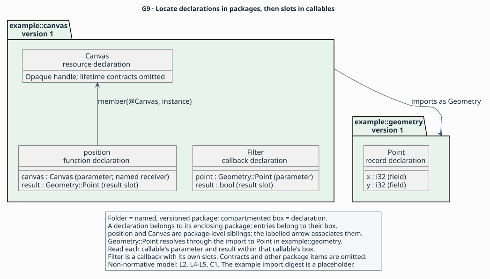

# Declarations and blocks

> **Purpose:** reference — locate each declaration form and its applicable contracts.
> **Reader:** language designers, API authors and tool implementers looking up draft 0.1.
> **Before this:** [The published description](../explanation/model.md#description) and [types](types.md); [reference conventions](notation.md#entry-conventions).
> **Status:** Draft 0.1 is a proposal under review through its specification
> and synthetic examples. Parser, validator and implementation development
> are future work.
> **Rules:** [L1](../language.md#l1), [L2](../language.md#l2), [L3](../language.md#l3), [L4](../language.md#l4), [L5](../language.md#l5), [L6](../language.md#l6), [C1](../contracts.md#c1), [C2](../contracts.md#c2), [C3](../contracts.md#c3), [C4](../contracts.md#c4), [C5](../contracts.md#c5), [C6](../contracts.md#c6), [C7](../contracts.md#c7), [A1](../profiles.md#a1), [A2](../profiles.md#a2), [A3](../profiles.md#a3) are canonical; this page is non-normative.

A [package](../glossary.md#package) contains declarations and selects the
[environments](../glossary.md#environment) in which its contracts hold.
A [member](../glossary.md#member) is a top-level declaration associated with a
nominal owner. A callable contains its parameters, outcomes, callback-use blocks
and access paths. The entries below locate each form; the
[applicability table](#applicability) gathers its required clause families.
These are non-normative summaries of [L2–L6](../language.md#l2),
[C1–C7](../contracts.md#c1) and [A2](../profiles.md#a2).



The imported `Geometry::Point` belongs to the geometry package. `Canvas` and
`position` belong to the canvas package; `member(@Canvas, instance)` connects
them without nesting the function inside the resource. Inside `position`,
`$canvas` addresses the parameter value; `@position::canvas` identifies that
slot from a declaration-reference argument. See [names and references](notation.md#names)
for the example and syntax, and [L2](../language.md#l2) for name resolution.

The view also shows `Filter`, a callback with a `Geometry::Point` parameter
and Boolean result, and the `Point` record's ordered `x` and `y` fields.
Each callable has its own slots. Both package versions are `"1"`; the other
package items and contracts are omitted and the import digest is illustrative.
[Diagram source](../figures/g9-model.puml).

<a id="package"></a>

## Package and language header

**Expresses:** [The published description](../explanation/model.md#description) — the identity and scope of a published API description.

**Form:** `language "0.1"; package Name version "version" { ... }` (production `document`; [shell](notation.md#shell)).

**Operands and types:** A qualified package name and opaque nonempty version string.

**Applies to:** One document.

**Required and repeatability:** Exactly one header and package; one `surface`, an `exports` list and at least one environment.

**Default:** None; publication facts are explicit.

**Meaning (non-normative; [L1](../language.md#l1), [L2](../language.md#l2), [L3](../language.md#l3)):** The package states which API subset and release it describes. Public roots bring their required support declarations into the authoritative dependency closure.

**Constraints:** Local declaration names are unique; dependencies are complete and pinned. Different environments can require separate declarations with disjoint availability. ([L1](../language.md#l1), [L2](../language.md#l2), [L3](../language.md#l3)).

**Rejected when:** The language version is unsupported, a required publication fact is missing, or a referenced dependency cannot be resolved. ([L1](../language.md#l1), [L2](../language.md#l2), [L3](../language.md#l3)).

**Example.** Fragment — an invented API, adapted from the
[teaching fragments](../examples/rule-reading/syntax.ail). The header, publication
context and unshown declarations and contracts are omitted.

<!-- ail-example: ../examples/reference/declarations.ail region=package -->
```ail
language "0.1";
package example::geometry version "1" {
  surface("An invented point API, release 1.");
  exports([@Point]);
  // Point, environments and remaining facts omitted.
}
```

`Point` is a public root of this package. The version of the description is independent of the AIL language version.

**Used by and see also:** [Applicability table](#applicability); [grammar and notation](notation.md); [conformance examples](../conformance.md).

**Rationale:** [Packages, environments and access paths](../explanation/packages.md).

<a id="import"></a>

## Import

**Expresses:** [The published description](../explanation/model.md#description) — the other package supplying a declaration.

**Form:** `import Name version "version" digest "sha256:..." as Alias;` (production `import`; [names](notation.md#names)).

**Operands and types:** Package name, nonempty version, exact-byte digest and local alias.

**Applies to:** Package body.

**Required and repeatability:** One declaration for each import alias used; aliases do not collide with local names.

**Default:** No implicit package lookup.

**Meaning (non-normative; [L2](../language.md#l2), [L3](../language.md#l3)):** An import supplies declarations from an exact document in the explicit resolution set.

**Constraints:** Pins use 64 lowercase hexadecimal digits after `sha256:`. Imports are acyclic; each package name/version resolves to one digest throughout the closure. ([L2](../language.md#l2), [L3](../language.md#l3)).

**Rejected when:** An alias collides, a dependency is absent or mismatched, or the closure contains conflicting pins (N28). ([L2](../language.md#l2), [L3](../language.md#l3)).

**Example.** Fragment — an invented API, adapted from the
[teaching fragments](../examples/rule-reading/canvas.ail). The header, publication
context and unshown declarations and contracts are omitted.

<!-- ail-example: ../examples/reference/declarations.ail region=import -->
```ail
package example::canvas version "1" {
  import example::geometry version "1"
    digest "sha256:cccccccccccccccccccccccccccccccccccccccccccccccccccccccccccccccc"
    as Geometry;
  fn position(canvas: Canvas) -> Geometry::Point {
    member(@Canvas, instance);
    receiver($canvas);
    // Callable contracts omitted.
  }
  // Canvas and publication context omitted.
}
```

The digest is an illustrative placeholder, not a computed hash. `Geometry::Point` is an imported type; `@Geometry::Point` is its declaration reference. `Canvas` is local, and `$canvas` is the function’s local place. A complete package supplies the matching geometry document.

**Used by and see also:** [Applicability table](#applicability); [grammar and notation](notation.md); [conformance examples](../conformance.md).

**Rationale:** [Packages, environments and access paths](../explanation/packages.md).

<a id="use"></a>

## Profile and ABI dependencies

**Expresses:** [Writers, checkers and users](../explanation/model.md#agreement) — the shared provider definitions writers, checkers and users agree on.

**Form:** `use profile Alias = "id" version "version" digest "sha256:...";` or `use abi ...` (production `dependency`; [dependencies](notation.md#dependency)).

**Operands and types:** Provider category, local alias, identifier, version and manifest digest.

**Applies to:** Package body.

**Required and repeatability:** Declare each provider alias used by types, clauses or access paths.

**Default:** No provider is inferred from a name or source spelling.

**Meaning (non-normative; [L2](../language.md#l2), [A1](../profiles.md#a1), [A2](../profiles.md#a2)):** The pin identifies the manifest defining additional semantics or native representations. Profile and ABI identities are resolved separately.

**Constraints:** Aliases share the local namespace with declarations, imports and environments. All pins agree across the full closure; validation does not fetch or execute providers implicitly. ([L2](../language.md#l2), [A1](../profiles.md#a1), [A2](../profiles.md#a2)).

**Rejected when:** An alias is unresolved, pins conflict (N29), or a required provider is unsupported. ([L2](../language.md#l2), [A1](../profiles.md#a1), [A2](../profiles.md#a2)).

**Example.** Fragment — an invented API, adapted from the
[teaching fragments](../examples/rule-reading/providers.ail). The header, publication
context and unshown declarations and contracts are omitted.

<!-- ail-example: ../examples/reference/declarations.ail region=use -->
```ail
package example::objects version "1" {
  use profile fixture = "example.fixture" version "1"
    digest "sha256:aaaaaaaaaaaaaaaaaaaaaaaaaaaaaaaaaaaaaaaaaaaaaaaaaaaaaaaaaaaaaaaa";
  use abi native = "example.fixture-abi" version "1"
    digest "sha256:bbbbbbbbbbbbbbbbbbbbbbbbbbbbbbbbbbbbbbbbbbbbbbbbbbbbbbbbbbbbbbbb";
  // Environments and declarations omitted.
}
```

These are F1’s synthetic test resolution tokens, not hashes of provider manifests. Ordinary publication uses real matching manifest digests. `fixture` and `native` are distinct aliases used by the declarations.

**Used by and see also:** [Applicability table](#applicability); [grammar and notation](notation.md); [conformance examples](../conformance.md).

**Rationale:** [Packages, environments and access paths](../explanation/packages.md).

<a id="environment"></a>

## Environment

**Expresses:** [The published description](../explanation/model.md#description) — the exact configurations covered by the description.

**Form:** `environment Name { ... }` (production `environment`; [environments](notation.md#environment)).

**Operands and types:** A local identifier and configuration clauses.

**Applies to:** Package body.

**Required and repeatability:** At least one per package; exactly one `target` and `platform` per environment. Optional `toolchain` and `runtime`; `feature` repeats by unique feature name.

**Default:** Omitted optional refinements supply no additional claim.

**Meaning (non-normative; [L2](../language.md#l2), [L3](../language.md#l3)):** An environment describes one exact deployment configuration. A declaration’s `available` clause selects local environment names.

**Constraints:** Strings are nonempty; configurations and feature names are unique. Imported availability is matched by configuration values. ([L2](../language.md#l2), [L3](../language.md#l3)).

**Rejected when:** Configurations duplicate each other, fields are missing or empty, or availability refers to an absent configuration (N24). ([L2](../language.md#l2), [L3](../language.md#l3)).

**Example.** Fragment — an invented API, adapted from the
[teaching fragments](../examples/rule-reading/providers.ail). The header, publication
context and unshown declarations and contracts are omitted.

<!-- ail-example: ../examples/reference/declarations.ail region=environment -->
```ail
package example::objects version "1" {
  environment test {
    target("fixture64");
    platform("fixture", "1");
    toolchain("fixture-compiler", "1");
  }
  // Providers and declarations omitted.
}
```

`test` names the synthetic F1 configuration, not the host machine or an OS version range.

**Used by and see also:** [Applicability table](#applicability); [grammar and notation](notation.md); [conformance examples](../conformance.md).

**Rationale:** [Packages, environments and access paths](../explanation/packages.md).

<a id="record"></a>

## Record

**Expresses:** [Operations and their values](../explanation/model.md#operations) — a named type and its obligations.

**Form:** `record Name { ... }` (production `nominal`; [shell](notation.md#shell)).

**Operands and types:** A unique local declaration name.

**Applies to:** Package body.

**Required and repeatability:** Exactly one `available`; `deprecated` for public declarations. The applicability table lists the additional clauses. `sharing` and `isolation` are required; see the applicability table for kind-specific clauses.

**Default:** None; applicable contracts are explicit.

**Meaning (non-normative; [L2](../language.md#l2), [L3](../language.md#l3), [L4](../language.md#l4), [L5](../language.md#l5), [C1](../contracts.md#c1), [C2](../contracts.md#c2), [A3](../profiles.md#a3)):** A record contains named, ordered fields by value. Field order is semantic; native layout comes from its representation provider.

**Constraints:** Fields have distinct names and non-unit types. `implements` is required, possibly empty. Reference-containing fields need recursive slot contracts. ([L2](../language.md#l2), [L3](../language.md#l3), [L4](../language.md#l4), [L5](../language.md#l5), [C1](../contracts.md#c1), [C2](../contracts.md#c2), [A3](../profiles.md#a3)).

**Rejected when:** A field is duplicated, by-value recursion occurs or aggregate reference obligations are missing (N31). ([L2](../language.md#l2), [L3](../language.md#l3), [L4](../language.md#l4), [L5](../language.md#l5), [C1](../contracts.md#c1), [C2](../contracts.md#c2), [A3](../profiles.md#a3)).

**Example.** Fragment — an invented API, adapted from the
[teaching fragments](../examples/rule-reading/syntax.ail). The header, publication
context and unshown declarations and contracts are omitted.

<!-- ail-example: ../examples/reference/declarations.ail region=record -->
```ail
package example::geometry version "1" {
  record Point {
    field x: i32;
    field y: i32;
    // Nominal contracts omitted.
  }
}
```

`Point` contains two signed integer values. Passing the record does not by itself establish field offsets.

**Used by and see also:** [Applicability table](#applicability); [grammar and notation](notation.md); [conformance examples](../conformance.md).

**Rationale:** [How AIL states a contract](../explanation/contracts.md).

<a id="resource"></a>

## Resource

**Expresses:** [Entities that outlive a call](../explanation/model.md#entities) — a named type and its obligations.

**Form:** `resource Name { ... }` (production `nominal`; [shell](notation.md#shell)).

**Operands and types:** A unique local declaration name.

**Applies to:** Package body.

**Required and repeatability:** Exactly one `available`; `deprecated` for public declarations. The applicability table lists the additional clauses. `sharing` and `isolation` are required; see the applicability table for kind-specific clauses.

**Default:** None; applicable contracts are explicit.

**Meaning (non-normative; [L2](../language.md#l2), [L3](../language.md#l3), [L4](../language.md#l4), [L5](../language.md#l5), [C2](../contracts.md#c2)):** A resource is an opaque reference with its own lifecycle. A unique owned handle carries one destruction obligation.

**Constraints:** `lifecycle` and `implements` are required. A unique destructor consumes its one non-null resource parameter, returns unit and has only a successful returned outcome. ([L2](../language.md#l2), [L3](../language.md#l3), [L4](../language.md#l4), [L5](../language.md#l5), [C2](../contracts.md#c2)).

**Rejected when:** Lifecycle is missing (N09), its destructor is incompatible (N10), or fields try to expose a resource layout. ([L2](../language.md#l2), [L3](../language.md#l3), [L4](../language.md#l4), [L5](../language.md#l5), [C2](../contracts.md#c2)).

**Example.** Fragment — an invented API, adapted from the
[teaching fragments](../examples/rule-reading/contracts.ail). The header, publication
context and unshown declarations and contracts are omitted.

<!-- ail-example: ../examples/reference/declarations.ail region=resource -->
```ail
package example::buffers version "1" {
  resource Store {
    lifecycle(unique, @destroy);
    // Implements, sharing, isolation and publication facts omitted.
  }
  // destroy and other declarations omitted.
}
```

`Store` is the handle itself. `ptr<Store>` would address storage containing such a handle.

**Used by and see also:** [Applicability table](#applicability); [grammar and notation](notation.md); [conformance examples](../conformance.md).

**Rationale:** [How AIL states a contract](../explanation/contracts.md).

<a id="object"></a>

## Object

**Expresses:** [Entities that outlive a call](../explanation/model.md#entities) — a named type and its obligations.

**Form:** `object Name { ... }` (production `nominal`; [shell](notation.md#shell)).

**Operands and types:** A unique local declaration name.

**Applies to:** Package body.

**Required and repeatability:** Exactly one `available`; `deprecated` for public declarations. The applicability table lists the additional clauses. `sharing` and `isolation` are required; see the applicability table for kind-specific clauses.

**Default:** None; applicable contracts are explicit.

**Meaning (non-normative; [L2](../language.md#l2), [L3](../language.md#l3), [L4](../language.md#l4), [L5](../language.md#l5), [C2](../contracts.md#c2)):** An object is a reference type with object inheritance and a release protocol.

**Constraints:** `base`, `implements` and `lifecycle` are required. A base is an object or `none`; inheritance is single and acyclic. Core object lifecycle is reference-counted. ([L2](../language.md#l2), [L3](../language.md#l3), [L4](../language.md#l4), [L5](../language.md#l5), [C2](../contracts.md#c2)).

**Rejected when:** The base is not an object, inheritance cycles, or required lifecycle/conformance facts are missing. ([L2](../language.md#l2), [L3](../language.md#l3), [L4](../language.md#l4), [L5](../language.md#l5), [C2](../contracts.md#c2)).

**Example.** Fragment — an invented API, adapted from the
[teaching fragments](../examples/rule-reading/clauses.ail). The header, publication
context and unshown declarations and contracts are omitted.

<!-- ail-example: ../examples/reference/declarations.ail region=object -->
```ail
package example::drawing version "1" {
  object Shape { base(none); implements([]); }
  object Dot { base(@Shape); implements([@Drawable]); }
  // Drawable, lifecycle and other nominal contracts omitted.
}
```

`Dot` inherits from `Shape` and declares interface conformance to `Drawable`; those references do not supply missing member implementations.

**Used by and see also:** [Applicability table](#applicability); [grammar and notation](notation.md); [conformance examples](../conformance.md).

**Rationale:** [How AIL states a contract](../explanation/contracts.md).

<a id="interface"></a>

## Interface

**Expresses:** [Entities that outlive a call](../explanation/model.md#entities) — a named type and its obligations.

**Form:** `interface Name { ... }` (production `nominal`; [shell](notation.md#shell)).

**Operands and types:** A unique local declaration name.

**Applies to:** Package body.

**Required and repeatability:** Exactly one `available`; `deprecated` for public declarations. The applicability table lists the additional clauses. `sharing` and `isolation` are required; see the applicability table for kind-specific clauses.

**Default:** None; applicable contracts are explicit.

**Meaning (non-normative; [L2](../language.md#l2), [L3](../language.md#l3), [L4](../language.md#l4), [L5](../language.md#l5), [C2](../contracts.md#c2), [C3](../contracts.md#c3)):** An interface specifies members required or optionally supported by conforming types.

**Constraints:** `extends` and `lifecycle` are required. Interface inheritance is acyclic. Its members state `requirement`; optional calls need a profile-defined capability test. ([L2](../language.md#l2), [L3](../language.md#l3), [L4](../language.md#l4), [L5](../language.md#l5), [C2](../contracts.md#c2), [C3](../contracts.md#c3)).

**Rejected when:** Inheritance cycles, a required implementation is absent, or an optional member is invoked without the required capability contract. ([L2](../language.md#l2), [L3](../language.md#l3), [L4](../language.md#l4), [L5](../language.md#l5), [C2](../contracts.md#c2), [C3](../contracts.md#c3)).

**Example.** Fragment — an invented API, adapted from the
[teaching fragments](../examples/rule-reading/clauses.ail). The header, publication
context and unshown declarations and contracts are omitted.

<!-- ail-example: ../examples/reference/declarations.ail region=interface -->
```ail
package example::drawing version "1" {
  interface Drawable { extends([]); }
  fn required_draw(item: Drawable) -> unit {
    member(@Drawable, instance);
    receiver($item);
    requirement(required);
    // Callable contracts omitted.
  }
  // Lifecycle and other nominal contracts omitted.
}
```

`required_draw` is a sibling declaration of `Drawable`. Its `requirement(required)` makes it part of the conformance obligation.

**Used by and see also:** [Applicability table](#applicability); [grammar and notation](notation.md); [conformance examples](../conformance.md).

**Rationale:** [How AIL states a contract](../explanation/contracts.md).

<a id="field"></a>

## Record field

**Expresses:** [Operations and their values](../explanation/model.md#operations) — a named component of a value.

**Form:** `field Name: Type;` (production `field`).

**Operands and types:** Field identifier and type.

**Applies to:** Record body only.

**Required and repeatability:** One declaration per field; names are distinct within the record.

**Default:** No implicit field value.

**Meaning (non-normative; [L4](../language.md#l4), [C1](../contracts.md#c1)):** Fields are ordered parts of a by-value record.

**Constraints:** The field type is non-unit; nested references retain their own contract obligations. ([L4](../language.md#l4), [C1](../contracts.md#c1)).

**Rejected when:** A field occurs outside a record, repeats a name, uses unit or creates by-value recursion. ([L4](../language.md#l4), [C1](../contracts.md#c1)).

**Example.** Fragment — an invented API, adapted from the
[teaching fragments](../examples/rule-reading/syntax.ail). The header, publication
context and unshown declarations and contracts are omitted.

<!-- ail-example: ../examples/reference/declarations.ail region=field -->
```ail
package example::geometry version "1" {
  record Point { field x: i32; field y: i32; }
  // Nominal contracts omitted.
}
```

`x` precedes `y` in the semantic record; the access provider decides their native offsets ([A3](../profiles.md#a3)).

**Used by and see also:** [Applicability table](#applicability); [grammar and notation](notation.md); [conformance examples](../conformance.md).

**Rationale:** [How AIL states a contract](../explanation/contracts.md).

<a id="alias"></a>

## Alias

**Expresses:** [Operations and their values](../explanation/model.md#operations) — a source name for an existing semantic type.

**Form:** `alias Name = Type { ... }` (production `alias`).

**Operands and types:** A unique local name and its expanded type.

**Applies to:** Package body.

**Required and repeatability:** Exactly one `available`; `deprecated` for public declarations. The applicability table lists the additional clauses. `sharing` and `isolation` are required; see the applicability table for kind-specific clauses.

**Default:** None; the target type is explicit.

**Meaning (non-normative; [L2](../language.md#l2), [L3](../language.md#l3), [L4](../language.md#l4), [C2](../contracts.md#c2)):** An alias is transparent for semantic typing. Source identity can be retained through `source`.

**Constraints:** Expansion has no cycles; sharing and isolation agree with the expanded type. Distinct handles use resource or object declarations. ([L2](../language.md#l2), [L3](../language.md#l3), [L4](../language.md#l4), [C2](../contracts.md#c2)).

**Rejected when:** Expansion cycles, a referenced type is unresolved or nominal contracts disagree with the expanded type. ([L2](../language.md#l2), [L3](../language.md#l3), [L4](../language.md#l4), [C2](../contracts.md#c2)).

**Example.** Fragment — an invented API, adapted from the
[teaching fragments](../examples/rule-reading/types.ail). The header, publication
context and unshown declarations and contracts are omitted.

<!-- ail-example: ../examples/reference/declarations.ail region=alias -->
```ail
package example::geometry version "1" {
  alias Coordinate = i32 {
    // Nominal contracts omitted.
  }
}
```

`Coordinate` supplies a source name for `i32`, with the same semantic typing.

**Used by and see also:** [Applicability table](#applicability); [grammar and notation](notation.md); [conformance examples](../conformance.md).

**Rationale:** [How AIL states a contract](../explanation/contracts.md).

<a id="enum"></a>

## Enum

**Expresses:** [Operations and their values](../explanation/model.md#operations) — the domain of an integer value.

**Form:** `enum Name: IntegerType { ... }` (production `enumeration`).

**Operands and types:** A name and core integer underlying type.

**Applies to:** Package body.

**Required and repeatability:** Exactly one `available`; `deprecated` for public declarations. The applicability table lists the additional clauses. `sharing` and `isolation` are required; see the applicability table for kind-specific clauses. `values(closed|open)` is required.

**Default:** None; openness is explicit.

**Meaning (non-normative; [L2](../language.md#l2), [L3](../language.md#l3), [L4](../language.md#l4), [C2](../contracts.md#c2), [C5](../contracts.md#c5)):** An enum names integer values; closed enums permit exactly the declared values, while open enums admit the underlying type’s full domain.

**Constraints:** Case names and values are distinct; values fit the underlying type. A closed enum is nonempty. ([L2](../language.md#l2), [L3](../language.md#l3), [L4](../language.md#l4), [C2](../contracts.md#c2), [C5](../contracts.md#c5)).

**Rejected when:** Values duplicate or overflow, or a closed enum is empty. ([L2](../language.md#l2), [L3](../language.md#l3), [L4](../language.md#l4), [C2](../contracts.md#c2), [C5](../contracts.md#c5)).

**Example.** Fragment — an invented API, adapted from the
[teaching fragments](../examples/rule-reading/types.ail). The header, publication
context and unshown declarations and contracts are omitted.

<!-- ail-example: ../examples/reference/declarations.ail region=enum -->
```ail
package example::geometry version "1" {
  enum Axis: u8 {
    values(closed);
    case horizontal = 0;
    case vertical = 1;
  }
  // Nominal contracts omitted.
}
```

`Axis` has two permitted values; an exhaustive discriminator covers both.

**Used by and see also:** [Applicability table](#applicability); [grammar and notation](notation.md); [conformance examples](../conformance.md).

**Rationale:** [How AIL states a contract](../explanation/contracts.md).

<a id="flags"></a>

## Flags

**Expresses:** [Operations and their values](../explanation/model.md#operations) — the domain of an integer value.

**Form:** `flags Name: IntegerType { ... }` (production `enumeration`).

**Operands and types:** A name and core integer underlying type.

**Applies to:** Package body.

**Required and repeatability:** Exactly one `available`; `deprecated` for public declarations. The applicability table lists the additional clauses. `sharing` and `isolation` are required; see the applicability table for kind-specific clauses. `values(closed|open)` is required.

**Default:** None; openness is explicit.

**Meaning (non-normative; [L2](../language.md#l2), [L3](../language.md#l3), [L4](../language.md#l4), [C2](../contracts.md#c2), [C5](../contracts.md#c5)):** Flags name integer bits; closed flags admit combinations of declared bits, including zero. Open flags admit the underlying type’s full domain.

**Constraints:** Closed case values are positive single bits. Case names and values are distinct and representable. Numeric aliases need a profile. ([L2](../language.md#l2), [L3](../language.md#l3), [L4](../language.md#l4), [C2](../contracts.md#c2), [C5](../contracts.md#c5)).

**Rejected when:** A closed case contains zero or several bits, or values duplicate or overflow. ([L2](../language.md#l2), [L3](../language.md#l3), [L4](../language.md#l4), [C2](../contracts.md#c2), [C5](../contracts.md#c5)).

**Example.** Fragment — an invented API, adapted from the
[teaching fragments](../examples/rule-reading/types.ail). The header, publication
context and unshown declarations and contracts are omitted.

<!-- ail-example: ../examples/reference/declarations.ail region=flags -->
```ail
package example::geometry version "1" {
  flags Edges: u8 {
    values(closed);
    case left = 1;
    case right = 2;
  }
  // Nominal contracts omitted.
}
```

`Edges` permits 0, 1, 2 and 3; zero is admitted without a zero-valued case.

**Used by and see also:** [Applicability table](#applicability); [grammar and notation](notation.md); [conformance examples](../conformance.md).

**Rationale:** [How AIL states a contract](../explanation/contracts.md).

<a id="case"></a>

## Enum or flags case

**Expresses:** [Operations and their values](../explanation/model.md#operations) — a named value in an integer domain.

**Form:** `case Name = integer;` (production `enum_case`).

**Operands and types:** Case name and decimal integer literal.

**Applies to:** Enum or flags body.

**Required and repeatability:** Names and values are distinct; numeric aliases require a profile.

**Default:** No implicit value assignment.

**Meaning (non-normative; [L1](../language.md#l1), [L4](../language.md#l4)):** The case names an integer in the containing declaration’s domain.

**Constraints:** Values fit the underlying type; closed flags use positive single bits. ([L1](../language.md#l1), [L4](../language.md#l4)).

**Rejected when:** The name/value duplicates another case or violates the underlying type or closed-flags constraint. ([L1](../language.md#l1), [L4](../language.md#l4)).

**Example.** Fragment — an invented API, adapted from the
[teaching fragments](../examples/rule-reading/types.ail). The header, publication
context and unshown declarations and contracts are omitted.

<!-- ail-example: ../examples/reference/declarations.ail region=case -->
```ail
package example::geometry version "1" {
  enum Axis: u8 {
    values(closed);
    case horizontal = 0;
    case vertical = 1;
  }
  // Nominal contracts omitted.
}
```

`horizontal` is the name of the enum’s integer value 0.

**Used by and see also:** [Applicability table](#applicability); [grammar and notation](notation.md); [conformance examples](../conformance.md).

**Rationale:** [How AIL states a contract](../explanation/contracts.md).

<a id="fn"></a>

## Function and member function

**Expresses:** [Operations and their values](../explanation/model.md#operations) — an operation, its parameters and result.

**Form:** `fn Name(parameters) -> Type [throws Type] { ... }` (production `callable`; [callables](notation.md#callable)).

**Operands and types:** Unique declaration name; ordered named parameters with types; result type; optional thrown type.

**Applies to:** Package body; member association is a clause.

**Required and repeatability:** Exactly one `available`; `deprecated` for public declarations. The applicability table lists the additional clauses. Seven effect clauses, applicable input/storage clauses, outcomes and access paths are required.

**Default:** No inferred effects, ownership or access path.

**Meaning (non-normative; [L2](../language.md#l2), [L3](../language.md#l3), [L5](../language.md#l5), [C3](../contracts.md#c3), [C5](../contracts.md#c5), [A2](../profiles.md#a2)):** The function describes one semantic operation. A member function relates it to a nominal owner; its receiver is an explicit ordinary parameter.

**Constraints:** Parameter names are unique and exclude `result`, `exception`, `completion`. Instance/initializer functions have `receiver`; static/free functions forbid it. Completion modes agree with `throws`. ([L2](../language.md#l2), [L3](../language.md#l3), [L5](../language.md#l5), [C3](../contracts.md#c3), [C5](../contracts.md#c5), [A2](../profiles.md#a2)).

**Rejected when:** Names collide (N03), required contracts/access paths are missing (N25), or receiver/owner relationships are inconsistent. ([L2](../language.md#l2), [L3](../language.md#l3), [L5](../language.md#l5), [C3](../contracts.md#c3), [C5](../contracts.md#c5), [A2](../profiles.md#a2)).

**Example.** Fragment — an invented API, adapted from the
[teaching fragments](../examples/rule-reading/canvas.ail). The header, publication
context and unshown declarations and contracts are omitted.

<!-- ail-example: ../examples/reference/declarations.ail region=fn -->
```ail
package example::canvas version "1" {
  fn position(canvas: Canvas) -> Geometry::Point {
    member(@Canvas, instance);
    receiver($canvas);
    input($canvas, borrow);
    retain($canvas, none);
    valid($canvas, call);
    // Effects, outcomes and access omitted.
  }
  // Canvas, Geometry import and publication context omitted.
}
```

`@position::canvas` identifies a parameter slot; `$canvas` addresses its value within the callable. The function returns an imported record type.

**Used by and see also:** [Applicability table](#applicability); [grammar and notation](notation.md); [conformance examples](../conformance.md).

**Rationale:** [How AIL states a contract](../explanation/contracts.md).

<a id="callback"></a>

## Callback declaration

**Expresses:** [Callbacks and their schedules](../explanation/model.md#callbacks) — the signature and obligations of one callback invocation.

**Form:** `callback Name(parameters) -> Type [throws Type] { ... }` (production `callable`; [callables](notation.md#callable)).

**Operands and types:** A type/declaration name and a complete callable signature.

**Applies to:** Package body.

**Required and repeatability:** Exactly one `available`; `deprecated` for public declarations. The applicability table lists the additional clauses. Sharing/isolation, seven effect clauses, applicable slot contracts, outcomes, [`callback_abi`](clauses-access.md#callback_abi) and [`representation`](clauses-access.md#representation) are required.

**Default:** No implicit closure representation or capture policy.

**Meaning (non-normative; [L2](../language.md#l2), [L3](../language.md#l3), [L4](../language.md#l4), [C2](../contracts.md#c2), [C3](../contracts.md#c3), [C5](../contracts.md#c5), [A2](../profiles.md#a2)):** The declaration describes one invocation and the reference value representing the callback. A callback-use block separately describes a registration’s schedule.

**Constraints:** Captured state permits every allowed use. Invocation and closure sharing contracts are independent; providers supply retain/release and representation. ([L2](../language.md#l2), [L3](../language.md#l3), [L4](../language.md#l4), [C2](../contracts.md#c2), [C3](../contracts.md#c3), [C5](../contracts.md#c5), [A2](../profiles.md#a2)).

**Rejected when:** Confinement has no executor (N19), invocation contracts are incomplete or representation is unsupported. ([L2](../language.md#l2), [L3](../language.md#l3), [L4](../language.md#l4), [C2](../contracts.md#c2), [C3](../contracts.md#c3), [C5](../contracts.md#c5), [A2](../profiles.md#a2)).

**Example.** Fragment — an invented API, adapted from the
[teaching fragments](../examples/rule-reading/contracts.ail). The header, publication
context and unshown declarations and contracts are omitted.

<!-- ail-example: ../examples/reference/declarations.ail region=callback -->
```ail
package example::events version "1" {
  callback Handler(code: u32) -> unit {
    sharing(shared);
    isolation(none);
    // Invocation effects, outcomes, ABI and representation omitted.
  }
}
```

`Handler` accepts one integer event code per invocation. This says nothing yet about when a registration may invoke it.

**Used by and see also:** [Applicability table](#applicability); [grammar and notation](notation.md); [conformance examples](../conformance.md).

**Rationale:** [How AIL states a contract](../explanation/contracts.md).

<a id="property"></a>

## Property

**Expresses:** [Entities that outlive a call](../explanation/model.md#entities) — a named access to an entity’s state.

**Form:** `property Name: Type { ... }` (production `property`).

**Operands and types:** Property name and value type.

**Applies to:** Package body; optional member owner/kind.

**Required and repeatability:** Exactly one `available`; `deprecated` for public declarations. The applicability table lists the additional clauses. `accessors` and `storage` are required.

**Default:** No implicit getter or setter.

**Meaning (non-normative; [L2](../language.md#l2), [L3](../language.md#l3), [L5](../language.md#l5), [C3](../contracts.md#c3)):** A property relates full accessor functions and asserts how their contracts implement storage behaviour.

**Constraints:** Accessors have the same member owner/kind and availability. Getter has only the receiver if any; setter adds one `value` parameter and returns unit. Accessor types agree with the property. ([L2](../language.md#l2), [L3](../language.md#l3), [L5](../language.md#l5), [C3](../contracts.md#c3)).

**Rejected when:** Accessors mismatch, or storage contradicts their ownership/retention behaviour. ([L2](../language.md#l2), [L3](../language.md#l3), [L5](../language.md#l5), [C3](../contracts.md#c3)).

**Example.** Fragment — an invented API, adapted from the
[teaching fragments](../examples/rule-reading/clauses.ail). The header, publication
context and unshown declarations and contracts are omitted.

<!-- ail-example: ../examples/reference/declarations.ail region=property -->
```ail
package example::objects version "1" {
  property count: u64 {
    member(@Counter, instance);
    accessors(@read_count, @write_count);
    storage(value);
    // Availability and deprecation omitted.
  }
  // Counter and accessor declarations omitted.
}
```

`count` reuses `read_count` and `write_count` as the authoritative callables; it does not supply a second implementation contract.

**Used by and see also:** [Object example](../examples/objects.ail); [functions](#fn); [applicability](#applicability).

**Rationale:** [How AIL states a contract](../explanation/contracts.md).

<a id="constant"></a>

## Constant

**Expresses:** [Entities that outlive a call](../explanation/model.md#entities) — a named value made available by the API.

**Form:** `constant Name: Type { ... }` (production `constant`).

**Operands and types:** Name and value type.

**Applies to:** Package body.

**Required and repeatability:** Exactly one `available`; `deprecated` for public declarations. The applicability table lists the additional clauses. Exactly one of `literal` or access paths.

**Default:** No implied linker symbol.

**Meaning (non-normative; [L3](../language.md#l3), [L5](../language.md#l5), [C7](../contracts.md#c7), [A2](../profiles.md#a2), [A3](../profiles.md#a3)):** A constant denotes a value. A literal scalar needs no ownership clauses; a value obtained through access obeys the applicable output rules.

**Constraints:** Core literals are matching integer/Boolean values; strings need a profile type. Accessed references retain output contracts. ([L3](../language.md#l3), [L5](../language.md#l5), [C7](../contracts.md#c7), [A2](../profiles.md#a2), [A3](../profiles.md#a3)).

**Rejected when:** Both or neither literal/access is supplied, the literal/type disagrees, or output obligations are absent. ([L3](../language.md#l3), [L5](../language.md#l5), [C7](../contracts.md#c7), [A2](../profiles.md#a2), [A3](../profiles.md#a3)).

**Example.** Fragment — an invented API, adapted from the
[teaching fragments](../examples/rule-reading/clauses.ail). The header, publication
context and unshown declarations and contracts are omitted.

<!-- ail-example: ../examples/reference/declarations.ail region=constant -->
```ail
package example::settings version "1" {
  constant default_limit: u32 {
    literal(16);
    // Availability and deprecation omitted.
  }
}
```

`default_limit` denotes the integer value 16; its spelling does not promise a symbol address.

**Used by and see also:** [Applicability table](#applicability); [grammar and notation](notation.md); [conformance examples](../conformance.md).

**Rationale:** [How AIL states a contract](../explanation/contracts.md).

<a id="global"></a>

## Global

**Expresses:** [Entities that outlive a call](../explanation/model.md#entities) — persistent storage exposed by the API.

**Form:** `global Name: Type { ... }` (production `global`).

**Operands and types:** Name and stored-value type.

**Applies to:** Package body.

**Required and repeatability:** Exactly one `available`; `deprecated` for public declarations. The applicability table lists the additional clauses. `mutable`, sharing/isolation and access paths; pointer and borrowed-output contracts as applicable.

**Default:** None; mutability is explicit.

**Meaning (non-normative; [L3](../language.md#l3), [L5](../language.md#l5), [C7](../contracts.md#c7), [A2](../profiles.md#a2), [A3](../profiles.md#a3)):** A global denotes storage, including when immutable. Core storage contains scalar/value data or a static borrowed reference with no earlier invalidators.

**Constraints:** Core mutable value globals are confined with non-none isolation. Mutable reference storage and ownership-changing reads/writes require a profile or explicit accessors. ([L3](../language.md#l3), [L5](../language.md#l5), [C7](../contracts.md#c7), [A2](../profiles.md#a2), [A3](../profiles.md#a3)).

**Rejected when:** Mutation/sharing is unsupported, a borrowed reference lacks output contracts, or a path confuses loading a value with using a symbol address. ([L3](../language.md#l3), [L5](../language.md#l5), [C7](../contracts.md#c7), [A2](../profiles.md#a2), [A3](../profiles.md#a3)).

**Example.** Fragment — an invented API, adapted from the
[teaching fragments](../examples/rule-reading/clauses.ail). The header, publication
context and unshown declarations and contracts are omitted.

<!-- ail-example: ../examples/reference/declarations.ail region=global -->
```ail
package example::settings version "1" {
  global current_limit: u32 {
    mutable(true);
    sharing(confined);
    isolation(main);
    // Access and publication facts omitted.
  }
}
```

`current_limit` is writable storage restricted to the main executor, not a replaceable literal constant.

**Used by and see also:** [Applicability table](#applicability); [grammar and notation](notation.md); [conformance examples](../conformance.md).

**Rationale:** [How AIL states a contract](../explanation/contracts.md).

<a id="outcome"></a>

## Outcome

**Expresses:** [How a call finishes](../explanation/model.md#outcomes) — one observable way a call finishes.

**Form:** `outcome Name { ... }` (production `outcome`; [outcomes](notation.md#outcome)).

**Operands and types:** Name local to the callable, completion/predicate and output obligations.

**Applies to:** Function or callback declaration body.

**Required and repeatability:** At least one per callable; unique names; one [`when`](clauses-outcomes.md#when) and [`meaning`](clauses-outcomes.md#meaning) per outcome, with applicable output state and transfer clauses.

**Default:** No implicit failure or output validity.

**Meaning (non-normative; [L2](../language.md#l2), [C1](../contracts.md#c1), [C5](../contracts.md#c5)):** The outcome partitions a completion’s observations and states what the caller can read and owns.

**Constraints:** Predicates are disjoint/exhaustive per completion and share a valid discriminator (or one `any`). Every declared completion is covered; returned results and thrown values are valid on their corresponding completion. ([L2](../language.md#l2), [C1](../contracts.md#c1), [C5](../contracts.md#c5)).

**Rejected when:** Cases overlap or omit values (N05/N06), a discriminator is invalid (N12), or outcome names repeat (N33). ([L2](../language.md#l2), [C1](../contracts.md#c1), [C5](../contracts.md#c5)).

**Example.** Fragment — an invented API, adapted from the
[teaching fragments](../examples/rule-reading/contracts.ail). The header, publication
context and unshown declarations and contracts are omitted.

<!-- ail-example: ../examples/reference/declarations.ail region=outcome -->
```ail
package example::buffers version "1" {
  fn create() -> nullable<Store> {
    outcome created {
      when(returned, nonnull($result));
      meaning(success);
      state($result, valid);
      give($result, owned);
    }
    // Null outcome, effects, access and other context omitted.
  }
}
```

On the non-null outcome, the caller receives one owned `Store` handle. A complete function also describes the null case.

**Used by and see also:** [Applicability table](#applicability); [grammar and notation](notation.md); [conformance examples](../conformance.md).

**Rationale:** [How AIL states a contract](../explanation/contracts.md).

<a id="callback-use"></a>

## Callback-use block

**Expresses:** [Callbacks and their schedules](../explanation/model.md#callbacks) — the schedule and teardown of one registration.

**Form:** `callback $place { ... }` (production `callback_use`; [callback use](notation.md#callback-use)).

**Operands and types:** A callable-local place naming a callback parameter or nested callback field.

**Applies to:** Enclosing registration callable.

**Required and repeatability:** Exactly one per callback-typed parameter/leaf, including nullable; timing, count, scope, executor, concurrency, reentrancy and quiescence are required.

**Default:** No inferred schedule.

**Meaning (non-normative; [C2](../contracts.md#c2), [C3](../contracts.md#c3), [C6](../contracts.md#c6)):** The block describes possible uses of a supplied callback over this registration’s scope.

**Constraints:** Call scope implies during-call timing, no retention and quiescence on return. Owner scope needs the matching retention region, valid non-null owned returned object/resource on successful registration and quiescence at its unique destruction. ([C2](../contracts.md#c2), [C3](../contracts.md#c3), [C6](../contracts.md#c6)).

**Rejected when:** Schedule and scope conflict (N15), quiescence is missing (N16), counts are impossible (N17) or blocking teardown lacks its exclusion/protocol (N18). ([C2](../contracts.md#c2), [C3](../contracts.md#c3), [C6](../contracts.md#c6)).

**Example.** Fragment — an invented API, adapted from the
[teaching fragments](../examples/rule-reading/contracts.ail). The header, publication
context and unshown declarations and contracts are omitted.

<!-- ail-example: ../examples/reference/declarations.ail region=callback-use -->
```ail
package example::events version "1" {
  fn subscribe(handler: Handler) -> Watch {
    callback $handler {
      timing(after_return);
      count(0, many);
      scope(owner($result));
      quiescence(@unsubscribe);
      // Executor, concurrency and reentrancy omitted.
    }
    // Callable, retention and output contracts omitted.
  }
  // Handler, Watch and unsubscribe omitted.
}
```

`$handler` refers to this registration’s parameter. `Handler` itself describes each invocation; `Watch` is the returned owner whose destructor ends the schedule.

**Used by and see also:** [Applicability table](#applicability); [grammar and notation](notation.md); [conformance examples](../conformance.md).

**Rationale:** [How AIL states a contract](../explanation/contracts.md).

<a id="access"></a>

## Access block

**Expresses:** [Reaching the code](../explanation/model.md#access) — a route that implements the whole declaration contract.

**Form:** `access Name in [env, ...] { ... }` (production `access`; [access paths](notation.md#access)).

**Operands and types:** A distinct local path name and nonempty list of local environment identifiers.

**Applies to:** Functions, globals and non-literal constants.

**Required and repeatability:** One or more, covering every available environment; each has one [`abi`](clauses-access.md#abi), [`via`](clauses-access.md#via), [`mapping`](clauses-access.md#mapping) and [`compatibility`](clauses-access.md#compatibility).

**Default:** Selection requires a consumer choice or configuration policy; order does not select.

**Meaning (non-normative; [L2](../language.md#l2), [L3](../language.md#l3), [A2](../profiles.md#a2), [A3](../profiles.md#a3), [A4](../profiles.md#a4)):** A path pairs an access mechanism with an ABI and compatibility domain for the same semantic declaration.

**Constraints:** Path environments are a subset of availability. Lowering accounts for every value, auxiliary native argument and completion exactly once, preserving observable distinctions. ([L2](../language.md#l2), [L3](../language.md#l3), [A2](../profiles.md#a2), [A3](../profiles.md#a3), [A4](../profiles.md#a4)).

**Rejected when:** An environment is unresolved (N24), coverage has a gap (N25), a provider is unresolved (N23), or the path cannot preserve the full contract. ([L2](../language.md#l2), [L3](../language.md#l3), [A2](../profiles.md#a2), [A3](../profiles.md#a3), [A4](../profiles.md#a4)).

**Example.** Fragment — an invented API, adapted from the
[teaching fragments](../examples/rule-reading/providers.ail). The header, publication
context and unshown declarations and contracts are omitted.

<!-- ail-example: ../examples/reference/declarations.ail region=access -->
```ail
package example::objects version "1" {
  fn read_count(receiver: Counter) -> u64 {
    access objc_like in [test] {
      abi(native, "object-message");
      via(fixture, "message", "currentCount");
      mapping(identity);
      compatibility(stable);
    }
    // Member, input, effects and outcomes omitted.
  }
  // Providers, Counter and test environment omitted.
}
```

In the synthetic fixture provider, `currentCount` is a message identity and the explicit semantic receiver is lowered to an implicit native receiver. This is not a claim about an OS API.

**Used by and see also:** [Applicability table](#applicability); [grammar and notation](notation.md); [conformance examples](../conformance.md).

**Rationale:** [Packages, environments and access paths](../explanation/packages.md).

<a id="pattern"></a>

## Pattern

**Expresses:** [Entities that outlive a call](../explanation/model.md#entities) — roles and laws relating persistent entities and operations.

**Form:** `pattern Name { ... }` (production `pattern`; [patterns](notation.md#pattern)).

**Operands and types:** Unique local name; typed roles; core or profile-defined laws.

**Applies to:** Package body.

**Required and repeatability:** Roles have unique names. Laws are optional; an identical operand tuple cannot repeat.

**Default:** No obligations are inferred from prose documentation.

**Meaning (non-normative; [L2](../language.md#l2), [L5](../language.md#l5), [L6](../language.md#l6)):** A pattern declares relationships that instances bind to concrete declarations or slots.

**Constraints:** Core laws are `before` and `releases`. They constrain client behaviour and agree with the participating contracts. Other laws need a typed profile. ([L2](../language.md#l2), [L5](../language.md#l5), [L6](../language.md#l6)).

**Rejected when:** Roles/laws have incompatible kinds/cardinalities, ordering cycles or destructor laws contradict lifecycle. ([L2](../language.md#l2), [L5](../language.md#l5), [L6](../language.md#l6)).

**Example.** Fragment — an invented API, adapted from the
[teaching fragments](../examples/rule-reading/patterns.ail). The header, publication
context and unshown declarations and contracts are omitted.

<!-- ail-example: ../examples/reference/declarations.ail region=pattern -->
```ail
package example::buffers version "1" {
  pattern lifetime {
    role value: type one;
    role release: operation one;
    law(releases, release, value);
  }
}
```

The law requires the bound release operation to be the resource’s declared unique destructor.

**Used by and see also:** [Applicability table](#applicability); [grammar and notation](notation.md); [conformance examples](../conformance.md).

**Rationale:** [How AIL states a contract](../explanation/contracts.md).

<a id="role"></a>

## Pattern role

**Expresses:** [Entities that outlive a call](../explanation/model.md#entities) — the kinds and number of participants in a relationship.

**Form:** `role Name: Kind Cardinality;` (production `role`).

**Operands and types:** Kind: `type`, `operation`, `slot` or `pattern`; cardinality: `one`, `optional`, `many` or `some`.

**Applies to:** Pattern body.

**Required and repeatability:** One declaration per role name.

**Default:** No implicit participant or cardinality.

**Meaning (non-normative; [L6](../language.md#l6)):** Cardinalities mean 1, 0..1, 0..unbounded and 1..unbounded respectively.

**Constraints:** An instance binds every role, even an empty optional/many role. Pattern participants refer to instances; slot identities include their operation. ([L6](../language.md#l6)).

**Rejected when:** A binding has the wrong participant kind (N21), cardinality or missing role (N22). ([L6](../language.md#l6)).

**Example.** Fragment — an invented API, adapted from the
[teaching fragments](../examples/rule-reading/patterns.ail). The header, publication
context and unshown declarations and contracts are omitted.

<!-- ail-example: ../examples/reference/declarations.ail region=role -->
```ail
package example::buffers version "1" {
  pattern grouping {
    role element: type one;
    role observer: operation optional;
    role inputs: slot many;
    role lifetimes: pattern some;
  }
}
```

The observer may be absent, but its instance still writes an explicit empty binding.

**Used by and see also:** [Applicability table](#applicability); [grammar and notation](notation.md); [conformance examples](../conformance.md).

**Rationale:** [How AIL states a contract](../explanation/contracts.md).

<a id="instance"></a>

## Pattern instance

**Expresses:** [Entities that outlive a call](../explanation/model.md#entities) — the concrete participants subject to a pattern’s laws.

**Form:** `instance Name: PatternName { ... }` (production `instance`).

**Operands and types:** Unique declaration name and a resolved pattern name, written without `@`.

**Applies to:** Package body.

**Required and repeatability:** One [`bind`](clauses-access.md#bind) per role, including empty bindings; [`subject`](clauses-access.md#subject) for each operation in a `before` law.

**Default:** Availability is the nonempty intersection of participants’ availability.

**Meaning (non-normative; [L2](../language.md#l2), [L3](../language.md#l3), [L5](../language.md#l5), [L6](../language.md#l6)):** The instance applies a pattern’s relationships to exact declaration and slot identities.

**Constraints:** Participants satisfy kinds/cardinalities, composition is acyclic and laws agree with referenced contracts. ([L2](../language.md#l2), [L3](../language.md#l3), [L5](../language.md#l5), [L6](../language.md#l6)).

**Rejected when:** A role is missing or mistyped (N21/N22), availability has an empty intersection, or a law is unsatisfied. ([L2](../language.md#l2), [L3](../language.md#l3), [L5](../language.md#l5), [L6](../language.md#l6)).

**Example.** Fragment — an invented API, adapted from the
[teaching fragments](../examples/rule-reading/patterns.ail). The header, publication
context and unshown declarations and contracts are omitted.

<!-- ail-example: ../examples/reference/declarations.ail region=instance -->
```ail
package example::buffers version "1" {
  instance store_lifetime: lifetime {
    bind(value, [@Store]);
    bind(release, [@destroy]);
  }
  // lifetime, Store and destroy omitted.
}
```

`store_lifetime` binds the lifetime pattern to the existing `Store`/`destroy` contract; it creates no alternate destructor.

**Used by and see also:** [Applicability table](#applicability); [grammar and notation](notation.md); [conformance examples](../conformance.md).

**Rationale:** [How AIL states a contract](../explanation/contracts.md).

<a id="applicability"></a>

## Clause-by-declaration applicability

This is a non-normative lookup table. The linked rules determine operands,
companions and rejection. Linked clause names lead to the corresponding entries. **Required** means
required when the stated applicability condition holds; omission does not infer
an empty or safe value. Under [L5](../language.md#l5), clauses are singular in
their stated scope unless an explicit repeatability rule applies, and a clause
outside its scope is invalid.

Every declaration except patterns and instances has one [`available`](clauses-package.md#available). Public
roots and members of public nominal types require [`deprecated`](clauses-package.md#deprecated); a private
support declaration remains subject to its applicable contracts
([L3](../language.md#l3), [L5](../language.md#l5)).

| Clause | Scope and requiredness | Canonical rule |
|---|---|---|
| [`surface`](clauses-package.md#surface), [`exports`](clauses-package.md#exports) | Package: required scope statement and public roots | [L3](../language.md#l3) |
| [`target`](clauses-package.md#target), [`platform`](clauses-package.md#platform) | Environment: exactly one each | [L3](../language.md#l3) |
| [`toolchain`](clauses-package.md#toolchain), [`runtime`](clauses-package.md#runtime) | Environment: optional configuration refinements; the `runtime(...)` value constructor in lifecycle is a separate use | [L3](../language.md#l3), [C2](../contracts.md#c2) |
| [`feature`](clauses-package.md#feature) | Environment: optional, repeats by unique feature name | [L3](../language.md#l3) |
| [`available`](clauses-package.md#available) | All declarations except patterns/instances: one nonempty environment set | [L3](../language.md#l3) |
| [`doc`](clauses-package.md#doc) | Optional on package, declaration (including a role's containing pattern) or outcome | [L5](../language.md#l5) |
| [`link`](clauses-package.md#link) | Optional, repeatable on package/declarations | [L5](../language.md#l5) |
| [`source`](clauses-package.md#source) | Optional on declarations, repeatable once per profile alias | [L5](../language.md#l5) |
| [`deprecated`](clauses-package.md#deprecated) | Public declarations except patterns/instances: required | [L5](../language.md#l5) |
| [`base`](clauses-package.md#base) | Object: required, object reference or explicit `none` | [L5](../language.md#l5) |
| [`implements`](clauses-package.md#implements) | Object, record, resource: required, possibly empty interface list | [L5](../language.md#l5) |
| [`extends`](clauses-package.md#extends) | Interface: required, possibly empty interface list | [L5](../language.md#l5) |
| [`member`](clauses-package.md#member) | Function/property: optional owner and instance/static/initializer association | [L5](../language.md#l5) |
| [`receiver`](clauses-package.md#receiver) | Instance/initializer function: required non-null parameter of the owner type or a provider-defined receiver type; static/free function forbids it | [L5](../language.md#l5) |
| [`requirement`](clauses-package.md#requirement) | Interface member: required; forbidden elsewhere | [L5](../language.md#l5) |
| [`overrides`](clauses-package.md#overrides), [`satisfies`](clauses-package.md#satisfies) | Function: optional relations to compatible members | [L5](../language.md#l5) |
| [`extension`](clauses-package.md#extension) | Member contributed by a source extension/category: optional origin | [L5](../language.md#l5) |
| [`accessors`](clauses-package.md#accessors), [`storage`](clauses-package.md#storage) | Property: required; storage agrees with accessor contracts | [L5](../language.md#l5), [C3](../contracts.md#c3) |
| [`literal`](clauses-package.md#literal) | Constant: exactly one literal or one/more access paths | [L5](../language.md#l5), [A2](../profiles.md#a2) |
| [`mutable`](clauses-package.md#mutable) | Global: required | [L5](../language.md#l5), [C7](../contracts.md#c7) |
| [`values`](clauses-package.md#values) | Enum/flags: required `open` or `closed` domain | [L4](../language.md#l4) |
| [`lifecycle`](clauses-package.md#lifecycle) | Resource/object/interface: required; `unique` only on resources | [C2](../contracts.md#c2) |
| [`sharing`](clauses-package.md#sharing), [`isolation`](clauses-package.md#isolation) | Record/resource/object/interface/enum/flags/alias/callback: required. Globals also require them; accessed constants obey C7's output rules | [C2](../contracts.md#c2), [C7](../contracts.md#c7) |
| [`execution`](clauses-callable.md#execution), [`completions`](clauses-callable.md#completions), [`mutation`](clauses-callable.md#mutation), [`variadic`](clauses-callable.md#variadic) | Every function/callback declaration: required | [C3](../contracts.md#c3) |
| [`executor`](clauses-callable.md#executor), [`concurrency`](clauses-callable.md#concurrency), [`reentrancy`](clauses-callable.md#reentrancy) | Every function/callback declaration and every callback-use block: required, with distinct invocation/registration scopes | [C3](../contracts.md#c3), [C6](../contracts.md#c6) |
| [`input`](clauses-callable.md#input), [`retain`](clauses-callable.md#retain) | Callable body: required per input reference leaf, including references read from `in`/`inout` storage | [C1](../contracts.md#c1), [C3](../contracts.md#c3) |
| [`valid`](clauses-callable.md#valid) | Callable body: required per borrowed input reference leaf | [C3](../contracts.md#c3) |
| [`direction`](clauses-callable.md#direction), [`aliasing`](clauses-callable.md#aliasing) | Callable body: required per pointer parameter | [C3](../contracts.md#c3) |
| [`extent`](clauses-callable.md#extent) | Callable body: required per pointer leaf, including results and nested pointers; also pointer-typed globals/accessed constants | [C4](../contracts.md#c4), [C7](../contracts.md#c7) |
| [`contents`](clauses-callable.md#contents) | Callable body: required for pointer parameters; other pointer slots when their pointee is byte/integer character storage; C7 also covers pointer data | [C4](../contracts.md#c4), [C7](../contracts.md#c7) |
| [`requires`](clauses-callable.md#requires) | Callable body: repeatable applicable capability or outside-callback preconditions | [C3](../contracts.md#c3), [C6](../contracts.md#c6) |
| [`when`](clauses-outcomes.md#when), [`meaning`](clauses-outcomes.md#meaning) | Each outcome: exactly one each | [C5](../contracts.md#c5) |
| [`state`](clauses-outcomes.md#state) | Outcome: one per applicable non-unit result, thrown value or writable pointee; aggregate state covers children and forbids overlapping child state | [L5](../language.md#l5), [C5](../contracts.md#c5) |
| [`give`](clauses-outcomes.md#give) | Outcome: required per valid output reference leaf; directly in global/accessed-constant bodies as C7 requires | [C5](../contracts.md#c5), [C7](../contracts.md#c7) |
| [`invalidated_by`](clauses-outcomes.md#invalidated_by) | Outcome: required per output borrow, including an empty list; directly in borrowed global/accessed-constant bodies | [C5](../contracts.md#c5), [C7](../contracts.md#c7) |
| [`timing`](clauses-outcomes.md#timing), [`count`](clauses-outcomes.md#count), [`scope`](clauses-outcomes.md#scope), [`quiescence`](clauses-outcomes.md#quiescence) | Each callback-use block: required | [C6](../contracts.md#c6) |
| [`abi`](clauses-access.md#abi), [`via`](clauses-access.md#via), [`mapping`](clauses-access.md#mapping), [`compatibility`](clauses-access.md#compatibility) | Each access path: exactly one each | [A2](../profiles.md#a2), [A4](../profiles.md#a4) |
| [`callback_abi`](clauses-access.md#callback_abi), [`representation`](clauses-access.md#representation) | Callback declaration: required provider selections | [A2](../profiles.md#a2) |
| [`law`](clauses-access.md#law) | Pattern: optional core/profile laws; repeatable by distinct whole operand tuple | [L5](../language.md#l5), [L6](../language.md#l6) |
| [`bind`](clauses-access.md#bind) | Pattern instance: exactly one per declared role, including empty lists | [L5](../language.md#l5), [L6](../language.md#l6) |
| [`subject`](clauses-access.md#subject) | Pattern instance: one per operation role used in a `before` law | [L5](../language.md#l5), [L6](../language.md#l6) |
| [`fixture::sendability`](clauses-access.md#fixture-sendability), [`fixture::actor`](clauses-access.md#fixture-actor) | Synthetic fixture only: optional once on object/record/enum/flags/interface; actor identity agrees with isolation | [F1](../profiles.md#f1) |

Slot clauses ([`input`](clauses-callable.md#input), [`retain`](clauses-callable.md#retain), [`valid`](clauses-callable.md#valid), [`direction`](clauses-callable.md#direction), [`aliasing`](clauses-callable.md#aliasing), [`extent`](clauses-callable.md#extent),
[`contents`](clauses-callable.md#contents), `state`, `give`, `invalidated_by`) repeat **by place**, exactly one
of each applicable clause per slot in its scope. Only aggregate `state`
applies recursively; other slot clauses address the exact leaf
([L5](../language.md#l5)). The [storage example](../tutorial/03-storage.md)
and [callback example](../tutorial/04-callbacks.md) put these scopes together.

For a complete declaration, combine its common clauses, its kind-specific row,
its nested blocks and the requirements of its selected providers. The table
locates rules; it does not replace the consistency checks in
[C8](../contracts.md#c8) or provider schemas in [A1](../profiles.md#a1).
