# Grammar and notation

> **Purpose:** reference — find AIL's syntax forms and the rules that give them meaning.
> **Reader:** language designers, API authors and tool implementers familiar with grammars and railroad diagrams.
> **Before this:** [A model of API behaviour and binding obligations](../explanation/model.md); [the language-containment view](../language.md#l2) locates packages, declarations and [callable](../glossary.md#callable) [slots](../glossary.md#slot).
> **Status:** Draft 0.1 is a proposal under review through its specification
> and synthetic examples. Parser, validator and implementation development
> are future work.
> **Rules:** [language](../language.md), [contracts](../contracts.md), [profiles](../profiles.md) and [grammar](../grammar.ebnf) are canonical. This page is non-normative.

The [API model](../explanation/model.md) explains what a description records.
This page locates the grammar forms used to write those facts. For example,
an operation's parameters become callable slots, and the ways it can finish
become named [outcomes](../glossary.md#outcome). Use [the model-to-notation map](../explanation/model.md#from-the-model-to-ail)
to start from a concept rather than a syntax form.

<a id="grammar-source-and-dialect"></a>

## Grammar source and dialect

[`grammar.ebnf`](../grammar.ebnf) is the authoritative syntax source.
Its opening comment defines the dialect: comma concatenates, `|` alternates,
`[]` marks an optional part and `{}` marks repetition. Quoted strings are
terminals. [`L1`](../language.md#l1) defines lexical tokens, whitespace and
comments; [`L2`](../language.md#l2) supplies scope and name resolution.

The G10 views below reproduce selected productions. The complete grammar also
contains the other [declaration](../glossary.md#declaration) forms and type expressions. Each view links
its source and the rules that constrain the form. The examples are independent
fragments of invented APIs; their omission notes distinguish them from
complete packages.

Use this table to go from the form you are writing to its grammar view.

| Form | Section |
|---|---|
| Document and [package](../glossary.md#package) items | [Package shell](#shell) |
| Clauses and their values | [Clauses](#clause) |
| Imports and declaration or slot references | [Names and references](#names) |
| Functions and [callback](../glossary.md#callback) declarations | [Callables](#callable) |
| Values addressed inside a callable | [Places](#places) |
| Exact deployment configurations | [Environments](#environment) |
| Roles and their concrete participants | [Patterns and instances](#pattern) |
| Observable [completion](../glossary.md#completion) cases | [Outcomes](#outcome) |
| A callback registration's schedule | [Callback use](#callback-use) |
| [Profile](../glossary.md#profile) and [ABI](../glossary.md#abi) definitions | [Dependencies](#dependency) |
| Routes to an implementation | [Access paths](#access) |

<a id="integer"></a>

## Integer literals

**Expresses:** [Operations and their values](../explanation/model.md#operations) — numeric values recorded in cases, constants and contract operands.

**Form:** `integer = [ "-" ], unsigned_integer;` in the [grammar](../grammar.ebnf). A type argument uses `unsigned_integer` directly.

**Operands and types:** A decimal integer token; its containing declaration, clause or type constructor determines the permitted value domain.

**Applies to:** Enum/flags case values and integer clause arguments; unsigned integers also supply array sizes.

**Required and repeatability:** Each integer position contains one literal; the enclosing form determines how many positions exist.

**Default:** No implicit numeric value.

**Meaning (non-normative; [`L1`](../language.md#l1), [`L4`](../language.md#l4)):** Integers have arbitrary mathematical precision during parsing. Their use remains subject to the containing type or contract's bounds.

**Constraints:** Decimal tokens have no leading zero except `0`; `-0` is forbidden. Enum and flags cases fit their underlying core integer type. Array sizes are nonnegative ([`L1`](../language.md#l1), [`L4`](../language.md#l4)).

**Rejected when:** The token has a forbidden spelling, a case is outside its underlying type, or a value violates its operand's bounds. For example, `01` and `-0` are invalid tokens; a negative array size is outside the type-argument grammar ([`L1`](../language.md#l1), [`L4`](../language.md#l4), [grammar](../grammar.ebnf)).

**Example.** Fragment — integer cases in an invented geometry API. The header, publication context and nominal contracts are omitted.

<!-- ail-example: ../examples/reference/declarations.ail region=case -->
```ail
package example::geometry version "1" {
  enum Axis: u8 {
    values(closed);
    case horizontal = 0;
    case vertical = 1;
  }
  // Nominal contracts omitted.
}
```

Both literals fit `u8`; `values(closed)` limits `Axis` to those two values. A syntactically valid decimal integer such as `256` would exceed this underlying type.

**Used by and see also:** [Integer types](types.md#integers); [enum/flags cases](declarations.md#case); [`literal`](clauses-package.md#literal); [array sizes](types.md#array); [`extent`](clauses-callable.md#extent).

**Rationale:** [Operations and their values](../explanation/model.md#operations).

<a id="shell"></a>

## Package shell

**Expresses:** [The published description](../explanation/model.md#description).
Use the [package](../glossary.md#package) shell to identify the API description
and locate its [declarations](../glossary.md#declaration).
**Productions:** `document`, `item`, `clause`.

Fragment — shows the invented geometry package and its `Point` record.
A complete package also supplies an [environment](../glossary.md#environment), [availability](../glossary.md#availability), deprecation,
sharing and [isolation](../glossary.md#isolation).

<!-- ail-example: ../examples/rule-reading/syntax.ail region=shell -->
```ail
language "0.1";
package example::geometry version "1" {
  surface("An invented point API, release 1.");
  exports([@Point]);
  record Point {
    field x: i32;
    field y: i32;
    // Environment, availability and nominal contracts omitted.
  }
}
```

The language version selects AIL draft 0.1; the package version identifies
this API description independently. `surface` states its scope, and
`exports` names `Point` as a [public root](../glossary.md#exports). These are summaries of
[`L1–L3`](../language.md#l1); the [located shell example](../language.md#reading-aid-non-normative-a-document-contains-a-package)
connects the package items to those rules.

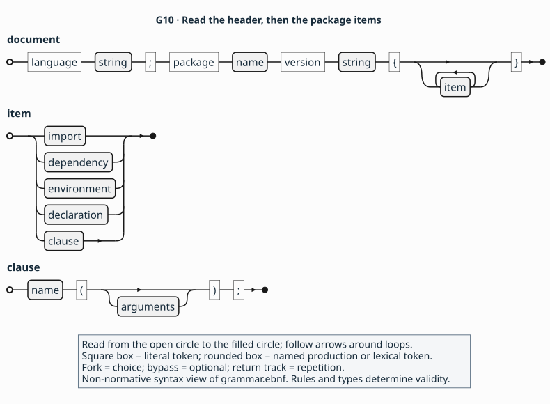

Use this view to locate a declaration or [clause](../glossary.md#clause) within the package document.

[Diagram source](../figures/g10-shell.puml) · [Exact grammar](../grammar.ebnf)

<a id="clause"></a>

## Clauses

**Expresses:** facts about the model's subjects; here,
[The published description](../explanation/model.md#description) records a
declaration's deprecation. Use the subject and arguments of a
[clause](../glossary.md#clause) to identify which fact it states.
**Productions:** `clause`, `arguments`, `value`,
`constructor`, `list`.

Fragment — shows deprecation in a record. The header, package context, fields
and other nominal contracts are omitted. `Position` is an advisory message,
not an imported or resolved declaration.

<!-- ail-example: ../examples/rule-reading/syntax.ail region=clause -->
```ail
package example::geometry version "2" {
  record Point {
    deprecated(since("2"), "Use Position instead.");
    // Header, package context, fields and nominal contracts omitted.
  }
}
```

`deprecated` states the fact about `Point`; `since("2")` supplies the version
at which deprecation began. The message guides the reader. [`L5`](../language.md#l5)
defines these operands; the [clause example](../language.md#reading-aid-non-normative-clauses-contain-values)
compares them with other values. [Vocabulary and validity](#vocabulary-and-validity)
explains how rules constrain this generic syntax.

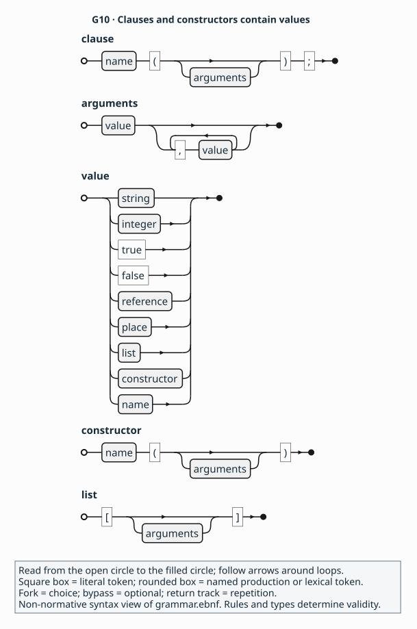

Use this view to identify the value forms a clause can contain; the cited
rules determine which values each named clause accepts.

[Diagram source](../figures/g10-clause.puml) · [Exact grammar](../grammar.ebnf)

Review tasks: [Predict an escaping borrow's validity](../review/tasks.md#predict), [Change a pointer input](../review/tasks.md#change) and [Compare a view's lifetime in two designs](../review/tasks.md#compare).

<a id="names"></a>

## Names and references

**Expresses:** identities and dependencies in
[The published description](../explanation/model.md#description).
Slot references also identify [Operations and their values](../explanation/model.md#operations).
Use names to distinguish local declarations, imported declarations and the
slots belonging to an operation. **Productions:** `import`, `reference`, `name`.

Fragment — shows an import and [member](../glossary.md#member) association in the invented canvas
package. The all-zero digest is a placeholder, not a checked dependency pin.
The [two-package language-containment view](../language.md#l2) supplies the
imported `Point` definition; publication and other contracts are omitted here.

<!-- ail-example: ../examples/rule-reading/canvas.ail region=model -->
```ail
language "0.1";
package example::canvas version "1" {
  import example::geometry version "1"
    digest "sha256:0000000000000000000000000000000000000000000000000000000000000000"
    as Geometry;
  resource Canvas {
    // Lifetime and other nominal contracts omitted.
  }
  fn position(canvas: Canvas) -> Geometry::Point {
    member(@Canvas, instance);
    receiver($canvas);
    input($canvas, borrow);
    retain($canvas, none);
    valid($canvas, call);
    // Effects, outcomes, access and publication context omitted.
  }
}
```

`position` and `Canvas` are sibling declarations; the
[`member`](../glossary.md#member) clause associates the function with its owner.
`canvas` is an explicitly named parameter designated
as the receiver. `Geometry::Point` is the result type from the imported
package. In a clause argument, `@Canvas` refers to the local declaration,
`@Geometry::Point` to the imported one, and `@position::canvas` to the
function's parameter. Inside `position`, `$canvas` addresses its local value.
The same name syntax serves different referents, resolved by
[`L2`](../language.md#l2); [`L5`](../language.md#l5) defines member association.
See the [reference and slot examples](../language.md#reading-aid-non-normative-names-references-and-callable-slots).

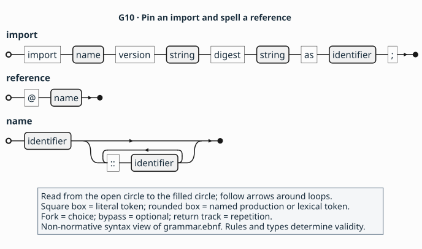

Use this view to compare an import's selected identity with the names used
to refer to declarations and slots.

[Diagram source](../figures/g10-names.puml) · [Exact grammar](../grammar.ebnf)

Review tasks: [Trace names and members](../review/tasks.md#trace).

<a id="callable"></a>

## Callables

**Expresses:** [Operations and their values](../explanation/model.md#operations).
Use a callable declaration to locate an invocation's parameters, result and
contracts. **Productions:** `callable`, `parameters`, `parameter`.

Fragment — shows a callback declaration in the canvas package. The header,
`Geometry` import, publication context, invocation and nominal contracts, and
callback [representation](../glossary.md#representation) are omitted.

<!-- ail-example: ../examples/rule-reading/canvas.ail region=callback -->
```ail
package example::canvas version "1" {
  callback Filter(point: Geometry::Point) -> bool {
    outcome decided {
      when(returned, any);
      meaning(success);
      state($result, valid);
    }
    // Invocation, representation and nominal contracts omitted.
  }
  // Header, Geometry import and publication context omitted.
}
```

`Filter` receives a point and returns a Boolean. Its `$result` belongs to one
callback invocation; `position` in [Names and references](#names) has a separate
result. The `callable` production serves both declarations. Rules govern
their contracts and the applicability of nested blocks:
[`C3`](../contracts.md#c3), [`C5–C6`](../contracts.md#c5) and [`A2`](../profiles.md#a2).
The [callable examples](../language.md#reading-aid-non-normative-names-references-and-callable-slots)
compare their slots.

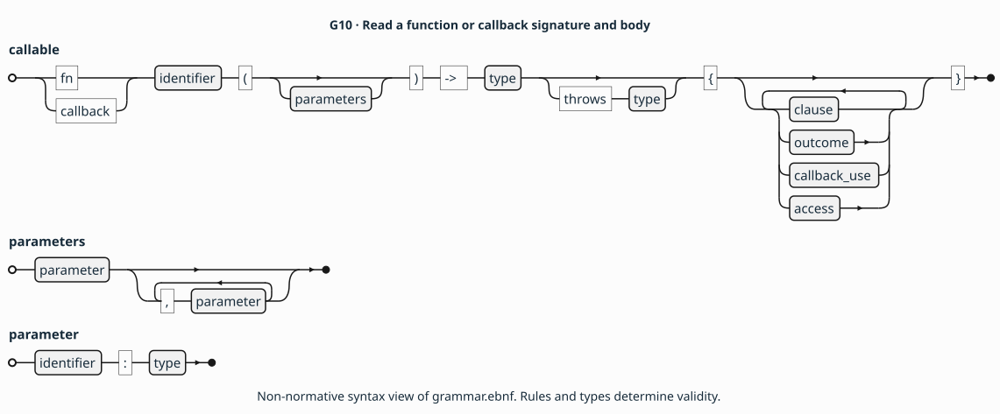

Use this view to locate an invocation's values and the contract blocks
within its callable declaration.

[Full-size callable view](../figures/g10-callable.svg) ·
[Diagram source](../figures/g10-callable.puml) · [Exact grammar](../grammar.ebnf)

Review tasks: [Trace names and members](../review/tasks.md#trace), [Change a pointer input](../review/tasks.md#change) and [Author a complete call contract](../review/tasks.md#author).

<a id="places"></a>

## Places

**Expresses:** [Operations and their values](../explanation/model.md#operations).
Use a [place](../glossary.md#place) to select the value or storage an obligation
concerns inside a callable. **Production:** `place`.

Fragment — shows the parameter addressed by `position`'s input clauses.
The header, import, `Canvas`, publication context and other callable contracts
are omitted; [Names and references](#names) supplies the declaration context.

<!-- ail-example: ../examples/rule-reading/glossary.ail region=place -->
```ail
package example::canvas version "1" {
  fn position(canvas: Canvas) -> Geometry::Point {
    input($canvas, borrow);
    retain($canvas, none);
    valid($canvas, call);
    // Member, effects, outcomes and access omitted.
  }
  // Header, Geometry import, Canvas and publication context omitted.
}
```

`$canvas` addresses the [handle](../glossary.md#handle) lent for this call. The callee retains no
reference, and the caller keeps the input valid throughout the call
([`C3`](../contracts.md#c3)). A longer place can select a field, single pointee
or elements; [`C1`'s located examples](../contracts.md#reading-aid-non-normative-address-a-value-inside-its-callable)
show the types and storage facts that make each selection meaningful.

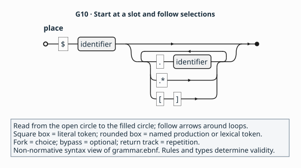

Use this view to trace a place from its callable-local slot to the value or
storage an obligation addresses.

[Diagram source](../figures/g10-places.puml) · [Exact grammar](../grammar.ebnf)

Review task: [Trace names and members](../review/tasks.md#trace).

<a id="environment"></a>

## Environments

**Expresses:** configurations covered by
[The published description](../explanation/model.md#description).
Use an [environment](../glossary.md#environment) to name the configuration
in which declarations are available. **Production:** `environment`.

Fragment — shows publication scope and availability in the canvas package.
The import, providers and other contracts needed for a complete description
are omitted. `fixture64` and `fixture` are synthetic [`F1`](../profiles.md#f1)
configuration values.

<!-- ail-example: ../examples/rule-reading/canvas.ail region=publication -->
```ail
language "0.1";
package example::canvas version "1" {
  surface("The invented canvas position API, release 1.");
  exports([@Canvas, @position]);
  environment test {
    target("fixture64");
    platform("fixture", "1");
  }
  resource Canvas {
    available([test]);
    // Lifetime and other nominal contracts omitted.
  }
  fn position(canvas: Canvas) -> Geometry::Point {
    available([test]);
    // Member, receiver and callable contracts omitted.
  }
  // Geometry import, providers and remaining support declarations omitted.
}
```

`test` is a local name for the exact target and platform configuration.
Both declarations name it in their availability. The grammar admits an empty
environment body; [`L3`](../language.md#l3) requires target and platform facts.
The [publication example](../language.md#reading-aid-non-normative-state-what-the-package-covers)
explains how these configurations bound the package's claims.

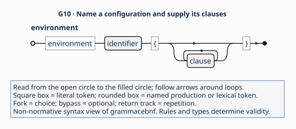

Use this view to locate the clauses defining one named configuration.

[Diagram source](../figures/g10-environment.puml) · [Exact grammar](../grammar.ebnf)

<a id="pattern"></a>

## Patterns and instances

**Expresses:** reusable relationships, such as the [lifecycle](../glossary.md#lifecycle) relationships of
[Entities that outlive a call](../explanation/model.md#entities).
Use a [pattern](../glossary.md#pattern) to name participant roles and an
instance to bind them to declarations or slots.
**Productions:** `pattern`, `role`, `instance`.

Fragment — shows slot roles in the invented canvas package. The header,
`position`, `Filter` and publication context are omitted; their declarations
appear in [Names and references](#names) and [Callables](#callable).

<!-- ail-example: ../examples/rule-reading/patterns.ail region=slots -->
```ail
package example::canvas version "1" {
  pattern inspection {
    role samples: slot many;
  }
  instance canvas_slots: inspection {
    bind(samples, [@position::canvas, @position::result,
                   @Filter::point, @Filter::result]);
  }
  // Header, position, Filter and publication context omitted.
}
```

`inspection` asks for slot participants; `canvas_slots` supplies four slots,
each identified with its callable. This pattern declares no lifecycle law.
The [role and lifecycle examples](../language.md#reading-aid-non-normative-bind-roles-to-participants)
also show a pattern connecting a resource and its destructor.
[`L6`](../language.md#l6) defines role kinds, cardinalities, binding and laws.

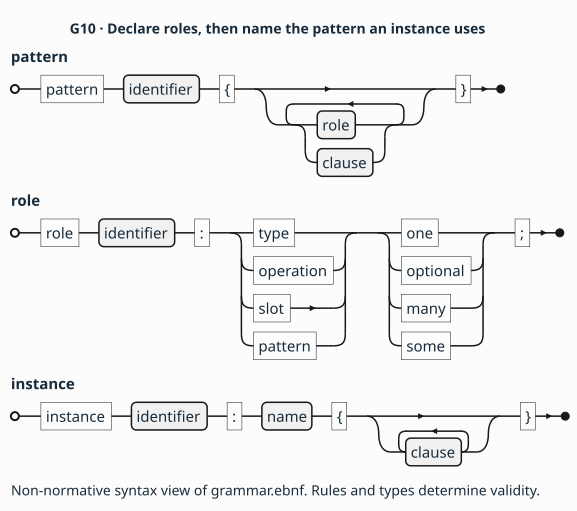

Use these forms together to distinguish a pattern's participant roles from
the instance that binds them.

[Diagram source](../figures/g10-pattern.puml) · [Exact grammar](../grammar.ebnf)

<a id="outcome"></a>

## Outcomes

**Expresses:** [How a call finishes](../explanation/model.md#outcomes).
Use outcomes to connect an observable completion case to the validity and
obligations of its outputs. **Production:** `outcome`.

Fragment — shows success and failure in a constructed buffer-copy operation.
The header, `Store` lifetime, publication context, inputs, buffer description,
effects and access contracts are omitted.

<!-- ail-example: ../examples/rule-reading/contracts.ail region=outcomes -->
```ail
package example::buffers version "1" {
  fn copy_bytes(store: Store, destination: mutptr<u8>) -> bool {
    outcome copied {
      when(returned, equal($result, true));
      meaning(success);
      state($result, valid);
      state($destination[], valid);
    }
    outcome failed {
      when(returned, equal($result, false));
      meaning(failure);
      state($result, valid);
      state($destination[], invalid);
    }
    // Input, buffer, effect and access contracts omitted.
  }
  // Header, Store lifetime and publication context omitted.
}
```

The caller can read the Boolean result in either case. The destination
elements are valid only in `copied`. [`C5`](../contracts.md#c5) supplies the
required clauses and checks coverage and exclusivity; the grammar locates each
outcome inside its [`callable`](#callable). See the
[outcome example](../contracts.md#reading-aid-non-normative-use-an-observable-result-to-choose-the-output-contract).

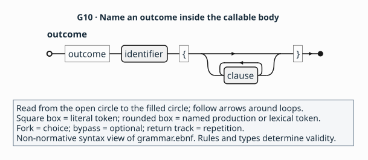

Use this view to locate the clauses describing one named completion case.

[Diagram source](../figures/g10-outcome.puml) · [Exact grammar](../grammar.ebnf)

Review tasks: [Trace validity across the model](../review/tasks.md#model-fit).

<a id="callback-use"></a>

## Callback use

**Expresses:** [Callbacks and their schedules](../explanation/model.md#callbacks).
Use a callback-use block to describe when a registration may invoke its
callback and when that registration reaches [quiescence](../glossary.md#quiescence).
**Production:** `callback_use`.

Fragment — shows registration and teardown in the synthetic callbacks API.
The [complete callbacks package](../examples/callbacks.ail) supplies the
header, `Handler`, `Subscription`, publication context, input [retention](../glossary.md#retention),
effects, outcomes and access contracts omitted here.

<!-- ail-example: ../examples/rule-reading/contracts.ail region=callback-use -->
```ail
package example::callbacks version "1" {
  fn subscribe(handler: Handler) -> Subscription {
    callback $handler {
      timing(after_return);
      count(0, many);
      scope(owner($result));
      executor(any);
      concurrency(serial);
      reentrancy(forbidden);
      quiescence(@unsubscribe);
    }
    // Input retention, effects, owned result outcome and access omitted.
  }
  fn unsubscribe(subscription: Subscription) -> unit {
    input($subscription, consume);
    retain($subscription, none);
    requires(outside_callback(@subscribe::handler));
    // Effects, successful returned outcome and access omitted.
  }
  // Header, Handler, Subscription lifetime and publication context omitted.
}
```

Within `subscribe(handler: Handler) -> Subscription`, `$handler` is the
callback parameter. Its schedule permits invocation after the registration
returns and ties its scope to the returned owner. `@unsubscribe` names the
quiescent teardown operation. [`C6`](../contracts.md#c6) checks these facts
together; its [registration example](../contracts.md#reading-aid-non-normative-separate-one-callback-invocation-from-its-registration)
shows the surrounding callable and teardown. The `callback` declaration
form in [Callables](#callable) describes one invocation and the callable value.

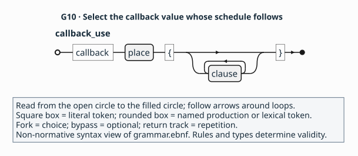

Use this view to connect a registration's callback value to the block
describing its schedule.

[Diagram source](../figures/g10-callback-use.puml) · [Exact grammar](../grammar.ebnf)

Review tasks: [Assess cancellation and teardown](../review/tasks.md#stretch).

<a id="dependency"></a>

## Dependencies

**Expresses:** shared definitions selected by
[The published description](../explanation/model.md#description).
Use [provider](../glossary.md#provider) dependencies to identify the
[profile](../glossary.md#profile) and [ABI](../glossary.md#abi) definitions that
tools need to interpret the package. **Production:** `dependency`.

Fragment — shows dependencies and an environment in the invented objects
package. The complete [objects example](../examples/objects.ail) also supplies
publication clauses and declarations. The repeated `a` and `b` digests are
synthetic [`F1`](../profiles.md#f1) test resolution tokens, not production hashes.

<!-- ail-example: ../examples/rule-reading/providers.ail region=dependencies -->
```ail
language "0.1";
package example::objects version "1" {
  use profile fixture = "example.fixture" version "1"
    digest "sha256:aaaaaaaaaaaaaaaaaaaaaaaaaaaaaaaaaaaaaaaaaaaaaaaaaaaaaaaaaaaaaaaa";
  use abi native = "example.fixture-abi" version "1"
    digest "sha256:bbbbbbbbbbbbbbbbbbbbbbbbbbbbbbbbbbbbbbbbbbbbbbbbbbbbbbbbbbbbbbbb";
  environment test {
    target("fixture64");
    platform("fixture", "1");
    toolchain("fixture-compiler", "1");
  }
  // Publication clauses and declarations omitted; these pins are F1 test tokens.
}
```

`fixture` and `native` are local aliases for external definitions selected by
identifier, version and digest. Their manifests supply meaning and supported
capabilities ([`A1`](../profiles.md#a1)); the dependency form identifies those
definitions. The [provider example](../profiles.md#reading-aid-non-normative-name-the-definitions-the-package-depends-on)
connects the aliases to clauses that use them.

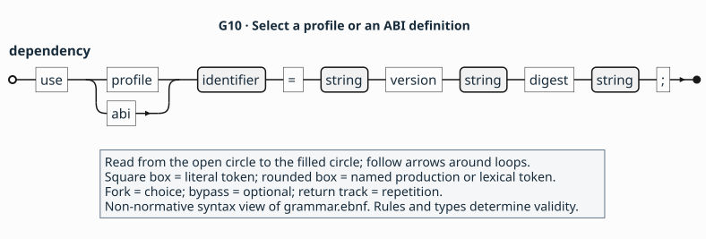

Use this view to identify the external definition selected by a local
profile or ABI alias.

[Diagram source](../figures/g10-dependency.puml) · [Exact grammar](../grammar.ebnf)

<a id="access"></a>

## Access paths

**Expresses:** [Reaching the code](../explanation/model.md#access).
Use an [access path](../glossary.md#access-path) to identify how a tool reaches
an implementation in a named environment. **Production:** `access`.

Fragment — shows a path in the invented canvas package. The header, import,
synthetic `fixture` and `native` provider pins, `test` environment, `Canvas`
and other contracts are omitted. The mechanism and convention use
[`F1`'s synthetic definitions](../profiles.md#f1).

<!-- ail-example: ../examples/rule-reading/canvas.ail region=spellings -->
```ail
package example::canvas version "1" {
  fn position(canvas: Canvas) -> Geometry::Point {
    source(fixture, "Canvas.position");
    access direct in [test] {
      abi(native, "c");
      via(fixture, "symbol", "canvas_position");
      mapping(identity);
      compatibility(stable);
    }
    // Member, receiver and callable contracts omitted.
  }
  // Header, imports, providers, environment and Canvas omitted.
}
```

`direct` names the path; `test` names its environment. The source spelling
`"Canvas.position"` identifies the API member, while `"canvas_position"`
selects the symbol used to reach it. [`A2`](../profiles.md#a2) defines the
required access clauses and environment coverage. Its
[two-path example](../profiles.md#reading-aid-non-normative-read-one-declaration-with-two-ways-to-reach-it)
shows another operation with two supported ways to reach the same behaviour.

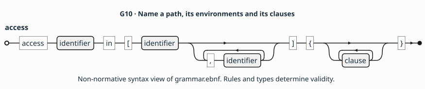

Use this view to locate a named implementation route, its environments and
the clauses defining that route.

[Diagram source](../figures/g10-access.puml) · [Exact grammar](../grammar.ebnf)

Review tasks: [Change a pointer input](../review/tasks.md#change).

## Vocabulary and validity

The generic `clause` production admits a name and arguments. The three rule
files define which clauses exist, their operand types, where they apply and
which combinations form a valid description. Recognised profiles supply
equally closed, typed extensions ([`L1`](../language.md#l1), [`A1`](../profiles.md#a1)).

For example, `deprecated(since("2"), "Use Position instead.");` above uses
values defined by [`L5`](../language.md#l5). Replacing `since("2")` with a
made-up `maybe` would still fit the `value` production, but would violate the
closed vocabulary. Similarly, an environment can have no clauses according
to its production, while [`L3`](../language.md#l3) requires a target and platform.
The grammar describes forms; the rules establish a complete, valid contract.

Return to [the documentation map](../README.md#paths-through-the-documentation),
continue to [How AIL states a contract](../explanation/contracts.md) for the
meaning of its obligations, or consult [the canonical language rules](../language.md)
for lexical, scope and publication requirements.

<a id="normative-wording"></a>

## Normative wording

The [landing page](../README.md#what-is-normative) identifies
`language.md`, `contracts.md`, `profiles.md` and `grammar.ebnf` as normative.
The language rules define the capitalised requirement, prohibition,
recommendation and permission keywords at their opening. Lowercase wording
retains its ordinary meaning and can still state a requirement; the spelling
of a keyword alone does not determine whether a sentence in these files is
part of the contract. [Q1](../explanation/choices.md#q1)
records the presentation question about consistent signals.

Reference meanings are labelled non-normative summaries and cite the rule
that determines the answer. The bordered reading aids on canonical pages
are also non-normative. A disagreement is resolved by the canonical rules,
with ambiguities retained for review.

<a id="entry-conventions"></a>

## Reading an entry

Start with **Expresses** to connect a construct to the
[API model](../explanation/model.md). **Form** names its production or syntax;
**Operands and types** names the accepted arguments. **Applies to** locates
its scope. **Required and repeatability** and **Default** distinguish an
explicit obligation from optional information. “None; required” records the
absence of a default, rather than supplying a guessed contract.

**Meaning** is a non-normative summary. **Constraints** names the companion
facts and cross-checks; **Rejected when** cites the relevant rule and any
matching conformance mutation. **Example** is a labelled complete package or
fragment with enough enclosing context to identify its subjects. **Used by
and see also** connects related entries and examples; **Rationale** leads to
the explanation. Type and declaration entries use the fields that apply.

The [reference index](README.md) offers model and rule routes.
[Types](types.md) and [declarations](declarations.md) include semantic
restrictions beyond the generic grammar. The
[applicability table](declarations.md#applicability) links each clause to its
entry and canonical rules, grouped by scope.
