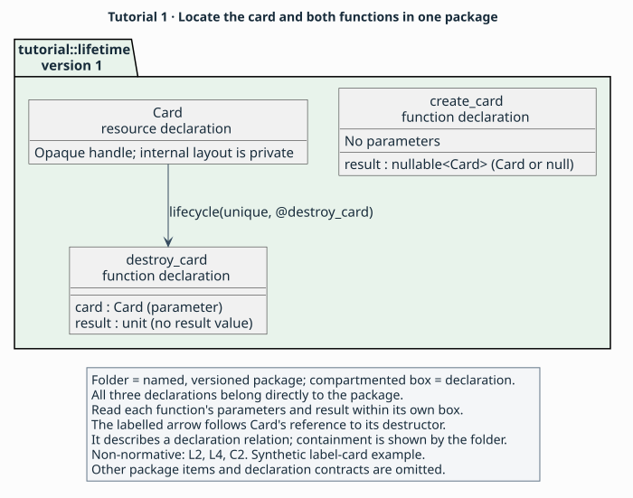
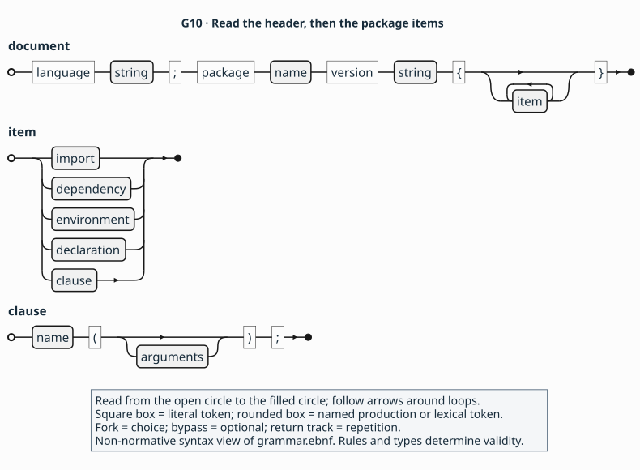
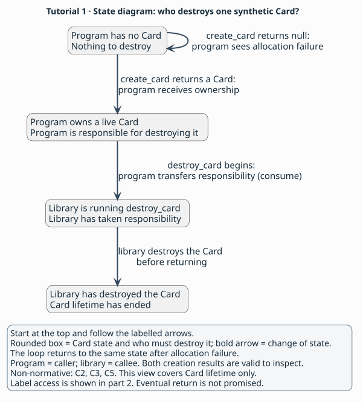

# 1. A package and one resource

> **Purpose:** tutorial — describe creation and destruction of a uniquely [owned](../glossary.md#owned) card.
> **Reader:** language designers new to [API binding](../glossary.md#binding).
> **Before this:** [Describing a small API](README.md).
> **Status:** Draft 0.1 is a proposal under review through its specification
> and synthetic examples. Parser, validator and implementation development
> are future work.
> **Rules:** [`L1–L5`](../language.md#l1), [`C1–C3`](../contracts.md#c1), [`C5`](../contracts.md#c5), [`A2–A4`](../profiles.md#a2) and [`F1`](../profiles.md#f1) are canonical.

## Goal

Write a [package](../glossary.md#package) containing `Card`, `create_card` and
`destroy_card`. At the checkpoint, you will be able to explain who destroys
the card after successful creation and what happens after allocation failure.

Start with the [steps](#steps), compare your work with the
[complete checkpoint](#checkpoint-package), then [check yourself](#check-yourself).
This part covers the invented API's card lifetime; label access comes next.

## The domain obligation

When creation returns a card, the [caller](../glossary.md#caller-and-callee)
takes responsibility for destroying it; when creation returns null, the
caller has nothing to destroy
([ownership and lifecycles](../explanation/contracts.md#who-owns-what)).

## Steps

### 1. Identify the values the caller receives

Start from these C-shaped signatures for the invented API. They sketch the
operations; the synthetic provider below supplies the calling rules.

   ```c
   typedef struct Card Card;
   Card *create_card(void);
   void destroy_card(Card *card);
   ```

Suppose a program calls `create_card`. On success it receives a handle to a
new card and eventually passes that handle to `destroy_card`. On allocation
failure it receives null and has no card to destroy. You will write those
two cases explicitly in AIL.

In AIL, `Card` will be an [opaque resource](../glossary.md#opaque-resource).
Its value is already a [handle](../glossary.md#handle) identifying a card whose
internal layout stays private. The following shell shows where that type
and the operations using it are declared ([`L4`](../language.md#l4)).

### 2. Name the package and the API it covers

Begin with the document's outer structure. This fragment locates the card
and its two operations inside one package; the next steps fill their bodies.

Fragment — shows the document shell and declaration locations. The
[complete checkpoint](#checkpoint-package) also supplies provider pins, an
environment and all declaration contracts.

<!-- ail-example: ../examples/tutorial/reading-fragments.ail region=lifetime-shell -->
```ail
language "0.1";
package tutorial::lifetime version "1" {
  surface("Synthetic label-card API release 1: Card lifetime; other operations excluded.");
  exports([@Card, @create_card, @destroy_card]);
  resource Card { /* Lifetime and other nominal contracts omitted. */ }
  fn create_card() -> nullable<Card> { /* Call contract omitted. */ }
  fn destroy_card(card: Card) -> unit { /* Call contract omitted. */ }
}
```

The outer braces contain package items. `resource` and `fn` introduce
[declarations](../glossary.md#declaration); each has its own braced body.
`surface` and `exports` are [clauses](../glossary.md#clause), whose parentheses hold arguments and whose
semicolons end the statements. The brackets in `exports` contain a list.
`@Card` selects a declaration in this package, while `card: Card` gives a
parameter its type, written without `@` ([`L1–L2`](../language.md#l1)).

Read `fn destroy_card(card: Card) -> unit` from left to right: function name,
named parameter with its type, then result type. `unit` means no result value.
Creation has no parameters and returns either a card or null, written
`nullable<Card>` ([`L4`](../language.md#l4)).

Use this model to locate the three declarations before tracing their syntax.
Start with the package folder, then read the boxes inside it. `Card`,
`create_card` and `destroy_card` are siblings in `tutorial::lifetime` version
`"1"`. Each function's compartment shows its own parameters and result.



**Reading key:** the folder shows package containment; each compartmented
box is one declaration. The labelled arrow follows `Card`'s
`lifecycle(unique, @destroy_card)` reference to the destructor, whose
definition stays beside `Card` at package level. [Step 4](#card-lifetime)
explains that clause. Other package items and contracts are omitted from
this view (non-normative; [`L2`](../language.md#l2), [`L4`](../language.md#l4),
[`C2`](../contracts.md#c2)).

[Label-card model source](../figures/tutorial-model.puml) ·
[How tools use the description](../README.md#who-writes-and-uses-an-ail-description)

Now trace the syntax that puts these declarations inside the package.



Trace the first track with `"0.1"`, `tutorial::lifetime` and `"1"` from the
fragment. The repeated `item` path admits the declarations and clauses inside
the braces. This is the
[`document`, `item` and `clause` syntax](../grammar.ebnf); completeness also
depends on [`L3`](../language.md#l3).

[Shell diagram source](../figures/g10-shell.puml) ·
[Language model with imports and members](../language.md#reading-aid-non-normative-locate-the-declarations-first)

Here all three declarations are [local](../glossary.md#local-and-imported-declaration)
to `tutorial::lifetime`: their definitions occur inside this package. The
tutorial uses free functions with explicit parameters. For an imported type
and a [member](../glossary.md#member) function associated with an owning type,
follow the language-model link above. Its geometry/canvas examples show
where those declarations live and how they refer to one another
([`L2`](../language.md#l2), [`L5`](../language.md#l5)).

Write `language "0.1";` and the package header shown in the checkpoint.
`tutorial::lifetime` names this description and `"1"` is its version.
In [`surface`](../glossary.md#surface), describe the lifetime operations of
synthetic label-card release 1. In [exports](../glossary.md#exports), list `Card`, `create_card`
and `destroy_card` as the public declarations ([`L2–L3`](../language.md#l2)).

A tool reading `Card` needs to find its destructor. Include that operation
in this first package so the tool can follow the complete lifetime. The label
operations can arrive in a later package because creating and destroying a
card can be described fully on their own ([`L3`](../language.md#l3)).

### 3. Select the synthetic definitions and configuration

The package also identifies the definitions used to interpret its calls.
Here are those selections and the configuration they support, called an
[environment](../glossary.md#environment).

Fragment — shows package dependencies and an environment. The
[complete checkpoint](#checkpoint-package) also supplies publication clauses
and declarations. Both digest strings are synthetic test tokens from
[`F1`](../profiles.md#f1).

<!-- ail-example: ../examples/tutorial/reading-fragments.ail region=lifetime-environment -->
```ail
package tutorial::lifetime version "1" {
  use profile fixture = "example.fixture" version "1" digest "sha256:aaaaaaaaaaaaaaaaaaaaaaaaaaaaaaaaaaaaaaaaaaaaaaaaaaaaaaaaaaaaaaaa";
  use abi native = "example.fixture-abi" version "1" digest "sha256:bbbbbbbbbbbbbbbbbbbbbbbbbbbbbbbbbbbbbbbbbbbbbbbbbbbbbbbbbbbbbbbb";
  environment test {
    target("fixture64");
    platform("fixture", "1");
  }
}
```

`fixture`, `native` and `test` are names introduced inside this package.
The quoted strings identify the selected definitions and exact configuration.
These `use` declarations select provider catalogues; importing declarations
from another AIL package uses the separate `import` form in
[`L2`](../language.md#l2).

Copy the two `use` declarations and the `test` environment from the checkpoint.
The `fixture` alias selects a [profile](../glossary.md#profile), the extension
defining the example's calling mechanisms. The `native` alias selects an
[ABI](../glossary.md#abi) definition, which specifies how values and calls
cross the machine boundary. The [provider](../glossary.md#provider) supplies
these definitions ([`A1`](../profiles.md#a1)).

Each selection includes a [digest pin](../glossary.md#digest-pin) identifying
the chosen definition. Here the repeated `a` and `b` digits are synthetic
test tokens specified by [`F1`](../profiles.md#f1). They belong to the
fixture catalogue, rather than identifying a production library.

The environment names target `fixture64` and
platform `fixture` version `1`. The local name `test` lets declarations say
where they apply with `available([test])`. This describes that exact
configuration; claims about other configurations require their own evidence
and description ([`L3`](../language.md#l3), [`F1`](../profiles.md#f1)).

<a id="card-lifetime"></a>

### 4. Give `Card` its lifetime and sharing rules

The resource's body records how an owner handles a card. Its lifetime clause
points to the destructor beside it in the package.

Fragment — shows `Card` inside `tutorial::lifetime`. The
[complete checkpoint](#checkpoint-package) also supplies publication,
provider and environment declarations and both functions.

<!-- ail-example: ../examples/tutorial/reading-fragments.ail region=lifetime-resource -->
```ail
package tutorial::lifetime version "1" {
  resource Card {
    available([test]);
    deprecated(no);
    implements([]);
    lifecycle(unique, @destroy_card);
    sharing(transferable);
    isolation(none);
  }
  // create_card and destroy_card are sibling declarations, omitted here.
}
```

`available([test])` refers to the environment just defined. `deprecated(no)`
states that this public declaration is not deprecated
([`L3`](../language.md#l3), [`L5`](../language.md#l5)).

Use `Card` as the parameter type when passing its handle, as the shell's
`destroy_card(card: Card)` does. `ptr<Card>` would describe storage
containing a handle, a different value ([`L4`](../language.md#l4)).

In `resource Card`, write `lifecycle(unique, @destroy_card)`. This
[lifecycle](../glossary.md#lifecycle) says that each owned card carries one
destruction obligation and names the function that discharges it. The `@`
reference points to the local `destroy_card` declaration
([`L2`](../language.md#l2), [`C2`](../contracts.md#c2)).

Add `implements([])` to state that the resource implements no interfaces.
Add `sharing(transferable)` so sole ownership can move between
[executors](../glossary.md#executor), such as threads. A caller can hand the
card to another thread, which then uses it; concurrent access is forbidden.
Add `isolation(none)` to record that the type adds no executor restriction.
The individual operations still state where and how callers enter them
([`L5`](../language.md#l5), [`C2–C3`](../contracts.md#c2)).

### 5. Describe creation's success and failure

Creation's two cases sit inside the function whose result they describe.

Fragment — shows creation outcomes in `tutorial::lifetime`. The
[complete checkpoint](#checkpoint-package) also supplies the function's
availability, effects and access path, and the surrounding package facts.

<!-- ail-example: ../examples/tutorial/reading-fragments.ail region=lifetime-outcomes -->
```ail
fn create_card() -> nullable<Card> {
  outcome created {
    when(returned, nonnull($result));
    meaning(success);
    state($result, valid);
    give($result, owned);
  }
  outcome allocation_failed {
    when(returned, null($result));
    meaning(failure);
    state($result, valid);
    give($result, owned);
  }
}
```

`created` and `allocation_failed` name outcomes within this function.
`$result` selects this invocation's returned value, a
[place](../glossary.md#place). The declaration reference `@create_card`
instead selects the function itself; `@create_card::result` identifies its
result [slot](../glossary.md#slot) from elsewhere. Inside this body, clauses
use `$result` to describe that value
([`L2`](../language.md#l2), [`C1`](../contracts.md#c1)).
In `when(returned, nonnull($result));`, the inner parentheses belong to
the predicate and the outer parentheses hold `when`'s two arguments.

Use this table to choose the form that addresses the function, its named
result slot or the returned value inside its own contract. All three rows
refer to `create_card` in `tutorial::lifetime` version `"1"`
(non-normative; [`L2`](../language.md#l2), [`C1`](../contracts.md#c1)).

| Form | What it selects | Where to read it |
|---|---|---|
| `@create_card` | The function declaration. | In the package's `exports` list. |
| `@create_card::result` | That function's named result slot. | In a reference identifying the slot from elsewhere; the checkpoint does not need this form. |
| `$result` | The returned value of this invocation. | Inside `create_card`'s outcomes, as shown above. |

Give `create_card` the result type `nullable<Card>`. For each possible
result, write an [outcome](../glossary.md#outcome): a named case explaining
what happened and which value the caller can use. Pair `nonnull($result)`
with `meaning(success)` and `null($result)` with `meaning(failure)`
([`C5`](../contracts.md#c5)).

In both outcomes write `state($result, valid)`. The caller can inspect the
returned value in either case, including testing the valid null that reports
failure. Also write `give($result, owned)` in both cases. For a non-null card
this gives the caller its destruction obligation. For null the same clause
creates no obligation, because ownership applies only to a non-null
reference ([`C1`](../contracts.md#c1), [`C5`](../contracts.md#c5)).

### 6. Transfer responsibility when destruction begins

Destruction describes its input in the function body. The outcome records
the single successful way this destructor returns.

Fragment — shows consumption in `tutorial::lifetime`. The
[complete checkpoint](#checkpoint-package) also supplies availability,
effects, access and the surrounding package facts.

<!-- ail-example: ../examples/tutorial/reading-fragments.ail region=lifetime-consume -->
```ail
fn destroy_card(card: Card) -> unit {
  input($card, consume);
  retain($card, none);
  outcome done {
    when(returned, any);
    meaning(success);
  }
}
```

The signature introduces `card`; `$card` selects that parameter's value.
`any` covers the returned case without testing a value: this function has
a `unit` result ([`C1`](../contracts.md#c1), [`C5`](../contracts.md#c5)).

Give `destroy_card` one `Card` parameter and a `unit` result. The caller
supplies a valid, non-null card that it owns. Write
`input($card, consume)` so responsibility passes to the library as soon as
the call begins. This transfer is [consumption](../glossary.md#consume).
Write `retain($card, none)` and one successful returned outcome, as in the
checkpoint. The destructor finishes destroying the card before returning
([`C2–C3`](../contracts.md#c2)).

After that transfer, the caller has no second destruction to perform.
Consumption transfers an obligation on every outcome, including failure in
operations that admit it. This destructor has only a successful returned
outcome. Its `mutation(none)` describes changes to live input contents;
destruction itself is already described by consumption and lifecycle
([`C2–C3`](../contracts.md#c2)).

### 7. Complete the facts about each call

Use creation to locate the remaining clauses and the access block. The
clauses describe the call; the nested block identifies its implementation.

Fragment — shows creation's common facts in `tutorial::lifetime`. The
[complete checkpoint](#checkpoint-package) also supplies the outcomes from
step 5 and the package context from steps 2–4.

<!-- ail-example: ../examples/tutorial/reading-fragments.ail region=lifetime-effects-access -->
```ail
fn create_card() -> nullable<Card> {
  available([test]);
  deprecated(no);
  execution(sync);
  completions([returned]);
  executor(any);
  concurrency(parallel);
  reentrancy(allowed);
  mutation(none);
  variadic(false);
  // Outcomes omitted.
  access direct in [test] {
    abi(native, "c");
    via(fixture, "symbol", "fixture_create_card");
    mapping(identity);
    compatibility(stable);
  }
}
```

`direct` names a path within `create_card`; `[test]` selects the environment
where it applies. `native` and `fixture` refer to the package's two `use`
aliases. The quoted symbol identifies the synthetic implementation
([`A2`](../profiles.md#a2)).

For both functions, copy the checkpoint's [availability](../glossary.md#availability),
deprecation and seven effect [clauses](../glossary.md#clause). Read the effects
as answers about execution: both calls run synchronously, and returning is
their only declared way to finish. `executor(any)` permits entry from any
executor.

Creation permits independent parallel calls. For destruction, callers make
calls using the same resource one at a time. They also avoid nested
[re-entry](../glossary.md#re-entrancy): starting another call on that resource
from within a call that is still active. `variadic(false)` fixes the parameter list
([`L3`](../language.md#l3), [`L5`](../language.md#l5), [`C3`](../contracts.md#c3)).

Copy each function's `access direct` block too. This [access path](../glossary.md#access-path)
tells a tool which synthetic symbol implements the function and which rules
govern the call. Its `abi`, `via`, `mapping` and `compatibility` clauses are
part of every complete function description. [Part 5](05-access-and-change.md)
explains them individually ([`A2`](../profiles.md#a2)).

Use the state diagram to follow who is responsible for destroying a card.
Start at the top box and follow the labelled arrows. If `create_card` returns
null, the program stays in the same state, with nothing to destroy. If it
returns a card, the program owns that card and becomes responsible for its
destruction. Both results are valid for the program to inspect.

When the program calls `destroy_card`, responsibility passes to the library
at entry. The library destroys the card before returning. The boxes separate
these states so that transfer at entry and completed destruction remain
visible as different events. The arrows describe changes of state.

This is the invented API's card-lifetime view; part 2 adds label access.
The contract describes what happens if a call returns; it supplies no guarantee
that the call eventually finishes (non-normative; [`C2–C3`](../contracts.md#c2),
[`C5`](../contracts.md#c5)).



[Card lifecycle diagram source](../figures/tutorial-lifetime.puml) ·
[How tools use the description](../README.md#who-writes-and-uses-an-ail-description)

## Checkpoint package

Compare your work with this complete [lifetime file](../examples/tutorial/01-lifetime.ail).
It describes the invented card using the synthetic fixture profile, catalogue
and digest tokens from [`F1`](../profiles.md#f1). After comparison, continue to
[the observations](#expected-observations).

Complete package — admitted by the grammar and complete under draft 0.1,
checked by inspection.

<!-- ail-example: ../examples/tutorial/01-lifetime.ail region=checkpoint -->
```ail
language "0.1";
package tutorial::lifetime version "1" {
  surface("Synthetic label-card API release 1: Card lifetime; other operations excluded.");
  exports([@Card, @create_card, @destroy_card]);
  use profile fixture = "example.fixture" version "1" digest "sha256:aaaaaaaaaaaaaaaaaaaaaaaaaaaaaaaaaaaaaaaaaaaaaaaaaaaaaaaaaaaaaaaa";
  use abi native = "example.fixture-abi" version "1" digest "sha256:bbbbbbbbbbbbbbbbbbbbbbbbbbbbbbbbbbbbbbbbbbbbbbbbbbbbbbbbbbbbbbbb";
  environment test {
    target("fixture64");
    platform("fixture", "1");
  }
  resource Card {
    available([test]);
    deprecated(no);
    implements([]);
    lifecycle(unique, @destroy_card);
    sharing(transferable);
    isolation(none);
    doc("Owns its current label; refresh replaces that label.");
  }
  fn create_card() -> nullable<Card> {
    available([test]);
    deprecated(no);
    execution(sync);
    completions([returned]);
    executor(any);
    concurrency(parallel);
    reentrancy(allowed);
    mutation(none);
    variadic(false);
    outcome created {
      when(returned, nonnull($result));
      meaning(success);
      state($result, valid);
      give($result, owned);
    }
    outcome allocation_failed {
      when(returned, null($result));
      meaning(failure);
      state($result, valid);
      give($result, owned);
    }
    access direct in [test] {
      abi(native, "c");
      via(fixture, "symbol", "fixture_create_card");
      mapping(identity);
      compatibility(stable);
    }
  }
  fn destroy_card(card: Card) -> unit {
    available([test]);
    deprecated(no);
    execution(sync);
    completions([returned]);
    executor(any);
    concurrency(serial);
    reentrancy(forbidden);
    mutation(none);
    variadic(false);
    input($card, consume);
    retain($card, none);
    outcome done {
      when(returned, any);
      meaning(success);
    }
    access direct in [test] {
      abi(native, "c");
      via(fixture, "symbol", "fixture_destroy_card");
      mapping(identity);
      compatibility(stable);
    }
  }
}
```

## Expected observations

Use these non-normative summaries to check your reading of
[`L3`](../language.md#l3), [`C1–C3`](../contracts.md#c1) and
[`C5`](../contracts.md#c5):

- Starting from `Card`, you can follow `@destroy_card` to its declaration.
  Every public declaration applies in `test`, and both functions have an
  access path for that configuration.
- A result from `create_card` selects exactly one case: null or non-null.
  The caller can inspect either result and destroys only a returned card.
- `destroy_card` takes the caller's destruction responsibility at entry.
  Its `unit` result contains no value needing an output-state clause.
- The `returned` [completion](../glossary.md#completion) describes how a call
  can finish. Eventual return remains a separate property: listing this
  completion supplies no termination guarantee.

## Check yourself

1. If creation reports allocation failure, does its `give(owned)` create a
   destruction obligation?
2. Which clause transfers responsibility to `destroy_card`, and why is
   `valid($card, call)` unnecessary there?
3. What would a reader lose if you removed the destructor from this package?

### Answers

1. Null carries no obligation. For a nullable reference, `give(owned)`
   applies only when the result is non-null ([`C1`](../contracts.md#c1),
   [`C5`](../contracts.md#c5)).
2. `input($card, consume)` transfers a valid owned input at entry. The
   library then controls its lifetime. `valid` instead describes the
   caller's continuing duty to keep a [borrowed input](../glossary.md#borrow)
   usable for a region ([`C3`](../contracts.md#c3)).
3. The reader would lose the operation that the card's lifecycle names.
   A package includes every definition its public declarations depend on,
   its [dependency closure](../glossary.md#dependency-closure), even when
   the chosen API subset is small ([`L3`](../language.md#l3), [`C2`](../contracts.md#c2)).

## Invalid variant

In `destroy_card`, replace `input($card, consume)` with this clause and keep
the rest of the checkpoint unchanged.

Invalid — rejected under [`C2`](../contracts.md#c2).

<!-- ail-fragment -->
```ail
input($card, borrow);
```

Borrowing leaves destruction with the caller. The unique lifecycle requires
its destructor to take that responsibility, so this change contradicts the
declared lifecycle. Adding a borrow-validity clause would still leave that
contradiction in place.

Return: [Describing a small API](README.md).
Next: [2. Lending access](02-lending.md).
