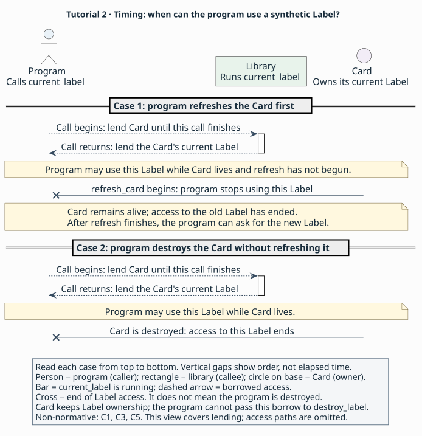

# 2. Lending access

> **Purpose:** tutorial — describe a label [borrow](../glossary.md#borrow) and the operation that ends it early.
> **Reader:** language designers new to [API binding](../glossary.md#binding).
> **Before this:** [1. A package and one resource](01-lifetime.md).
> **Status:** Draft 0.1 is a proposal under review through its specification
> and synthetic examples. Parser, validator and implementation development
> are future work.
> **Rules:** [`L3–L5`](../language.md#l3), [`C1–C3`](../contracts.md#c1), [`C5`](../contracts.md#c5) and [`A2–A4`](../profiles.md#a2) are canonical.

## Goal

Extend the card-lifetime [package](../glossary.md#package) with `Label`,
`current_label`, `refresh_card` and `destroy_label`. You will describe how a
caller uses the current label while its card owns it, and identify the two
events that end that access.

Follow the [steps](#steps), compare the [complete checkpoint](#checkpoint-package),
then [check yourself](#check-yourself). The new relationship is between the
returned label and its card; the creation and destruction functions from
part 1 keep their contracts.

## The domain obligation

A [caller](../glossary.md#caller-and-callee) using a card's current label keeps
the card alive and finishes using that label before refreshing the card
([borrow validity and invalidation](../explanation/contracts.md#how-long-a-borrow-lasts)).

## Steps

### 1. Follow a label through use and refresh

Add these operations to the C-shaped sketch of the synthetic API. The
signatures identify the values exchanged; the following steps supply their
lifetime promises.

   ```c
   typedef struct Label Label;
   Label *current_label(Card *card);
   void refresh_card(Card *card);
   void destroy_label(Label *label);
   ```

Imagine a program obtaining the current label and using it while the card
stays alive. If the program finishes with the card without refreshing it,
destruction ends its access to that label. Now consider the same program
refreshing the card first. The card lives on, but the old label becomes
unusable as soon as refresh begins. After refresh finishes, the program can
call `current_label` again to obtain the new label.

These cases need two facts: the owner that keeps the label alive and any
operation that makes it unusable earlier. AIL calls that earlier ending
[invalidation](../glossary.md#invalidation). You will express both facts on
the returned borrow ([`C1`](../contracts.md#c1), [`C5`](../contracts.md#c5)).

### 2. Describe `Label` and its destructor

Place the label and its destructor beside the card declarations. This is the
same relationship you used for `Card`, with its own type and operation names.

Fragment — shows the label's lifecycle in `tutorial::lending`. The
[complete checkpoint](#checkpoint-package) also supplies publication and
provider context, common declaration clauses and the destructor's effects,
outcome and access path.

<!-- ail-example: ../examples/tutorial/reading-fragments.ail region=lending-lifecycle -->
```ail
package tutorial::lending version "1" {
  resource Label {
    implements([]);
    lifecycle(unique, @destroy_label);
    sharing(transferable);
    isolation(none);
  }
  fn destroy_label(label: Label) -> unit {
    input($label, consume);
    retain($label, none);
    // Remaining call contract omitted.
  }
}
```

`@destroy_label` finds the local function declaration. In its signature,
`Label` names the type without `@`; inside its body, `$label` selects the
parameter value ([`L2`](../language.md#l2), [`C1`](../contracts.md#c1)).

Declare `Label` as a resource. Like `Card`, its value is an opaque
[handle](../glossary.md#handle); the library keeps the layout private.
Give it `lifecycle(unique, @destroy_label)`, `implements([])`,
`sharing(transferable)` and `isolation(none)`. Add `destroy_label` using the
same consuming-destructor form as `destroy_card`
([`L4–L5`](../language.md#l4), [`C2`](../contracts.md#c2)).

The [lifecycle](../glossary.md#lifecycle) explains what an owner does with a
label. An [owned](../glossary.md#owned) label brings a destruction obligation,
which `destroy_label` can take and discharge. A label borrowed from the card
leaves ownership with the card. The caller uses that label only within its
borrow lifetime; it has no owned obligation to pass to the destructor
([`C2–C3`](../contracts.md#c2), [`C5`](../contracts.md#c5)).

Keep this distinction in mind as you add the getter. A resource's type
describes how an owner releases it, while an individual operation says whether
the caller receives ownership or temporary access. Borrowing in AIL states
that agreement; it implies no Rust-style static checking or exclusivity.

### 3. Keep the input card usable during the call

The getter names a card input and a label result. Read the clauses about
the input before adding the result's separate lifetime.

Fragment — shows the getter's input in `tutorial::lending`. The
[complete checkpoint](#checkpoint-package) also supplies outcomes, effects,
access and the surrounding resource and package declarations.

<!-- ail-example: ../examples/tutorial/reading-fragments.ail region=lending-input -->
```ail
fn current_label(card: Card) -> Label {
  input($card, borrow);
  retain($card, none);
  valid($card, call);
}
```

The colon assigns `Card` as the type of `card`, and the arrow introduces
the result type `Label`. All three `$card` [places](../glossary.md#place)
select that same input.
`call` names the period during which this invocation runs
([`L2`](../language.md#l2), [`C1`](../contracts.md#c1)).

For `current_label(card: Card) -> Label`, write `input($card, borrow)`.
The caller keeps ownership while the library uses the card. Write
`retain($card, none)` to promise that the call stores no card reference for
later work. Finally, write `valid($card, call)`: the caller keeps the card
usable until this invocation completes ([`C3`](../contracts.md#c3)).

This describes the input while the library is finding the label. The returned
label needs its own promise because the caller will use it after that call
has finished.

### 4. Tie the returned label to the card's lifetime

The result's contract belongs inside an outcome. Read its owner relationship
first; the following step explains the additional refresh cutoff shown here.

Fragment — shows the getter's returned borrow in `tutorial::lending`. The
[complete checkpoint](#checkpoint-package) also supplies input clauses,
effects, access and the declarations named by this fragment.

<!-- ail-example: ../examples/tutorial/reading-fragments.ail region=lending-result -->
```ail
fn current_label(card: Card) -> Label {
  outcome lent {
    when(returned, any);
    meaning(success);
    state($result, valid);
    give($result, borrow(owner($card)));
    invalidated_by($result, [@refresh_card]);
  }
}
```

`$result` selects the returned label; `$card` still selects the enclosing
function's input. Read `borrow(owner($card))` from inside out.
`owner($card)` names the card's lifetime, and `borrow(...)` describes
access bounded by that lifetime. The `give` clause associates that access
with the result. These values describe the contract; tools do not evaluate
them as executable expressions ([`L1`](../language.md#l1),
[`C1`](../contracts.md#c1), [`C5`](../contracts.md#c5)).

In the successful `lent` [outcome](../glossary.md#outcome), write
`state($result, valid)` and `give($result, borrow(owner($card)))`.
The caller receives a usable, non-null label and keeps the card alive for
as long as it uses that label ([`C1`](../contracts.md#c1), [`C5`](../contracts.md#c5)).

AIL calls the lifetime named by `owner($card)` a [region](../glossary.md#region).
Here that region lasts until the card is destroyed. Compare it with `call`
in the previous step: `call` bounds the input's use during `current_label`;
`owner($card)` bounds later use of the result. The
[input/output validity discussion](../explanation/choices.md#q5) examines
the cost of finding these related facts in separate places.

### 5. End earlier borrows when refresh begins

The preceding outcome points to the refresh operation using `@refresh_card`.
Here is the relevant part of that sibling function.

Fragment — shows refresh's input and mutation in `tutorial::lending`. The
[complete checkpoint](#checkpoint-package) also supplies its remaining
effects, successful outcome, access path and package context.

<!-- ail-example: ../examples/tutorial/reading-fragments.ail region=lending-refresh -->
```ail
fn refresh_card(card: Card) -> unit {
  mutation(arguments);
  input($card, borrow);
  retain($card, none);
  valid($card, call);
}
```

Each function has its own parameter named `card`. `$card` addresses the
parameter in the enclosing function; `@refresh_card` identifies the other
declaration from the getter's outcome ([`L2`](../language.md#l2),
[`C1`](../contracts.md#c1)).

In `lent`, add `invalidated_by($result, [@refresh_card])`. This tells the
caller to stop using that label at entry to `refresh_card` involving its
card, even though the card itself remains alive. Destruction already ends
the owner region; the list names the additional, earlier cutoff
([`C5`](../contracts.md#c5)).

Define `refresh_card(card: Card) -> unit` with a borrowed card input and
`valid($card, call)`. Set `mutation(arguments)` because refresh replaces
the card's live contents. Give it one successful returned outcome and the
remaining clauses from the checkpoint. A reader can now follow
`@refresh_card` from the borrowed result to the function that ends its use.
That function takes the owning card as an argument and declares that it
changes the card's contents, as the invalidation contract requires
([`C3`](../contracts.md#c3), [`C5`](../contracts.md#c5)).

### 6. Include the new declarations in the package

The expanded publication clauses stay at package level. Each `@` entry
selects a local declaration included in this checkpoint.

Fragment — shows publication in `tutorial::lending`. The
[complete checkpoint](#checkpoint-package) also supplies the header,
dependencies, environment and all declarations.

<!-- ail-example: ../examples/tutorial/reading-fragments.ail region=lending-publication -->
```ail
package tutorial::lending version "1" {
  surface("Synthetic label-card API release 1: Card lifetime, label lending and refresh; other operations excluded.");
  exports([@Card, @create_card, @destroy_card, @Label, @destroy_label, @current_label, @refresh_card]);
}
```

Use the checkpoint's new package name and expand its [surface](../glossary.md#surface)
to include lending and refresh. Add the new declarations to
[`exports`](../glossary.md#exports) and give each its
[availability](../glossary.md#availability), deprecation and other applicable clauses. Copy
the synthetic [access paths](../glossary.md#access-path) for each new function
([`L2–L5`](../language.md#l2), [`A2`](../profiles.md#a2)).

A reader can now follow `current_label` to `Label`, the label's destructor
and the refresh operation that ends its borrow. Together with their further
dependencies, these form the [dependency closure](../glossary.md#dependency-closure)
needed to interpret this package. Keep the first checkpoint as its own
smaller example ([`L3`](../language.md#l3)).

Compare the two timelines to find when the program stops using a borrowed
label. Read each case separately from top to bottom. Both begin with the
program lending its card to `current_label` until that call finishes. The
library then returns the card's current label, which the program can use
after the call has finished. The card keeps ownership of the label.

In the first case, the program refreshes the card. Access to the old label
ends as soon as `refresh_card` begins, while the card remains alive. After
refresh finishes, the program can ask for the new label. In the second case,
there is no refresh: access lasts until the card is destroyed. In either
case, the program has borrowed access only and cannot pass this label to
`destroy_label`.

Dashed arrows show the borrowed access; a cross marks its end. The bar shows
when `current_label` is running. Vertical gaps show event order rather than
elapsed time. This view covers the synthetic label's lifetime; the access
paths remain in the checkpoint (non-normative;
[`C1`](../contracts.md#c1), [`C3`](../contracts.md#c3),
[`C5`](../contracts.md#c5)).



[Label borrow diagram source](../figures/tutorial-borrow.puml) ·
[How tools use the description](../README.md#who-writes-and-uses-an-ail-description)

## Checkpoint package

Compare your work with the complete [lending file](../examples/tutorial/02-lending.ail).
The invented API uses the synthetic fixture [profile](../glossary.md#profile),
catalogue and [digest tokens](../glossary.md#digest-pin) from [`F1`](../profiles.md#f1).
After comparison, continue to [the observations](#expected-observations).

Complete package — admitted by the grammar and complete under draft 0.1,
checked by inspection.

<!-- ail-example: ../examples/tutorial/02-lending.ail region=checkpoint -->
```ail
language "0.1";
package tutorial::lending version "1" {
  surface("Synthetic label-card API release 1: Card lifetime, label lending and refresh; other operations excluded.");
  exports([@Card, @create_card, @destroy_card, @Label, @destroy_label, @current_label, @refresh_card]);
  use profile fixture = "example.fixture" version "1" digest "sha256:aaaaaaaaaaaaaaaaaaaaaaaaaaaaaaaaaaaaaaaaaaaaaaaaaaaaaaaaaaaaaaaa";
  use abi native = "example.fixture-abi" version "1" digest "sha256:bbbbbbbbbbbbbbbbbbbbbbbbbbbbbbbbbbbbbbbbbbbbbbbbbbbbbbbbbbbbbbbb";
  environment test {
    target("fixture64");
    platform("fixture", "1");
  }
  resource Card {
    available([test]);
    deprecated(no);
    implements([]);
    lifecycle(unique, @destroy_card);
    sharing(transferable);
    isolation(none);
    doc("Owns its current label; refresh replaces that label.");
  }
  fn create_card() -> nullable<Card> {
    available([test]);
    deprecated(no);
    execution(sync);
    completions([returned]);
    executor(any);
    concurrency(parallel);
    reentrancy(allowed);
    mutation(none);
    variadic(false);
    outcome created {
      when(returned, nonnull($result));
      meaning(success);
      state($result, valid);
      give($result, owned);
    }
    outcome allocation_failed {
      when(returned, null($result));
      meaning(failure);
      state($result, valid);
      give($result, owned);
    }
    access direct in [test] {
      abi(native, "c");
      via(fixture, "symbol", "fixture_create_card");
      mapping(identity);
      compatibility(stable);
    }
  }
  fn destroy_card(card: Card) -> unit {
    available([test]);
    deprecated(no);
    execution(sync);
    completions([returned]);
    executor(any);
    concurrency(serial);
    reentrancy(forbidden);
    mutation(none);
    variadic(false);
    input($card, consume);
    retain($card, none);
    outcome done {
      when(returned, any);
      meaning(success);
    }
    access direct in [test] {
      abi(native, "c");
      via(fixture, "symbol", "fixture_destroy_card");
      mapping(identity);
      compatibility(stable);
    }
  }
  resource Label {
    available([test]);
    deprecated(no);
    implements([]);
    lifecycle(unique, @destroy_label);
    sharing(transferable);
    isolation(none);
    doc("A label of seven nonzero UTF-8 code units; an owned Label is an independent snapshot.");
  }
  fn destroy_label(label: Label) -> unit {
    available([test]);
    deprecated(no);
    execution(sync);
    completions([returned]);
    executor(any);
    concurrency(serial);
    reentrancy(forbidden);
    mutation(none);
    variadic(false);
    input($label, consume);
    retain($label, none);
    outcome done {
      when(returned, any);
      meaning(success);
    }
    access direct in [test] {
      abi(native, "c");
      via(fixture, "symbol", "fixture_destroy_label");
      mapping(identity);
      compatibility(stable);
    }
  }
  fn current_label(card: Card) -> Label {
    available([test]);
    deprecated(no);
    execution(sync);
    completions([returned]);
    executor(any);
    concurrency(serial);
    reentrancy(allowed);
    mutation(none);
    variadic(false);
    input($card, borrow);
    retain($card, none);
    valid($card, call);
    outcome lent {
      when(returned, any);
      meaning(success);
      state($result, valid);
      give($result, borrow(owner($card)));
      invalidated_by($result, [@refresh_card]);
    }
    access direct in [test] {
      abi(native, "c");
      via(fixture, "symbol", "fixture_current_label");
      mapping(identity);
      compatibility(stable);
    }
  }
  fn refresh_card(card: Card) -> unit {
    available([test]);
    deprecated(no);
    execution(sync);
    completions([returned]);
    executor(any);
    concurrency(serial);
    reentrancy(allowed);
    mutation(arguments);
    variadic(false);
    input($card, borrow);
    retain($card, none);
    valid($card, call);
    outcome done {
      when(returned, any);
      meaning(success);
    }
    access direct in [test] {
      abi(native, "c");
      via(fixture, "symbol", "fixture_refresh_card");
      mapping(identity);
      compatibility(stable);
    }
  }
}
```

## Expected observations

Use these non-normative summaries to check your reading of
[`C1–C3`](../contracts.md#c1) and [`C5`](../contracts.md#c5):

- `current_label` returns a non-null `Label` and lends it to the caller.
  Ownership remains with the card.
- The caller can use the label after the getter returns because its region
  is `owner($card)`. The input's `call` region has already ended.
- Beginning refresh ends the old label borrow for that card. Destroying the
  card also ends it. In either case the caller stops using the old label.
- Both new card operations require serial access. `executor(any)` permits
  entry from any [executor](../glossary.md#executor); the caller still
  serializes independent calls using the same card.
- `destroy_label` accepts an owned label. Its [availability](../glossary.md#availability)
  in `test` tells the caller where the operation exists; the consuming
  input contract tells the caller what it needs to supply.

## Check yourself

1. If the card remains alive after refresh, can a caller keep using the old label?
2. Which clause requires the caller to keep the card alive while using a
   label after `current_label` returns?
3. Who is responsible for the label borrowed from `current_label`, and
   can the caller pass that borrow to `destroy_label`?

### Answers

1. Refresh entry ends the old borrow through `invalidated_by`. The caller
   obtains a fresh label after refresh finishes ([`C5`](../contracts.md#c5)).
2. `give($result, borrow(owner($card)))` relates the returned label to the
   card's lifetime. `valid($card, call)` covers the input only for that
   invocation ([`C1`](../contracts.md#c1), [`C3`](../contracts.md#c3),
   [`C5`](../contracts.md#c5)).
3. The card keeps ownership. The caller receives access with no destruction
   obligation, so it cannot supply the owned input that `destroy_label`
   consumes ([`C3`](../contracts.md#c3), [`C5`](../contracts.md#c5)).

## Invalid variant

In `current_label`'s `lent` outcome, replace `give` with this clause and keep
the rest unchanged.

Invalid — rejected under [`C1`](../contracts.md#c1).

<!-- ail-fragment -->
```ail
give($result, borrow(call));
```

The `call` region ends at the completion delivering the label. A returned
borrow needs a region that survives delivery so the caller can use it.

Return: [Describing a small API](README.md).
Next: [3. Caller-supplied storage and failure](03-storage.md).
