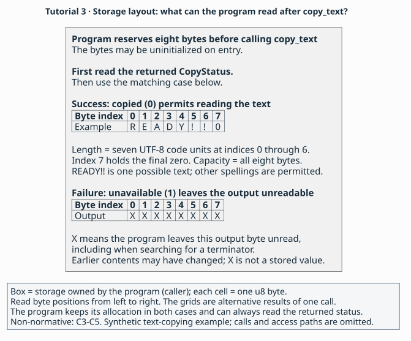

# 3. Caller-supplied storage and failure

> **Purpose:** tutorial — describe text copying and what the caller can read after success or failure.
> **Reader:** language designers new to [API binding](../glossary.md#binding).
> **Before this:** [2. Lending access](02-lending.md).
> **Status:** Draft 0.1 is a proposal under review through its specification
> and synthetic examples. Parser, validator and implementation development
> are future work.
> **Rules:** [`L4–L5`](../language.md#l4), [`C1–C5`](../contracts.md#c1) and [`A2–A4`](../profiles.md#a2) are canonical.

## Goal

Add `CopyStatus` and `copy_text` to the invented label-card API. The
[caller](../glossary.md#caller-and-callee) reserves eight bytes, and the
library attempts to write the label's text into them. You will describe the
storage the call needs and what the caller can read after either result.

Follow the [steps](#steps), compare the [complete checkpoint](#checkpoint-package),
then [check yourself](#check-yourself). The new material concerns the
destination buffer and the returned status; the card and label lifetimes
continue to apply.

## The domain obligation

The caller supplies enough storage that overlaps no other memory accessed
by the call, and reads the output text only after a successful copy
([buffers](../explanation/contracts.md#buffers-and-strings) and
[output states](../explanation/contracts.md#every-way-a-call-can-end)).

## Steps

### 1. Distinguish successful copying from unavailable text

Start with this C-shaped sketch. It gives the synthetic operation a status
result as well as a destination address; the fixture supplies its representation.

   ```c
   typedef enum CopyStatus {
       copied = 0,
       unavailable = 1
   } CopyStatus;
   CopyStatus copy_text(Label *label, unsigned char *destination);
   ```

On success, `copy_text` writes seven nonzero UTF-8 code units followed by
a zero terminator and returns `copied`. For the illustrative label `READY!!`,
the caller can read those seven bytes and the final zero. If text is
unavailable, the function returns `unavailable` and leaves the output
unreadable. The caller checks the status first to decide which case applies.

A failed call may already have changed the destination. The failure contract
promises no readable output and no preservation of earlier bytes
([`C5`](../contracts.md#c5)).

### 2. Define the two permitted status values

Declare `enum CopyStatus: i32` with `values(closed)` and cases `copied = 0`
and `unavailable = 1`. Add `sharing(value)`, `isolation(none)`,
[availability](../glossary.md#availability) and deprecation as shown below.
The closed enum permits exactly these two values. An open enum would admit
every value of its underlying `i32`, including unnamed values
([`L4`](../language.md#l4), [`C2`](../contracts.md#c2)).

The caller tests the returned status to distinguish success from failure.
AIL calls the tested value a [discriminator](../glossary.md#discriminator).
Because the enum is closed, the two cases you will describe cover its entire
domain ([`C5`](../contracts.md#c5)).

### 3. Lend the label and destination for the call

Give `copy_text` a `Label` input and a `mutptr<u8>` destination. For each
parameter, write `input(..., borrow)`, `retain(..., none)` and
`valid(..., call)` using the full parameter names shown in the checkpoint. The call
[borrows](../glossary.md#borrow) access while the caller keeps ownership,
and the library promises no [retention](../glossary.md#retention) for later
work ([`C3`](../contracts.md#c3)).

For a label obtained in part 2, keeping it valid means keeping its card alive
and preventing refresh throughout copying. Passing that label to another
function preserves its earlier borrow conditions. AIL borrowing describes
these obligations; it supplies no Rust-style static checking
([`C1`](../contracts.md#c1), [`C3`](../contracts.md#c3), [`C5`](../contracts.md#c5)).

The destination is the address of caller-owned storage. Its pointer stays
usable throughout the call, even if the function fails to write valid text.
You will describe that pointer and the bytes reached through it separately.

### 4. Describe the writable storage

Write `direction($destination, out)`. The library writes through this
pointer and leaves its prior contents unread. Write
`aliasing($destination, disjoint)` so the caller supplies storage that
overlaps no other memory accessed in the call. Set `mutation(arguments)`
because writing the destination changes storage reached through an argument
([`C3`](../contracts.md#c3)).

Now write `extent($destination, buffer(7, 8, elements))`. This
[extent](../glossary.md#buffer-extent) gives two counts: seven initialized
text elements when the output is valid, and capacity for eight elements.
The caller allocates correctly aligned storage for all eight before entry.
Because the direction is `out`, the caller may leave the bytes uninitialized
on entry ([`C4`](../contracts.md#c4)).

Finally, write `contents($destination, text("utf-8", nul))`. The
[contents](../glossary.md#contents) contract interprets the elements as UTF-8
code units and requires a final zero. Length counts the seven units before
that zero; capacity includes its eighth position. Compare seven allocated
bytes with eight: only eight leaves room for the terminator. The synthetic
profile supports this encoding ([`C4`](../contracts.md#c4), [`F1`](../profiles.md#f1)).

### 5. State what the caller can read on each outcome

Add two [outcomes](../glossary.md#outcome) describing what happens when the
call returns. Returning is this function's declared
[completion](../glossary.md#completion), or way to finish. Use `equal($result, 0)` with
`meaning(success)` and `equal($result, 1)` with `meaning(failure)`.
In both outcomes, mark `$result` valid so the caller can read the status
that decides which case occurred ([`C5`](../contracts.md#c5)).

For success, write `state($destination[], valid)`. For failure, write
`state($destination[], invalid)`. The parameter `$destination` is a
[slot](../glossary.md#slot); adding `[]` makes a
[place](../glossary.md#place) selecting its buffer elements. These clauses
therefore describe the written bytes. The caller continues to own the
allocation in both cases ([`C1`](../contracts.md#c1), [`C3`](../contracts.md#c3),
[`C5`](../contracts.md#c5)).

On failure, the caller leaves the buffer unread. Searching for a terminator
would also read those bytes, so the caller skips that search. It can still
inspect the valid status.
`meaning(failure)` describes that status result; a thrown exception would
need a different signature and completion contract ([`C5`](../contracts.md#c5)).

### 6. Include copying in the package

Use the checkpoint's package name, describe copying in its
[surface](../glossary.md#surface), and add `CopyStatus` and `copy_text` to
the [exports](../glossary.md#exports). Keep the preceding declarations and
complete `copy_text` with its effects and synthetic
[symbol access path](../glossary.md#access-path)
([`L3`](../language.md#l3), [`C3`](../contracts.md#c3), [`A2`](../profiles.md#a2)).

Use the layout to distinguish allocated capacity from readable text length.
For the index's illustrative `READY!!`, success writes the seven text elements
at indices 0–6 and the final zero at index 7. The spelling is not fixed by the
contract. Failure still returns a valid status, but none of those output
elements is readable; the `X` marks do not mean cleared or unchanged bytes.
The caller allocates eight elements before entry without initializing them
and retains that storage in both outcomes. This view omits calls and access
paths (non-normative; [`C3–C5`](../contracts.md#c3)).



[Buffer layout source](../figures/tutorial-storage.puml) ·
[How tools use the description](../README.md#who-writes-and-uses-an-ail-description)

## Checkpoint package

Compare your work with the complete [text-copying file](../examples/tutorial/03-storage.ail).
The invented API uses the synthetic fixture [profile](../glossary.md#profile),
catalogue and [digest tokens](../glossary.md#digest-pin) from [`F1`](../profiles.md#f1).
After comparison, continue to [the observations](#expected-observations).

Complete package — admitted by the grammar and complete under draft 0.1,
checked by inspection.

<!-- ail-example: ../examples/tutorial/03-storage.ail region=checkpoint -->
```ail
language "0.1";
package tutorial::storage version "1" {
  surface("Synthetic label-card API release 1: Card lifetime, label lending, refresh and text copying; other operations excluded.");
  exports([@Card, @create_card, @destroy_card, @Label, @destroy_label, @current_label, @refresh_card, @CopyStatus, @copy_text]);
  use profile fixture = "example.fixture" version "1" digest "sha256:aaaaaaaaaaaaaaaaaaaaaaaaaaaaaaaaaaaaaaaaaaaaaaaaaaaaaaaaaaaaaaaa";
  use abi native = "example.fixture-abi" version "1" digest "sha256:bbbbbbbbbbbbbbbbbbbbbbbbbbbbbbbbbbbbbbbbbbbbbbbbbbbbbbbbbbbbbbbb";
  environment test {
    target("fixture64");
    platform("fixture", "1");
  }
  resource Card {
    available([test]);
    deprecated(no);
    implements([]);
    lifecycle(unique, @destroy_card);
    sharing(transferable);
    isolation(none);
    doc("Owns its current label; refresh replaces that label.");
  }
  fn create_card() -> nullable<Card> {
    available([test]);
    deprecated(no);
    execution(sync);
    completions([returned]);
    executor(any);
    concurrency(parallel);
    reentrancy(allowed);
    mutation(none);
    variadic(false);
    outcome created {
      when(returned, nonnull($result));
      meaning(success);
      state($result, valid);
      give($result, owned);
    }
    outcome allocation_failed {
      when(returned, null($result));
      meaning(failure);
      state($result, valid);
      give($result, owned);
    }
    access direct in [test] {
      abi(native, "c");
      via(fixture, "symbol", "fixture_create_card");
      mapping(identity);
      compatibility(stable);
    }
  }
  fn destroy_card(card: Card) -> unit {
    available([test]);
    deprecated(no);
    execution(sync);
    completions([returned]);
    executor(any);
    concurrency(serial);
    reentrancy(forbidden);
    mutation(none);
    variadic(false);
    input($card, consume);
    retain($card, none);
    outcome done {
      when(returned, any);
      meaning(success);
    }
    access direct in [test] {
      abi(native, "c");
      via(fixture, "symbol", "fixture_destroy_card");
      mapping(identity);
      compatibility(stable);
    }
  }
  resource Label {
    available([test]);
    deprecated(no);
    implements([]);
    lifecycle(unique, @destroy_label);
    sharing(transferable);
    isolation(none);
    doc("A label of seven nonzero UTF-8 code units; an owned Label is an independent snapshot.");
  }
  fn destroy_label(label: Label) -> unit {
    available([test]);
    deprecated(no);
    execution(sync);
    completions([returned]);
    executor(any);
    concurrency(serial);
    reentrancy(forbidden);
    mutation(none);
    variadic(false);
    input($label, consume);
    retain($label, none);
    outcome done {
      when(returned, any);
      meaning(success);
    }
    access direct in [test] {
      abi(native, "c");
      via(fixture, "symbol", "fixture_destroy_label");
      mapping(identity);
      compatibility(stable);
    }
  }
  fn current_label(card: Card) -> Label {
    available([test]);
    deprecated(no);
    execution(sync);
    completions([returned]);
    executor(any);
    concurrency(serial);
    reentrancy(allowed);
    mutation(none);
    variadic(false);
    input($card, borrow);
    retain($card, none);
    valid($card, call);
    outcome lent {
      when(returned, any);
      meaning(success);
      state($result, valid);
      give($result, borrow(owner($card)));
      invalidated_by($result, [@refresh_card]);
    }
    access direct in [test] {
      abi(native, "c");
      via(fixture, "symbol", "fixture_current_label");
      mapping(identity);
      compatibility(stable);
    }
  }
  fn refresh_card(card: Card) -> unit {
    available([test]);
    deprecated(no);
    execution(sync);
    completions([returned]);
    executor(any);
    concurrency(serial);
    reentrancy(allowed);
    mutation(arguments);
    variadic(false);
    input($card, borrow);
    retain($card, none);
    valid($card, call);
    outcome done {
      when(returned, any);
      meaning(success);
    }
    access direct in [test] {
      abi(native, "c");
      via(fixture, "symbol", "fixture_refresh_card");
      mapping(identity);
      compatibility(stable);
    }
  }
  enum CopyStatus: i32 {
    available([test]);
    deprecated(no);
    values(closed);
    sharing(value);
    isolation(none);
    case copied = 0;
    case unavailable = 1;
  }
  fn copy_text(label: Label, destination: mutptr<u8>) -> CopyStatus {
    available([test]);
    deprecated(no);
    execution(sync);
    completions([returned]);
    executor(any);
    concurrency(serial);
    reentrancy(allowed);
    mutation(arguments);
    variadic(false);
    input($label, borrow);
    retain($label, none);
    valid($label, call);
    input($destination, borrow);
    retain($destination, none);
    valid($destination, call);
    direction($destination, out);
    aliasing($destination, disjoint);
    extent($destination, buffer(7, 8, elements));
    contents($destination, text("utf-8", nul));
    outcome copied {
      when(returned, equal($result, 0));
      meaning(success);
      state($result, valid);
      state($destination[], valid);
    }
    outcome unavailable {
      when(returned, equal($result, 1));
      meaning(failure);
      state($result, valid);
      state($destination[], invalid);
    }
    access direct in [test] {
      abi(native, "c");
      via(fixture, "symbol", "fixture_copy_text");
      mapping(identity);
      compatibility(stable);
    }
  }
}
```

## Expected observations

Use these non-normative summaries to check your reading of
[`L4`](../language.md#l4) and [`C3–C5`](../contracts.md#c3):

- Status `0` lets the caller read seven nonzero UTF-8 code units and their
  final zero within the eight-element allocation.
- Status `1` remains readable, while the output contract guarantees no
  readable buffer elements. The caller leaves those bytes unread.
- `state($destination[], invalid)` describes output elements. The caller
  still owns its allocation and supplied a pointer valid for the call.
- The closed enum admits exactly two statuses, each covered by one outcome.
- The caller reserves all eight elements before entry. That requirement
  applies whether the copy later succeeds or fails.

## Check yourself

1. How much storage does this operation require, and where does its
   terminator fit?
2. After status `1`, can a caller read the old bytes because the copy failed?
3. Why does successful copying need an output-state clause but no
   `give($destination[], owned)` clause?

### Answers

1. Eight bytes: seven text elements and a final zero. Length excludes the
   terminator, while capacity includes it ([`C4`](../contracts.md#c4)).
2. The caller leaves the failed output unread. The declaration marks it
   invalid and supplies no promise that earlier contents survive
   ([`C5`](../contracts.md#c5)).
3. The output state makes the written bytes readable. Those bytes are scalar
   `u8` values; ownership clauses apply to [reference leaves](../glossary.md#reference-leaf).
   The caller already owns the allocation and lends its pointer during
   the call ([`C1`](../contracts.md#c1), [`C3`](../contracts.md#c3), [`C5`](../contracts.md#c5)).

## Invalid variant

In `copy_text`, replace `extent` with this clause and keep
`contents($destination, text("utf-8", nul))`.

Invalid — rejected under [`C4`](../contracts.md#c4).

<!-- ail-fragment -->
```ail
extent($destination, buffer(7, 7, elements));
```

Seven text elements fill all seven positions. The required final zero needs
an eighth position, so this capacity contradicts the text contract.

Return: [Describing a small API](README.md).
Next: [4. Callbacks and teardown](04-callbacks.md).
