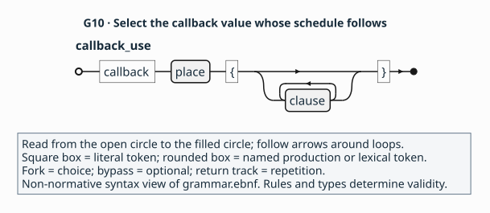

# 4. Callbacks and teardown

> **Purpose:** tutorial — describe when a library may invoke a [callback](../glossary.md#callback) and how a caller ends the subscription.
> **Reader:** language designers new to [API binding](../glossary.md#binding).
> **Before this:** [3. Caller-supplied storage and failure](03-storage.md).
> **Status:** Draft 0.1 is a proposal under review through its specification
> and synthetic examples. Parser, validator and implementation development
> are future work.
> **Rules:** [`C2–C3`](../contracts.md#c2), [`C5–C6`](../contracts.md#c5), [`A2`](../profiles.md#a2) and the synthetic catalogue [`F1`](../profiles.md#f1) are canonical.

## Goal

Add `LabelChanged`, `Watch`, `watch_labels` and `destroy_watch`. A program
supplies a notification function and receives a watch identifying its
subscription. You will describe when the library can call that function,
how it keeps the function available, and when the program knows all callback
use has ended.

Follow the [steps](#steps), compare the [complete checkpoint](#checkpoint-package),
then [check yourself](#check-yourself). The subscription is a separate part
of the synthetic label-card API: notifications carry change numbers, while
the label lifetimes from parts 2–3 still govern label access.

## The domain obligation

The library keeps the stored callback usable for every permitted invocation
and finishes all callback use before returning from watch destruction
([callback schedules and teardown](../explanation/contracts.md#callbacks)).

## Steps

### 1. Describe one notification invocation

Start with the callable type that the program's handler will satisfy.
It is a package-level declaration alongside the resources and functions.

Fragment — shows one callback invocation in `tutorial::callbacks`. The
[complete checkpoint](#checkpoint-package) also supplies availability,
sharing, isolation, representation and the surrounding package declarations.

<!-- ail-example: ../examples/tutorial/reading-fragments.ail region=callback-invocation -->
```ail
callback LabelChanged(change: u64) -> unit {
  execution(sync);
  completions([returned]);
  executor(any);
  concurrency(serial);
  reentrancy(forbidden);
  mutation(none);
  variadic(false);
  outcome handled {
    when(returned, any);
    meaning(success);
  }
}
```

The `callback` keyword introduces a named callable type. Its parameter
`change` has type `u64`, and its `unit` result contains no value. Like a
function, it contains clauses and outcomes describing one invocation
([`L4`](../language.md#l4), [`C3`](../contracts.md#c3)).

Declare `callback LabelChanged(change: u64) -> unit`. The library invokes
this function with a scalar change number. For that invocation, the library
is the [caller](../glossary.md#caller-and-callee) and the program's handler
is the callee. The number identifies a synthetic change notification and
carries no card or label ownership.

Give the callback one successful returned [outcome](../glossary.md#outcome)
and all seven callable effects shown in the checkpoint. `execution(sync)`
means an invocation completes before returning control to its caller.
`mutation(none)` describes its externally visible input state. You will
specify when the library can start these invocations in a later step
([`C3`](../contracts.md#c3), [`C5`](../contracts.md#c5)).

### 2. Describe the state the callback can use

A callback can carry saved program state needed when it runs. Those saved
values are its [captures](../glossary.md#callback-captures). For example,
a handler could read immutable saved state and return. A different handler
could require state usable only on the main thread. The permitted execution
context determines which of these can satisfy the callback type.

Fragment — shows the callback value's sharing rules and its invocation
restrictions in `tutorial::callbacks`. The [complete checkpoint](#checkpoint-package)
also supplies common clauses, the remaining effects, representation,
outcome and package context.

<!-- ail-example: ../examples/tutorial/reading-fragments.ail region=callback-sharing -->
```ail
callback LabelChanged(change: u64) -> unit {
  sharing(shared);
  isolation(none);
  executor(any);
  concurrency(serial);
  reentrancy(forbidden);
}
```

These clauses belong to the declaration of `LabelChanged`. They govern
every value of that callback type, including a handler the program supplies
to more than one registration ([`C2–C3`](../contracts.md#c2)).

For this example, add `sharing(shared)`, `isolation(none)` and
`executor(any)`. [Shared](../glossary.md#shared) allows references to the
callback to cross [executors](../glossary.md#executor), and `executor(any)`
permits invocation on any thread. Its captured state needs to permit those
uses too. The immutable-state handler can satisfy that requirement; the
main-thread-only handler cannot
([`C2–C3`](../contracts.md#c2)).

Set `concurrency(serial)` and `reentrancy(forbidden)`. The
[concurrency](../glossary.md#concurrency) clause requires independent invocations
of the callback value to run one at a time. Nested invocation while an earlier
one is still active is also forbidden; that separate condition is
[re-entrancy](../glossary.md#re-entrancy). The declaration applies even when
the same callback value is registered more than once
([`C3`](../contracts.md#c3), [`C6`](../contracts.md#c6)).

### 3. Select the callback's synthetic representation

The callback declaration also names how its values cross the call boundary.

Fragment — shows callback representation in `tutorial::callbacks`. The
[complete checkpoint](#checkpoint-package) also supplies the two provider
dependencies, common clauses and the callback's invocation contract.

<!-- ail-example: ../examples/tutorial/reading-fragments.ail region=callback-representation -->
```ail
callback LabelChanged(change: u64) -> unit {
  callback_abi(native, "c");
  representation(fixture, "closure");
}
```

`native` and `fixture` refer to package-level `use abi` and `use profile`
aliases, as in [part 1](01-lifetime.md#3-select-the-synthetic-definitions-and-configuration).
The strings select the convention and representation within those definitions
([`A1–A2`](../profiles.md#a1)).

Add `callback_abi(native, "c")` and `representation(fixture, "closure")`.
These select the [calling convention](../glossary.md#calling-convention) and
the way the fixture stores the callback with its captures, its
[representation](../glossary.md#representation).
The synthetic [provider](../glossary.md#provider) defines how to retain and
release that stored value. It has no separately visible context argument
([`A2`](../profiles.md#a2), [`F1`](../profiles.md#f1)).

An ordinary function's [access path](../glossary.md#access-path) names how to
reach its implementation. Here the program supplies the callback value, so
these two declaration clauses instead tell the library how to hold and
invoke it ([`A2`](../profiles.md#a2)).

### 4. Return a watch for the subscription

The watch type and registration function are siblings in the package.
Registration's result makes the program responsible for that watch.

Fragment — shows the watch lifecycle and registration result. The
[complete checkpoint](#checkpoint-package) also supplies the destructor,
handler contracts, common clauses, effects, access and package dependencies.

<!-- ail-example: ../examples/tutorial/reading-fragments.ail region=callback-owner -->
```ail
package tutorial::callbacks version "1" {
  resource Watch {
    lifecycle(unique, @destroy_watch);
    sharing(transferable);
    isolation(none);
    // Common resource clauses omitted.
  }
  fn watch_labels(handler: LabelChanged) -> Watch {
    outcome registered {
      when(returned, any);
      meaning(success);
      state($result, valid);
      give($result, owned);
    }
    // Input, schedule, effects and access omitted.
  }
}
```

`LabelChanged` in the parameter type position refers to the callback
declaration. `$result` inside `registered` selects `watch_labels`'s
returned `Watch` ([`L2`](../language.md#l2), [`C1`](../contracts.md#c1)).

Declare `resource Watch` with `lifecycle(unique, @destroy_watch)`,
`sharing(transferable)`, `isolation(none)` and the common clauses shown in
the checkpoint. Add `watch_labels(handler: LabelChanged) -> Watch` with
one successful returned outcome: a valid result and `give($result, owned)`.
The program receives an [owned](../glossary.md#owned) watch and becomes
responsible for destroying it ([`C2`](../contracts.md#c2), [`C5`](../contracts.md#c5)).

This synthetic registration returns a non-null watch whenever it completes.
That is the API promise being described; the signature provides no failure
result. As with the other operations, its completion contract supplies no
guarantee that the call eventually returns ([`C3`](../contracts.md#c3)).

The registration takes only a handler. Its watch manages this subscription;
it retains no `Card` and extends no borrowed `Label` lifetime. Each invocation
delivers only the `u64` change number.

### 5. Keep the handler for later notifications

Registration describes what happens to the handler input as well as the watch
result. Their lifetime relationship is visible in the retention clause.

Fragment — shows handler retention in `tutorial::callbacks`. The
[complete checkpoint](#checkpoint-package) also supplies the owned result,
schedule, effects, access and surrounding declarations.

<!-- ail-example: ../examples/tutorial/reading-fragments.ail region=callback-retention -->
```ail
fn watch_labels(handler: LabelChanged) -> Watch {
  input($handler, borrow);
  retain($handler, strong(owner($result)));
  valid($handler, call);
}
```

`$handler` selects the callback passed to registration. In the same function,
`$result` selects the watch that registration returns. Read
`strong(owner($result))` as a stored strong reference bounded by that watch's
lifetime ([`C1`](../contracts.md#c1), [`C3`](../contracts.md#c3)).

On `watch_labels`, write `input($handler, borrow)` and
`valid($handler, call)`. The program supplies a callback valid during
registration and keeps its existing ownership. This is a
[borrow](../glossary.md#borrow), describing responsibility rather than
Rust-style static checking ([`C3`](../contracts.md#c3)).

Now write `retain($handler, strong(owner($result)))`. The library acquires
its own reference so it can keep using the handler after registration
returns. Keeping a value for later work is [retention](../glossary.md#retention).
Strong retention creates an independent release obligation, and
`owner($result)` ties that stored reference to the returned watch's lifetime
([`C3`](../contracts.md#c3)).

The fixture provider supplies the retain and release operations for the
callback and its captures. This stored reference is what keeps the handler
available for later notifications ([`C2–C3`](../contracts.md#c2), [`F1`](../profiles.md#f1)).

### 6. Specify when this registration may invoke the handler

The schedule is a block inside the registration function. Its `$handler`
selects that function's input, giving this particular use of the callback
its own invocation rules.

Fragment — shows a callback-use block in `tutorial::callbacks`. The
[complete checkpoint](#checkpoint-package) also supplies retention, the
owned watch result, effects, access and surrounding declarations.

<!-- ail-example: ../examples/tutorial/reading-fragments.ail region=callback-schedule -->
```ail
fn watch_labels(handler: LabelChanged) -> Watch {
  callback $handler {
    timing(after_return);
    count(0, many);
    scope(owner($result));
    executor(any);
    concurrency(serial);
    reentrancy(forbidden);
    quiescence(@destroy_watch);
  }
}
```

Compare `callback LabelChanged(change: u64) -> unit` in step 1 with
`callback $handler` here. The first declares a callable type with its own
signature. The second addresses a value in the enclosing function and
describes when the library may invoke it. `$result` here is still the
registration's watch result ([`C1`](../contracts.md#c1), [`C6`](../contracts.md#c6)).



Trace `callback`, substitute `$handler` for `place`, then follow the braced
clause loop for the seven schedule clauses. **Reading key:** start at the
open circle and follow arrowheads to the filled circle. Square boxes show
literals; rounded boxes name productions. The bypass permits no clauses
syntactically, and the return track permits repetition. The
[`callback_use` production](../grammar.ebnf) gives this shape;
[`C6`](../contracts.md#c6) requires the schedule's actual facts.

[Callback-use diagram source](../figures/g10-callback-use.puml) ·
[Package structure in part 1](01-lifetime.md#2-name-the-package-and-the-api-it-covers)

Inside `watch_labels`, add a `callback $handler` block. Write
`timing(after_return)` so notifications can start only after registration
returns. Compare this with an API that invokes its handler entirely during
registration: that call could finish all callback use before it returns.
This subscription permits later use and therefore needs the watch to bound
it ([`C6`](../contracts.md#c6)).

Write `count(0, many)`. The library is permitted to send zero notifications,
or any number during the registration's scope. `many` supplies an unbounded
maximum. The API author uses it when the API permits an unbounded number
of notifications, based on knowledge of its behaviour
([`C6`](../contracts.md#c6)).

Write `scope(owner($result))` to relate the schedule to the watch. Add
`executor(any)`, `concurrency(serial)` and `reentrancy(forbidden)` to keep
this registration's permitted invocations consistent with the callback
declaration. Finally, write `quiescence(@destroy_watch)` to name the
operation whose return ends all callback use ([`C6`](../contracts.md#c6)).

Registration itself completes synchronously. Its schedule permits later
notifications. Read `execution(sync)` as describing the registration call
and `timing(after_return)` as describing invocation starts relative to that
call ([`C3`](../contracts.md#c3), [`C6`](../contracts.md#c6)).

### 7. End the subscription through its destructor

The schedule names a separate function as the watch's destructor. This is
the function that takes over the program's obligation to finish with a watch.

Fragment — shows watch consumption in `tutorial::callbacks`. The
[complete checkpoint](#checkpoint-package) also supplies the teardown
precondition, effects, access and surrounding declarations.

<!-- ail-example: ../examples/tutorial/reading-fragments.ail region=callback-destroy -->
```ail
fn destroy_watch(subscription: Watch) -> unit {
  input($subscription, consume);
  retain($subscription, none);
  outcome stopped {
    when(returned, any);
    meaning(success);
  }
}
```

`subscription` names this function's input. Its `$subscription` place selects
the watch that was the result of an earlier registration. The link between
the schedule and this function is the declaration reference
`@destroy_watch` ([`L2`](../language.md#l2), [`C6`](../contracts.md#c6)).

Define `destroy_watch(subscription: Watch) -> unit`. Write
`input($subscription, consume)`, `retain($subscription, none)` and one
successful returned outcome. At entry the destructor
[consumes](../glossary.md#consume) the watch: the library takes over the
program's destruction obligation ([`C2–C3`](../contracts.md#c2)).

A notification may still be running when destruction begins. The destructor
finishes all callback use before returning. At its return, no invocation is
running or can begin for that subscription. This is
[quiescence](../glossary.md#quiescence). Responsibility moves at entry;
the caller can rely on quiescence at return ([`C6`](../contracts.md#c6)).

### 8. Require teardown from outside the callback

Teardown's precondition refers back to the handler use in registration.
The two declarations below locate both ends of that reference.

Fragment — shows a reference to another function's parameter in
`tutorial::callbacks`. The [complete checkpoint](#checkpoint-package) also
supplies the callback-use block, input and output contracts, effects, access
and package context.

<!-- ail-example: ../examples/tutorial/reading-fragments.ail region=callback-slot-reference -->
```ail
package tutorial::callbacks version "1" {
  fn watch_labels(handler: LabelChanged) -> Watch {
    // Callback use and remaining contract omitted.
  }
  fn destroy_watch(subscription: Watch) -> unit {
    requires(outside_callback(@watch_labels::handler));
    // Remaining call contract omitted.
  }
}
```

`@watch_labels::handler` identifies the parameter by its function and local
name. Inside `watch_labels`, the place `$handler` addresses that input.
Inside `destroy_watch`, the longer reference is needed to identify the
other function's callback use; that destructor's own input is
`$subscription` ([`L2`](../language.md#l2), [`C3`](../contracts.md#c3)).

In `destroy_watch`, add
`requires(outside_callback(@watch_labels::handler))`. This reference names
the `handler` use in `watch_labels`. It requires the program to start
destruction outside an invocation of that callback use
([`C3`](../contracts.md#c3), [`C6`](../contracts.md#c6)).

To see why, imagine the handler calling `destroy_watch` itself. The
destructor waits for the handler to finish, while the handler waits for
the destructor to return. Starting teardown outside the handler avoids
this self-wait. The fixture defines no alternative protocol for re-entrant
destruction. The precondition complements `reentrancy(forbidden)`; each
states a separate restriction ([`C3`](../contracts.md#c3), [`C6`](../contracts.md#c6)).

The quiescence promise describes what holds when destruction returns.
Whether a handler or destructor eventually finishes remains outside these
contracts ([`C3`](../contracts.md#c3), [`C8`](../contracts.md#c8)).

### 9. Include the subscription in the package

The package's public roots now include the watch, callback type, registration
and destructor. The callback type appears in the same export list as the
other declarations.

Fragment — shows publication in `tutorial::callbacks`. The
[complete checkpoint](#checkpoint-package) also supplies the header,
dependencies, environment and all declarations.

<!-- ail-example: ../examples/tutorial/reading-fragments.ail region=callback-publication -->
```ail
package tutorial::callbacks version "1" {
  surface("Synthetic label-card API release 1: Card lifetime, label lending, refresh, text copying and independent label-change notifications; other operations excluded.");
  exports([@Card, @create_card, @destroy_card, @Label, @destroy_label, @current_label, @refresh_card, @CopyStatus, @copy_text, @Watch, @LabelChanged, @watch_labels, @destroy_watch]);
}
```

Use the checkpoint's package identity, expand `surface` and `exports` with
the four declarations, and keep the earlier declarations. Complete both new
functions with their effects and synthetic symbol paths. The callback uses
the representation clauses from step 3 ([`L3`](../language.md#l3), [`A2`](../profiles.md#a2)).

Use the timeline to distinguish when the library takes responsibility for
the watch from when the program knows all callback use has ended. Read from
top to bottom. During `watch_labels`, the program lends its handler and the
library keeps its own reference for the watch's lifetime. Registration then
returns an owned watch to the program. Notifications may start after that
return.

The dotted arrow shows the library invoking the handler with a change number.
For this call, the library is the caller and the handler is the callee. The
bar shows the handler running. In this sequence the program starts
`destroy_watch` from outside the callback while the handler is still running
on another thread. At destruction entry the library takes responsibility for
the watch; the solid arrow shows that ownership transfer.

The handler finishes during the shown destruction call. When `destroy_watch`
returns, no invocation is running or can start for this subscription. That
is the promised quiescence. The program can rely on it at return, even though
responsibility for the watch moved earlier, at entry.

This is one permitted sequence for the synthetic subscription. The library
may send no notifications, and the contract promises no eventual return.
The watch retains no card, so a program using a borrowed label still obeys
that label's original lifetime and refresh cutoff. Vertical gaps show order
rather than elapsed time; native scheduling is omitted (non-normative;
[`C3`](../contracts.md#c3), [`C5–C6`](../contracts.md#c5)).


[Watch callback diagram source](../figures/tutorial-callbacks.puml) ·
[How tools use the description](../README.md#who-writes-and-uses-an-ail-description)

## Checkpoint package

Compare your work with the complete [subscription file](../examples/tutorial/04-callbacks.ail).
The invented API uses the synthetic fixture [profile](../glossary.md#profile),
catalogue and [digest tokens](../glossary.md#digest-pin) from [`F1`](../profiles.md#f1).
After comparison, continue to [the observations](#expected-observations).

Complete package — admitted by the grammar and complete under draft 0.1,
checked by inspection.

<!-- ail-example: ../examples/tutorial/04-callbacks.ail region=checkpoint -->
```ail
language "0.1";
package tutorial::callbacks version "1" {
  surface("Synthetic label-card API release 1: Card lifetime, label lending, refresh, text copying and independent label-change notifications; other operations excluded.");
  exports([@Card, @create_card, @destroy_card, @Label, @destroy_label, @current_label, @refresh_card, @CopyStatus, @copy_text, @Watch, @LabelChanged, @watch_labels, @destroy_watch]);
  use profile fixture = "example.fixture" version "1" digest "sha256:aaaaaaaaaaaaaaaaaaaaaaaaaaaaaaaaaaaaaaaaaaaaaaaaaaaaaaaaaaaaaaaa";
  use abi native = "example.fixture-abi" version "1" digest "sha256:bbbbbbbbbbbbbbbbbbbbbbbbbbbbbbbbbbbbbbbbbbbbbbbbbbbbbbbbbbbbbbbb";
  environment test {
    target("fixture64");
    platform("fixture", "1");
  }
  resource Card {
    available([test]);
    deprecated(no);
    implements([]);
    lifecycle(unique, @destroy_card);
    sharing(transferable);
    isolation(none);
    doc("Owns its current label; refresh replaces that label.");
  }
  fn create_card() -> nullable<Card> {
    available([test]);
    deprecated(no);
    execution(sync);
    completions([returned]);
    executor(any);
    concurrency(parallel);
    reentrancy(allowed);
    mutation(none);
    variadic(false);
    outcome created {
      when(returned, nonnull($result));
      meaning(success);
      state($result, valid);
      give($result, owned);
    }
    outcome allocation_failed {
      when(returned, null($result));
      meaning(failure);
      state($result, valid);
      give($result, owned);
    }
    access direct in [test] {
      abi(native, "c");
      via(fixture, "symbol", "fixture_create_card");
      mapping(identity);
      compatibility(stable);
    }
  }
  fn destroy_card(card: Card) -> unit {
    available([test]);
    deprecated(no);
    execution(sync);
    completions([returned]);
    executor(any);
    concurrency(serial);
    reentrancy(forbidden);
    mutation(none);
    variadic(false);
    input($card, consume);
    retain($card, none);
    outcome done {
      when(returned, any);
      meaning(success);
    }
    access direct in [test] {
      abi(native, "c");
      via(fixture, "symbol", "fixture_destroy_card");
      mapping(identity);
      compatibility(stable);
    }
  }
  resource Label {
    available([test]);
    deprecated(no);
    implements([]);
    lifecycle(unique, @destroy_label);
    sharing(transferable);
    isolation(none);
    doc("A label of seven nonzero UTF-8 code units; an owned Label is an independent snapshot.");
  }
  fn destroy_label(label: Label) -> unit {
    available([test]);
    deprecated(no);
    execution(sync);
    completions([returned]);
    executor(any);
    concurrency(serial);
    reentrancy(forbidden);
    mutation(none);
    variadic(false);
    input($label, consume);
    retain($label, none);
    outcome done {
      when(returned, any);
      meaning(success);
    }
    access direct in [test] {
      abi(native, "c");
      via(fixture, "symbol", "fixture_destroy_label");
      mapping(identity);
      compatibility(stable);
    }
  }
  fn current_label(card: Card) -> Label {
    available([test]);
    deprecated(no);
    execution(sync);
    completions([returned]);
    executor(any);
    concurrency(serial);
    reentrancy(allowed);
    mutation(none);
    variadic(false);
    input($card, borrow);
    retain($card, none);
    valid($card, call);
    outcome lent {
      when(returned, any);
      meaning(success);
      state($result, valid);
      give($result, borrow(owner($card)));
      invalidated_by($result, [@refresh_card]);
    }
    access direct in [test] {
      abi(native, "c");
      via(fixture, "symbol", "fixture_current_label");
      mapping(identity);
      compatibility(stable);
    }
  }
  fn refresh_card(card: Card) -> unit {
    available([test]);
    deprecated(no);
    execution(sync);
    completions([returned]);
    executor(any);
    concurrency(serial);
    reentrancy(allowed);
    mutation(arguments);
    variadic(false);
    input($card, borrow);
    retain($card, none);
    valid($card, call);
    outcome done {
      when(returned, any);
      meaning(success);
    }
    access direct in [test] {
      abi(native, "c");
      via(fixture, "symbol", "fixture_refresh_card");
      mapping(identity);
      compatibility(stable);
    }
  }
  enum CopyStatus: i32 {
    available([test]);
    deprecated(no);
    values(closed);
    sharing(value);
    isolation(none);
    case copied = 0;
    case unavailable = 1;
  }
  fn copy_text(label: Label, destination: mutptr<u8>) -> CopyStatus {
    available([test]);
    deprecated(no);
    execution(sync);
    completions([returned]);
    executor(any);
    concurrency(serial);
    reentrancy(allowed);
    mutation(arguments);
    variadic(false);
    input($label, borrow);
    retain($label, none);
    valid($label, call);
    input($destination, borrow);
    retain($destination, none);
    valid($destination, call);
    direction($destination, out);
    aliasing($destination, disjoint);
    extent($destination, buffer(7, 8, elements));
    contents($destination, text("utf-8", nul));
    outcome copied {
      when(returned, equal($result, 0));
      meaning(success);
      state($result, valid);
      state($destination[], valid);
    }
    outcome unavailable {
      when(returned, equal($result, 1));
      meaning(failure);
      state($result, valid);
      state($destination[], invalid);
    }
    access direct in [test] {
      abi(native, "c");
      via(fixture, "symbol", "fixture_copy_text");
      mapping(identity);
      compatibility(stable);
    }
  }
  resource Watch {
    available([test]);
    deprecated(no);
    implements([]);
    lifecycle(unique, @destroy_watch);
    sharing(transferable);
    isolation(none);
  }
  callback LabelChanged(change: u64) -> unit {
    available([test]);
    deprecated(no);
    sharing(shared);
    isolation(none);
    execution(sync);
    completions([returned]);
    executor(any);
    concurrency(serial);
    reentrancy(forbidden);
    mutation(none);
    variadic(false);
    callback_abi(native, "c");
    representation(fixture, "closure");
    outcome handled {
      when(returned, any);
      meaning(success);
    }
  }
  fn watch_labels(handler: LabelChanged) -> Watch {
    available([test]);
    deprecated(no);
    execution(sync);
    completions([returned]);
    executor(any);
    concurrency(serial);
    reentrancy(forbidden);
    mutation(none);
    variadic(false);
    input($handler, borrow);
    retain($handler, strong(owner($result)));
    valid($handler, call);
    callback $handler {
      timing(after_return);
      count(0, many);
      scope(owner($result));
      executor(any);
      concurrency(serial);
      reentrancy(forbidden);
      quiescence(@destroy_watch);
    }
    outcome registered {
      when(returned, any);
      meaning(success);
      state($result, valid);
      give($result, owned);
    }
    access direct in [test] {
      abi(native, "c");
      via(fixture, "symbol", "fixture_watch_labels");
      mapping(identity);
      compatibility(stable);
    }
  }
  fn destroy_watch(subscription: Watch) -> unit {
    available([test]);
    deprecated(no);
    execution(sync);
    completions([returned]);
    executor(any);
    concurrency(serial);
    reentrancy(forbidden);
    mutation(none);
    variadic(false);
    input($subscription, consume);
    retain($subscription, none);
    requires(outside_callback(@watch_labels::handler));
    outcome stopped {
      when(returned, any);
      meaning(success);
      doc("No callback is running or can start after this completion.");
    }
    access direct in [test] {
      abi(native, "c");
      via(fixture, "symbol", "fixture_destroy_watch");
      mapping(identity);
      compatibility(stable);
    }
  }
}
```

## Expected observations

Use these non-normative summaries to check your reading of
[`C2–C3`](../contracts.md#c2) and [`C5–C6`](../contracts.md#c5):

- `LabelChanged` describes one invocation receiving a scalar number.
  `callback $handler` describes when this registration can make such
  invocations.
- `watch_labels` completes before returning control. Notifications may
  start afterwards, as permitted by `timing(after_return)`.
- The library retains its own handler reference for the watch's
  [region](../glossary.md#region). The input borrow leaves the program's
  existing ownership in place.
- `destroy_watch` takes the watch at entry and establishes quiescence at
  return. A running invocation can finish during teardown.
- If the same handler is registered twice, its callback declaration still
  requires serial invocation across those registrations.
- A notification supplies a number. Using a label still requires satisfying
  `current_label`'s owner lifetime and refresh cutoff.

## Check yourself

1. What is the earliest point at which a `LabelChanged` invocation may start?
2. If no notification arrives before destruction, is the count contract broken?
3. Can a notification handler destroy its watch because invocations are serial?

### Answers

1. After `watch_labels` returns, as stated by `timing(after_return)`
   ([`C6`](../contracts.md#c6)).
2. Zero invocations satisfy `count(0, many)`. Counts cover the registration's
   whole scope, conditional on that scope eventually ending
   ([`C6`](../contracts.md#c6)).
3. Teardown requires `outside_callback`, so the handler cannot make that
   call from its own invocation. Serial scheduling controls overlap; it
   does not satisfy the separate teardown precondition
   ([`C3`](../contracts.md#c3), [`C6`](../contracts.md#c6)).

## Invalid variant

In `watch_labels`, replace the callback-use block's `quiescence` clause with
this clause and keep its owner scope unchanged.

Invalid — rejected under [`C6`](../contracts.md#c6).

<!-- ail-fragment -->
```ail
quiescence(return);
```

Quiescence at registration return belongs to a call-scoped schedule, where
all invocations finish within the call. This schedule instead stores the
handler for the watch's lifetime and permits later starts. It needs
quiescence at that unique owner's destructor.

Return: [Describing a small API](README.md).
Next: [5. Reaching the code, and changing the contract](05-access-and-change.md).
