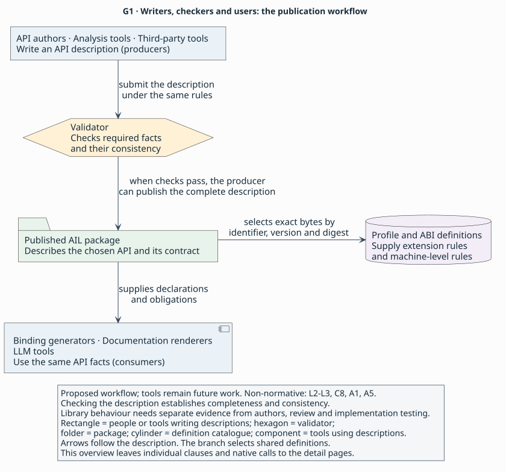

# Describing a small API

> **Purpose:** tutorial — describe a synthetic API in complete AIL checkpoints, then change its contract.
> **Reader:** language designers new to [API binding](../glossary.md#binding) who can read C signatures.
> **Before this:** [Using an API across languages](../explanation/unsaid.md); the [contract explanation](../explanation/contracts.md) is available for deeper questions.
> **Status:** draft 0.1, a proposal under review; no parser, validator or implementation exists.
> **Rules:** [language and publication](../language.md#l1), [contracts](../contracts.md#c1), [access paths](../profiles.md#a2) and the [synthetic fixture catalogue](../profiles.md#f1) are canonical.

The context map places your work on the producer side: you will describe a
package that pins catalogue definitions and supplies the same contract to its
consumers. Publication validation checks completeness and consistency, not
whether a binary honours the assertions. These are proposed roles, not running
tools ([`L2–L3`](../language.md#l2), [`C8`](../contracts.md#c8),
[`A1`](../profiles.md#a1), [`A5`](../profiles.md#a5)). The map omits individual
clauses; the parts below zoom into them.

[Context map source](../figures/g1-context.puml)

## What you will describe

Describe a small label-card API. A card owns a current label. You can [borrow](../glossary.md#borrow)
that label, replace it by refreshing the card, or copy its text into your own
storage. Comparing a live card with an [invalidated](../glossary.md#invalidation)
label shows why a [handle](../glossary.md#handle)'s type alone cannot tell a
[caller](../glossary.md#caller-and-callee) whether using it is safe.

The example is synthetic. Its names, seven-code-unit labels and possible copy
failure are chosen for this exercise. The synthetic fixture [profile](../glossary.md#profile), catalogue
and [digest tokens](../glossary.md#digest-pin) come from [`F1`](../profiles.md#f1); they do not identify
a real library, host [ABI](../glossary.md#abi) or operating-system API.

Use this table to connect each operation or value to the obligation its
declaration will describe:

| Operation or value | Contract you will describe |
|---|---|
| `Card` | A unique resource owning its current label. Sole ownership can move between [executors](../glossary.md#executor); callers do not use the card concurrently. |
| `create_card` | Return an [owned](../glossary.md#owned) card, or null on allocation failure. |
| `destroy_card` | [Consume](../glossary.md#consume) an owned card and end the validity of its dependent label borrows. |
| `Label` | An [opaque resource](../glossary.md#opaque-resource) representing seven nonzero UTF-8 code units. A separately owned label is an independent snapshot. |
| `current_label` | Lend the card's current label without transferring ownership. |
| `refresh_card` | Replace the card's label; old label borrows become invalid at entry, even while the card remains alive. |
| `destroy_label` | Consume an owned label. Borrowing a label never grants permission to call this destructor. |
| `copy_text` | Borrow a valid label and write seven UTF-8 code units plus a final zero into disjoint caller storage. Return the `CopyStatus` case `copied` (`0`) or `unavailable` (`1`); failure leaves no readable output. |
| `LabelChanged` | Receive a scalar change number in one synchronous [callback](../glossary.md#callback) invocation. |
| `watch_labels` | [Retain](../glossary.md#retention) a callback for zero or more notifications after registration returns; return an owned `Watch`. |
| `Watch` and `destroy_watch` | A separate unique subscription owner; destruction consumes it and returns only when no callback is running or can start. |

For a concrete label, imagine `READY!!`: seven one-byte code units followed
by the zero terminator when copied. The length is measured in code units,
not in user-perceived characters. A refresh may choose another seven-code-unit
label. The exact spelling is not part of the contract.

The callback exercise adds a label-change notification subscription,
with a callback and a separate unique `Watch` owner whose destruction waits
for [quiescence](../glossary.md#quiescence). The subscription does not retain a `Card` or extend a borrowed `Label`'s
lifetime. The ownership exercise changes `current_label` to return
an independent owned `Label` snapshot. Its caller then uses `destroy_label`
to discharge the new obligation.

These are the example's API choices. AIL provides the notation for stating them;
another API could return binary bytes, use a different length or retain its
inputs. [Design choices](../explanation/choices.md) separates AIL's choices
from the domain obligations.

## The five parts

Each checkpoint is a complete [package](../glossary.md#package) for a narrower
declared subset of synthetic release 1. The package identities differ so you
can read each file independently. Parts 2–4 add operations and types; they do not supply missing [clauses](../glossary.md#clause)
in earlier declarations ([`L2–L3`](../language.md#l2)). Part 5 first assembles that release, then
publishes an explicitly different owned-snapshot variant for the change exercise.

Use this map to choose a concept and open the complete package that teaches it.

| Part | New concept | Checkpoint |
|---|---|---|
| [1. A package and one resource](01-lifetime.md) | Publication, ownership and nullable creation | [Card lifetime package](../examples/tutorial/01-lifetime.ail) |
| [2. Lending access](02-lending.md) | Owner-dependent borrows and earlier invalidation | [Label lending package](../examples/tutorial/02-lending.ail) |
| [3. Caller-supplied storage and failure](03-storage.md) | Text extent, writable output and a closed status domain | [Text copying package](../examples/tutorial/03-storage.ail) |
| [4. Callbacks and teardown](04-callbacks.md) | Invocation schedule, owner scope and quiescent destruction | [Subscription package](../examples/tutorial/04-callbacks.ail) |
| [5. Reaching the code, and changing the contract](05-access-and-change.md) | Access paths and the borrowed-to-owned change | [Finished package](../examples/tutorial/05-finished.ail) and [owned variant](../examples/tutorial/05-owned.ail) |

Every function already has an [access path](../glossary.md#access-path) in
part 1. For now, follow the existing synthetic symbol-path form;
[part 5](05-access-and-change.md) explains its four clauses. Omitting those paths would make even the first
checkpoint incomplete ([`A2`](../profiles.md#a2)).

## How to check your work

Read a checkpoint as a document. Follow each reference, then compare the
clauses with the expected observations. Before reading
the answers, answer the check questions. Each part ends with an invalid variant that changes
one fact; identify the cited rule's reason for rejecting that change.

The complete-package labels record inspection against the grammar and rules.
The examples remain synthetic, and no parser or semantic validator has run.
A clause can be internally consistent yet false about an implementation
([`C8`](../contracts.md#c8)); this exercise establishes no runtime behaviour.

The full repeated clauses stay visible so you can judge the authoring burden.
Use the explanations and the canonical rules for deeper lookup rather than
inferring defaults from familiar language syntax.

Return: [API Interface Language](../README.md).
Next: [1. A package and one resource](01-lifetime.md).
